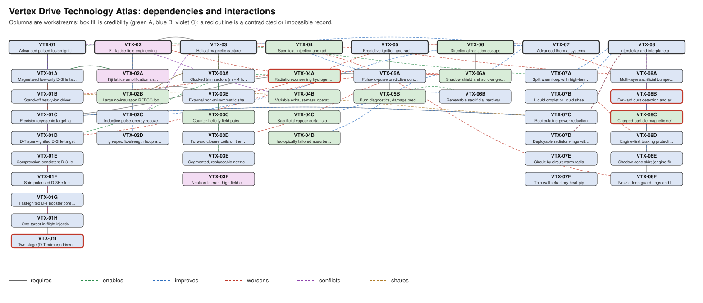

# Vertex Drive Technology Atlas

_Generated by `atlas.py render` from `registry/*.toml`; do not edit by hand. Research records, not canon: nothing here changes the
canonical Fiji Drive, the production model or the Drive workbooks._

Classifications are independent. **Credibility** (Atlas level, not PMDS material level): A established, B plausible future,
C fictional breakthrough. **Verdict**: the brief's five outcome classes. **Research status** and **canon status** are tracked
separately; only the owner moves a record past NON_CANON.

## Index

| ID | Name | Cred. | Verdict | Research | Canon | Geometry | Priority |
|---|---|---|---|---|---|---|---|
| VTX-01 | Advanced pulsed fusion ignition | B | Plausible future engineering | UNDER_INVESTIGATION | NON_CANON | Engineering-supported | 4.00 |
| VTX-01A | Magnetised fuel-only D-3He target | B | Plausible future engineering | PROPOSED | NON_CANON | Conceptual illustration | 3.45 |
| VTX-01B | Stand-off heavy-ion driver | B | Plausible future engineering | UNDER_INVESTIGATION | NON_CANON | Parametric placeholder | 3.64 |
| VTX-01C | Precision cryogenic target factory and injection | B | Plausible future engineering | PROPOSED | NON_CANON | Parametric placeholder | 4.00 |
| VTX-01D | D-T spark-ignited D-3He target | B | Plausible future engineering | PROPOSED | NON_CANON | No geometry | 3.09 |
| VTX-01E | Compression-consistent D-3He target (lower density, larger pulse) | B | Plausible future engineering | PROPOSED | NON_CANON | No geometry | 3.82 |
| VTX-01F | Spin-polarised D-3He fuel | B | Plausible future engineering | PROPOSED | NON_CANON | No geometry | 2.27 |
| VTX-01G | Fast-ignited D-T booster core in D-3He fuel | B | Plausible future engineering | PROPOSED | NON_CANON | Parametric placeholder | 3.36 |
| VTX-01H | One-target-in-flight injection (fast cryogenic target launcher) | B | Plausible future engineering | PROPOSED | NON_CANON | Parametric placeholder | 4.18 |
| VTX-01I | Two-stage (D-T primary driven) D-3He target | B | Possible but not practical | CONTRADICTED | NON_CANON | No geometry | 1.27 |
| VTX-02 | Fiji lattice field engineering | C | Dependent on a defined fictional breakthrough | UNDER_INVESTIGATION | NON_CANON | Engineering-supported | 3.27 |
| VTX-02A | Fiji lattice amplification and stabilisation (capability card) | C | Dependent on a defined fictional breakthrough | SUPPORTED | APPROVED | Parametric placeholder | 2.55 |
| VTX-02B | Large no-insulation REBCO loops with distributed quench protection | A | Plausible future engineering | PROPOSED | NON_CANON | Parametric placeholder | 3.09 |
| VTX-02C | Inductive pulse-energy recovery | B | Plausible future engineering | PROPOSED | NON_CANON | Parametric placeholder | 3.27 |
| VTX-02D | High-specific-strength hoop and truss structure | B | Plausible future engineering | PROPOSED | NON_CANON | Parametric placeholder | 3.18 |
| VTX-03 | Helical magnetic capture | B | Unresolved | UNDER_INVESTIGATION | NON_CANON | Conceptual illustration | 4.09 |
| VTX-03A | Clocked trim sectors (m = 4 helical harmonic) | B | Unresolved | UNDER_INVESTIGATION | NON_CANON | Parametric placeholder | 3.55 |
| VTX-03B | External non-axisymmetric shaping coils | B | Unresolved | PROPOSED | NON_CANON | Conceptual illustration | 2.82 |
| VTX-03C | Counter-helicity field pairs (zero net angular momentum) | A | Plausible future engineering | SUPPORTED | NON_CANON | Conceptual illustration | 2.82 |
| VTX-03D | Forward closure coils on the X-ray stand-off sphere | B | Unresolved | UNDER_INVESTIGATION | NON_CANON | Parametric placeholder | 4.45 |
| VTX-03E | Segmented, replaceable nozzle-loop sectors | B | Unresolved | PROPOSED | NON_CANON | Parametric placeholder | 3.55 |
| VTX-03F | Neutron-tolerant high-field conductor (proposed Level C need) | C | Dependent on a defined fictional breakthrough | PROPOSED | NON_CANON | No geometry | 1.82 |
| VTX-04 | Sacrificial injection and radiation conversion | A | Possible but not practical | UNDER_INVESTIGATION | NON_CANON | Conceptual illustration | 3.18 |
| VTX-04A | Radiation-converting hydrogen or LiH tamper | A | Possible but not practical | CONTRADICTED | NON_CANON | No geometry | 2.82 |
| VTX-04B | Variable exhaust-mass operating mode (hydrogen low gear) | A | Plausible future engineering | UNDER_INVESTIGATION | NON_CANON | Engineering-supported | 2.82 |
| VTX-04C | Sacrificial vapour curtains on strike surfaces | A | Plausible future engineering | PROPOSED | NON_CANON | Conceptual illustration | 2.55 |
| VTX-04D | Isotopically tailored absorbers in the shield | A | Plausible future engineering | PROPOSED | NON_CANON | Parametric placeholder | 2.55 |
| VTX-05 | Predictive ignition and radiation management | B | Plausible future engineering | UNDER_INVESTIGATION | NON_CANON | Parametric placeholder | 3.64 |
| VTX-05A | Pulse-to-pulse predictive control on the target and driver side | B | Plausible future engineering | PROPOSED | NON_CANON | Parametric placeholder | 3.18 |
| VTX-05B | Burn diagnostics, damage prediction and safe stop | A | Plausible future engineering | PROPOSED | NON_CANON | Parametric placeholder | 3.18 |
| VTX-06 | Directional radiation escape | A | Plausible future engineering | SUPPORTED | NON_CANON | Engineering-supported | 3.45 |
| VTX-06A | Shadow shield and solid-angle minimisation | A | Plausible future engineering | SUPPORTED | NON_CANON | Engineering-supported | 3.55 |
| VTX-06B | Renewable sacrificial hardware faces | B | Plausible future engineering | PROPOSED | NON_CANON | Parametric placeholder | 3.18 |
| VTX-07 | Advanced thermal systems | B | Plausible future engineering | UNDER_INVESTIGATION | NON_CANON | Parametric placeholder | 4.73 |
| VTX-07A | Split warm loop with high-temperature power electronics | B | Plausible future engineering | UNDER_INVESTIGATION | NON_CANON | Parametric placeholder | 4.45 |
| VTX-07B | Liquid droplet or liquid sheet radiator | B | Plausible future engineering | PROPOSED | NON_CANON | Conceptual illustration | 4.09 |
| VTX-07C | Recirculating power reduction | B | Plausible future engineering | UNDER_INVESTIGATION | NON_CANON | No geometry | 3.82 |
| VTX-07D | Deployable radiator wings with edge bumpers | B | Plausible future engineering | PROPOSED | NON_CANON | Parametric placeholder | 3.82 |
| VTX-07E | Circuit-by-circuit warm radiator (split warm loop as booked) | B | Plausible future engineering | SUPPORTED | NON_CANON | Parametric placeholder | 4.45 |
| VTX-07F | Thin-wall refractory heat-pipe radiators for the 1,800 K band | B | Plausible future engineering | PROPOSED | NON_CANON | Parametric placeholder | 2.64 |
| VTX-08 | Interstellar and interplanetary particle protection | B | Unresolved | UNDER_INVESTIGATION | NON_CANON | Conceptual illustration | 3.91 |
| VTX-08A | Multi-layer sacrificial bumpers for the vaporisation regime | B | Unresolved | PROPOSED | NON_CANON | Parametric placeholder | 3.82 |
| VTX-08B | Forward dust detection and active clearing | B | Physically impossible | PROPOSED | NON_CANON | Conceptual illustration | 2.82 |
| VTX-08C | Charged-particle magnetic deflection (limited) | A | Physically impossible | CONTRADICTED | NON_CANON | No geometry | 2.09 |
| VTX-08D | Engine-first braking protection | B | Plausible future engineering | UNDER_INVESTIGATION | NON_CANON | Conceptual illustration | 3.64 |
| VTX-08E | Shadow-cone skirt (engine-first braking screen) | B | Plausible future engineering | PROPOSED | NON_CANON | Conceptual illustration | 4.36 |
| VTX-08F | Nozzle-loop guard rings and local bumpers | B | Possible but not practical | PROPOSED | NON_CANON | Parametric placeholder | 3.36 |

## Priority ranking

Weighted score (weights: mission feasibility 3, credibility 2, independence from unmet prerequisites 1, mass/thermal 2,
unlocking 2, 3D value 1; scores 1-5 in each record). The ranking orders research effort, not adoption.

| Rank | ID | Name | Score | Feasibility | Credibility | Independence | Mass/thermal | Unlock | 3D |
|---|---|---|---|---|---|---|---|---|---|
| 1 | VTX-07 | Advanced thermal systems | 4.73 | 5 | 4 | 4 | 5 | 5 | 5 |
| 2 | VTX-03D | Forward closure coils on the X-ray stand-off sphere | 4.45 | 5 | 3 | 3 | 5 | 5 | 5 |
| 3 | VTX-07A | Split warm loop with high-temperature power electronics | 4.45 | 5 | 4 | 5 | 5 | 4 | 3 |
| 4 | VTX-07E | Circuit-by-circuit warm radiator (split warm loop as booked) | 4.45 | 5 | 4 | 4 | 5 | 4 | 4 |
| 5 | VTX-08E | Shadow-cone skirt (engine-first braking screen) | 4.36 | 5 | 3 | 4 | 4 | 5 | 5 |
| 6 | VTX-01H | One-target-in-flight injection (fast cryogenic target launcher) | 4.18 | 5 | 3 | 3 | 4 | 5 | 4 |
| 7 | VTX-03 | Helical magnetic capture | 4.09 | 5 | 3 | 3 | 4 | 4 | 5 |
| 8 | VTX-07B | Liquid droplet or liquid sheet radiator | 4.09 | 4 | 4 | 5 | 4 | 4 | 4 |
| 9 | VTX-01 | Advanced pulsed fusion ignition | 4.00 | 5 | 2 | 2 | 5 | 5 | 3 |
| 10 | VTX-01C | Precision cryogenic target factory and injection | 4.00 | 5 | 3 | 4 | 5 | 3 | 3 |
| 11 | VTX-08 | Interstellar and interplanetary particle protection | 3.91 | 5 | 3 | 3 | 3 | 4 | 5 |
| 12 | VTX-01E | Compression-consistent D-3He target (lower density, larger pulse) | 3.82 | 4 | 3 | 3 | 5 | 5 | 1 |
| 13 | VTX-07C | Recirculating power reduction | 3.82 | 5 | 3 | 4 | 5 | 3 | 1 |
| 14 | VTX-07D | Deployable radiator wings with edge bumpers | 3.82 | 4 | 4 | 5 | 3 | 3 | 5 |
| 15 | VTX-08A | Multi-layer sacrificial bumpers for the vaporisation regime | 3.82 | 5 | 3 | 4 | 3 | 3 | 5 |
| 16 | VTX-01B | Stand-off heavy-ion driver | 3.64 | 4 | 3 | 4 | 4 | 3 | 4 |
| 17 | VTX-05 | Predictive ignition and radiation management | 3.64 | 4 | 4 | 3 | 3 | 4 | 3 |
| 18 | VTX-08D | Engine-first braking protection | 3.64 | 5 | 3 | 3 | 3 | 3 | 4 |
| 19 | VTX-03A | Clocked trim sectors (m = 4 helical harmonic) | 3.55 | 4 | 3 | 4 | 3 | 3 | 5 |
| 20 | VTX-03E | Segmented, replaceable nozzle-loop sectors | 3.55 | 4 | 3 | 3 | 3 | 4 | 4 |
| 21 | VTX-06A | Shadow shield and solid-angle minimisation | 3.55 | 3 | 5 | 5 | 3 | 2 | 5 |
| 22 | VTX-01A | Magnetised fuel-only D-3He target | 3.45 | 5 | 2 | 2 | 4 | 4 | 1 |
| 23 | VTX-06 | Directional radiation escape | 3.45 | 3 | 5 | 4 | 3 | 2 | 5 |
| 24 | VTX-01G | Fast-ignited D-T booster core in D-3He fuel | 3.36 | 4 | 3 | 3 | 3 | 4 | 2 |
| 25 | VTX-08F | Nozzle-loop guard rings and local bumpers | 3.36 | 4 | 3 | 3 | 3 | 3 | 4 |
| 26 | VTX-02 | Fiji lattice field engineering | 3.27 | 4 | 2 | 3 | 3 | 3 | 5 |
| 27 | VTX-02C | Inductive pulse-energy recovery | 3.27 | 4 | 3 | 4 | 3 | 3 | 2 |
| 28 | VTX-02D | High-specific-strength hoop and truss structure | 3.18 | 4 | 3 | 4 | 3 | 2 | 3 |
| 29 | VTX-04 | Sacrificial injection and radiation conversion | 3.18 | 3 | 5 | 4 | 2 | 3 | 2 |
| 30 | VTX-05A | Pulse-to-pulse predictive control on the target and driver side | 3.18 | 4 | 4 | 3 | 2 | 3 | 2 |
| 31 | VTX-05B | Burn diagnostics, damage prediction and safe stop | 3.18 | 3 | 5 | 5 | 1 | 3 | 3 |
| 32 | VTX-06B | Renewable sacrificial hardware faces | 3.18 | 3 | 4 | 4 | 2 | 3 | 4 |
| 33 | VTX-01D | D-T spark-ignited D-3He target | 3.09 | 4 | 3 | 3 | 2 | 4 | 1 |
| 34 | VTX-02B | Large no-insulation REBCO loops with distributed quench protection | 3.09 | 3 | 4 | 5 | 2 | 2 | 4 |
| 35 | VTX-03B | External non-axisymmetric shaping coils | 2.82 | 3 | 3 | 3 | 2 | 3 | 3 |
| 36 | VTX-03C | Counter-helicity field pairs (zero net angular momentum) | 2.82 | 3 | 5 | 4 | 1 | 2 | 2 |
| 37 | VTX-04A | Radiation-converting hydrogen or LiH tamper | 2.82 | 2 | 5 | 4 | 2 | 3 | 1 |
| 38 | VTX-04B | Variable exhaust-mass operating mode (hydrogen low gear) | 2.82 | 2 | 5 | 5 | 2 | 2 | 2 |
| 39 | VTX-08B | Forward dust detection and active clearing | 2.82 | 3 | 4 | 5 | 1 | 2 | 3 |
| 40 | VTX-07F | Thin-wall refractory heat-pipe radiators for the 1,800 K band | 2.64 | 3 | 3 | 4 | 2 | 2 | 2 |
| 41 | VTX-02A | Fiji lattice amplification and stabilisation (capability card) | 2.55 | 3 | 1 | 5 | 1 | 3 | 4 |
| 42 | VTX-04C | Sacrificial vapour curtains on strike surfaces | 2.55 | 2 | 4 | 4 | 2 | 2 | 2 |
| 43 | VTX-04D | Isotopically tailored absorbers in the shield | 2.55 | 2 | 5 | 5 | 2 | 1 | 1 |
| 44 | VTX-01F | Spin-polarised D-3He fuel | 2.27 | 3 | 2 | 3 | 2 | 2 | 1 |
| 45 | VTX-08C | Charged-particle magnetic deflection (limited) | 2.09 | 1 | 5 | 5 | 1 | 1 | 1 |
| 46 | VTX-03F | Neutron-tolerant high-field conductor (proposed Level C need) | 1.82 | 1 | 1 | 2 | 3 | 3 | 1 |
| 47 | VTX-01I | Two-stage (D-T primary driven) D-3He target | 1.27 | 1 | 2 | 2 | 1 | 1 | 1 |

## Dependency and synergy map

Hard prerequisites (`depends_on`, acyclic):

- VTX-01 requires VTX-01A, VTX-01B, VTX-01C
- VTX-01A requires VTX-02A
- VTX-01E requires VTX-01
- VTX-01F requires VTX-01
- VTX-01G requires VTX-01D
- VTX-01H requires VTX-01C
- VTX-01I requires VTX-01
- VTX-02 requires VTX-02A, VTX-02B
- VTX-02C requires VTX-02B
- VTX-03 requires VTX-02
- VTX-03A requires VTX-02B
- VTX-03B requires VTX-02B
- VTX-03C requires VTX-03A
- VTX-03D requires VTX-03
- VTX-03E requires VTX-03
- VTX-05 requires VTX-05A, VTX-05B
- VTX-05A requires VTX-01C
- VTX-06 requires VTX-06A
- VTX-07 requires VTX-07A, VTX-07C
- VTX-07C requires VTX-01C
- VTX-07E requires VTX-07A
- VTX-08 requires VTX-08A
- VTX-08D requires VTX-08A
- VTX-08E requires VTX-08A
- VTX-08F requires VTX-08A

Interactions (`registry/links.toml`); a quantified case is in `results/convergence.json`:

| From | To | Kind | Effect | Quantified |
|---|---|---|---|---|
| VTX-02A | VTX-01A | enables | The lattice provides the target seed field that magnetised targets need. | UNKNOWN |
| VTX-01A | VTX-01 | improves | Magnetisation is the most direct route to the gain the drive needs; the gain cliff per generation is measured. | gain_threshold |
| VTX-01C | VTX-07C | improves | The target factory is the bulk of the house load; its energy per pellet sets the warm loop. | house_sweep |
| VTX-07C | VTX-07 | improves | Every watt of house load is a watt of warm-loop heat and radiator area. | house_sweep |
| VTX-07A | VTX-07D | improves | A hotter machinery loop shrinks the wings (tip radius falls from km to hundreds of metres), which makes deployment and dust protection credible. | warm_sweep |
| VTX-07A | VTX-08 | improves | Smaller wings expose less edge to the dust stream. | warm_sweep |
| VTX-07B | VTX-08 | improves | A droplet sheet that exists only during burns has no cruise dust exposure; but during braking burns it flies into the stream. | UNKNOWN |
| VTX-07B | VTX-08D | worsens | During engine-first braking the sheet is in the stream and droplets are lost to impacts. | UNKNOWN |
| VTX-01B | VTX-06A | worsens | Driver galleries outside the hull set the 9.6 deg hardware cone; inside the hull they allow 7.9 deg and a lighter shield. | galleries_r4p5 |
| VTX-06A | VTX-07 | improves | Less solid angle means less radiation on hardware and a smaller hot loop (small effect: radiation is about 5 % of the hot load). | galleries_r4p5 |
| VTX-03 | VTX-07 | improves | If shaping halves the plume-strike share, the hot loop and shield shrink; the benefit is not demonstrated and is carried as a band. | plume_strike_sweep |
| VTX-03A | VTX-03 | worsens | Clocked sectors add m = 4 ripple; if ripple lowers nozzle efficiency, the ship grows steeply (0.79 -> 0.72 is +61 %). | nozzle_efficiency_sweep |
| VTX-03C | VTX-03A | enables | Balanced helicity keeps the roll torque inside RCS and CMG authority, so a helical field is usable at all. | UNKNOWN |
| VTX-03B | VTX-06 | worsens | Shaping coils add hardware in the burn's sky: more solid angle, armour and hot-loop heat. | UNKNOWN |
| VTX-08A | VTX-06 | worsens | Bumpers on the burn-facing side of loops add solid angle and heat; on the outward side they do not. | UNKNOWN |
| VTX-08A | VTX-02 | worsens | Bumper mass on loops adds structure mass in the nozzle. | UNKNOWN |
| VTX-01D | VTX-04A | enables | A D-T spark produces 14.1 MeV neutrons that a hydrogen tamper could turn into reaction-mass energy: the only regime where the tamper may pay. | UNKNOWN |
| VTX-01D | VTX-06A | worsens | D-T neutrons raise the shield mass and the conductor dose. | UNKNOWN |
| VTX-04A | VTX-01 | worsens | At the mission ve the tamper lowers exhaust velocity more than the radiation it recovers adds (liner study). | liner_study |
| VTX-04B | VTX-01 | conflicts | The hydrogen low gear lowers ve below what the four 0.016 c burns need; it is usable only outside the mission burns. | ve_sweep |
| VTX-04C | VTX-06B | improves | Vapour curtains spread the heat on armour, extending panel life; total hot load is unchanged. | UNKNOWN |
| VTX-04D | VTX-06A | improves | Li-6 and B-10 capture lowers the secondary gamma dose per tonne of shield. | UNKNOWN |
| VTX-05A | VTX-03 | improves | Symmetric, well-placed burns keep the nozzle at its design efficiency and plume-strike share. | UNKNOWN |
| VTX-05B | VTX-06B | enables | A measured fluence ledger per panel lets armour be replaced by condition instead of by margin. | UNKNOWN |
| VTX-02C | VTX-03 | conflicts | Recovered energy is taken from the jet; strong recovery may lower nozzle efficiency. The calculator treats them as independent. | UNKNOWN |
| VTX-02B | VTX-03A | shares | Sector joints are the same hardware that the clocked helical harmonic uses. | UNKNOWN |
| VTX-08C | VTX-08 | conflicts | Magnetic deflection cannot protect against neutral or weakly charged grains; relying on it would leave the dust problem open. | UNKNOWN |
| VTX-08B | VTX-08D | improves | Engine-side detection of large grains reduces the braking-burn risk; it does nothing for the sub-micron flux. | UNKNOWN |
| VTX-07D | VTX-08 | improves | Retracted wings sit in the shield shadow during coast. | UNKNOWN |
| VTX-01H | VTX-01C | conflicts | FDP-1's 400 m/s gas-gun injection with 12.5 targets in flight cannot coexist with 81 GJ pulses; a 400 m/s launcher allows about 1 Hz. | study:thermal:S1_advanced_eta0.30_vinj400 |
| VTX-07C | VTX-01B | shares | Once the house load is booked bottom-up (0.003-0.014 %), driver-proportional loss is 75-95 % of the warm load: driver efficiency, not the house, sets the wings. | study:thermal:S1_advanced_eta0.30 |
| VTX-07B | VTX-07A | enables | Only a droplet sheet reaches about 1 kg/m2 above 520 K; on halide or alkali heat-pipe panels (5-6 kg/m2) V1 grows to 50.6 kt at 700 K. | study:thermal:V1_areal_by_band_700K |
| VTX-07D | VTX-08 | worsens | Wing tip radius per case (T02 exposure): 460 m (advanced, eta 0.45) to 1,688 m (advanced, eta 0.25); 1.7-2.3 km if near-term components are flown at 0.5-1.0 kg/m2. | study:thermal:S1_advanced_eta0.45 |
| VTX-08E | VTX-08D | improves | The skirt is the quantified form of the engine-side shield inside the hardware cone. | UNKNOWN |
| VTX-03E | VTX-03 | enables | Loop sectors must be separable and the nozzle must tolerate a lost sector. | UNKNOWN |
| VTX-08F | VTX-03 | worsens | Burn-facing bumpers and LiH shoes add burn solid angle (shoes +0.0127 share vs the V1 ship's 0.0168). | UNKNOWN |
| VTX-01A | VTX-01 | conflicts | Compression and gain are one lever (T04 EARLY bound G <= 1,787 x eta_c/alpha x (rho/3,000)^(-2/3)): denser fuel lowers the gain a driver can reach. The Atlas pair (3,000 g/cm3, gain 3,000) needs eta_c/alpha 1.68 and is not energy-consistent; 6,000 g/cm3 at gain 3,000 needs 2.66. | study:futures:consistency |
| VTX-07A | VTX-01 | enables | Under the gain-compression bound the engineering package decides whether a ship exists: at eta_c/alpha 0.3, V1c (Atlas engineering) closes only at 161 kt, the full T06 package at 10.3 kt; at 0.2 V1c does not close and the package closes at 13.3 kt. Shared with VTX-01B, VTX-07B, VTX-07C, T06-NEW-1, T06-NEW-2. | study:futures:consistency.frontier |
| VTX-01A | VTX-01C | worsens | Where density is raised at fixed gain the pulse rate rises (133 to 449 Hz in K4); under the bound the consistent optimum is the opposite, lower density and larger, slower pulses (44 t TNT at 57-94 Hz in V3), which loosens the factory and the launcher but enlarges the nozzle (outer loop r 169 m). | study:futures:proposals.V3 |
| VTX-02D | VTX-02 | improves | Doubling specific strength halves the virial nozzle structure; small for the whole ship (K5 -9 %). | study:futures:chains.K5 |
| VTX-07F | VTX-07 | improves | Halving hot-panel areal mass saves about 4 % on V1c. | study:futures:chains.K2 |
| VTX-02C | VTX-07 | improves | Revision: at gain 3,000 the recirculating power is about 0.1 % of fusion, so recovery efficiency barely matters (0.90 to 0.98 moves V1c by 0.4 %). Its value is in pulse storage sizing, not mass. | study:futures:elasticities |
| VTX-03D | VTX-06A | worsens | Closure coils raise the hardware solid angle from 0.017 to 0.040-0.051 (x2.4-3.0 radiation on hardware); not booked in the calculator. | UNKNOWN |
| VTX-01E | VTX-01H | worsens | Compression-consistent targets give larger, slower pulses and a longer injection path: V4 needs a launcher of at least 12 km/s; at 6 km/s it does not close. | V4_launcher_sweep |

## VTX-01 Advanced pulsed fusion ignition

### VTX-01 Advanced pulsed fusion ignition

Workstream. Credibility **B** (PLAUSIBLE_FUTURE); verdict **Plausible future engineering**; research UNDER_INVESTIGATION; canon NON_CANON.

| Attribute | Record |
|---|---|
| Purpose | Release D-3He fusion energy in discrete, dense micro-burns far from all hardware, at the gain and burnup the mission exhaust velocity needs. |
| Physical principle | Inertial confinement: a target compressed to areal density rhoR burns a fraction b = rhoR / (rhoR + H_B) before it disassembles; target gain G = yield / driver energy sets the recirculating power 1/(G eta_driver). |
| Scientific ancestry | NIF has shown D-T ignition at gain about 4; MagLIF shows magnetisation helps; Daedalus defined the pulsed D-3He drive; Fiji v4 derived the ve gate eta x b >= 0.52. (S-NIF-2025, S-MAGLIF-2020, S-DAEDALUS-1978, S-FIJI-V4, S-FOURBURN) |
| Current limitations | D-3He has never been ignited; it needs about 5-10x the temperature of D-T; best target gain is about 4 (D-T), laser wall-plug about 1 %, cadence about one shot per day. |
| Future advancement | Present: D-T ignition at gain about 4 with lasers; magnetised liner targets on Z; pellet injection at 400 m/s. Advanced: Fuel-only magnetised targets compressed by efficient stand-off drivers at 10-100 Hz; gain hundreds (D-T). Wayfarer era: Magnetised D-3He targets at gain about 1,000-3,000, 100-200 Hz, with Fiji-seeded magnetisation (VTX-02A); still the cliff of the design. |
| Required breakthrough | D-3He ignition (hot spot about 50 keV, about 7 g/cm2) at target gain about 600-700 with driver-to-fuel coupling eta_c/alpha of 0.12-0.4 (density 500-3,000 g/cm3) at 3-100 Hz for years; or a labelled Level C compression aid (D-T04-1). |
| Dependencies | VTX-01A, VTX-01B, VTX-01C |
| Input resources | Driver beam energy (27 MJ per pulse in FDP-1), cryogenic D and He-3, electricity for the target factory. |
| Expected output | Plasma kinetic energy per pulse (19.5 t TNT, 8.1e10 J in FDP-1), plus escaping X-rays and neutrons. |
| Potential penalties | Recirculating power, driver waste heat (warm loop), X-ray fluence on hardware, D-D neutrons and tritium. |
| Performance criteria | Target gain G; burn fraction b; driver wall-plug efficiency; repetition rate; neutral (X-ray + neutron) escape fraction; target cost in energy per pellet. |
| Materials (PMDS) | MAT-W, MAT-LIH; purposes P03, P07 |
| A. Today? | No. D-3He ignition is undemonstrated, and gain is three orders of magnitude short. |
| B. Future engineering? | Plausibly; the bottleneck is gain x driver efficiency (recirculating power), then repetition rate and target cost. |
| C. Benefit to Wayfarer? | Yes, it is the only fusion mode in the record that closes four 0.016 c burns; but the whole design exists only above the gain cliff. |
| Earlier finding | Integration study 2026-11-08: keep FDP-1's pulsed point burn as is; the gain cliff sits at about 1,100 (FDP-1) and moves to 700-1,000 with the thermal package. Atlas bisection: 1,257 (V0), 705 (V1), 581 (V2). |
| Geometry | Engineering-supported, MIXED, colour MAIN_PROPULSION: burn-point marker, pellet bore, on-axis LiH plug, final-focus ports |
| Evidence | S-NIF-2025, S-FDP1, S-FIJI-V4 |
| Uncertainties | Whether D-3He can ignite without a D-T spark; burn physics at 100 keV and rhoR 90 g/cm2; pellet survival at 1.5 K during 400 m/s injection. / T04 2026-11-09: The FDP-1 optimistic gain (3,000 at 3,000 g/cm3) exceeds the compression-energy ceiling (1,787 x eta_c/alpha); the burn-fraction model H_B is 13 % below the published D-3He minimum. |
| Next experiments | Gain threshold sweep per Vertex generation (convergence.py, done); Burn-fraction model check against published D-3He ICF simulations; Target-factory energy per pellet (VTX-01C) |
| Claim | demonstrated_target_gain = 4.1 1 (PUBLISHED, S-NIF-2025) |
| Claim | assumed_target_gain = 3000 1 (ASSUMPTION, S-FDP1) |
| Claim | gain_cliff_V0 = 1257 1 (MODEL, case:gain_threshold) |
| Claim | gain_cliff_V2 = 581 1 (MODEL, case:gain_threshold) |
| Claim | pulse_rate = 212 Hz (MODEL, case:V0) |
| Claim | gain_ceiling_FDP1_density_per_eta = 1787 1 (MODEL, S-T04-STUDY, case compression) |
| Claim | DHe3_hotspot_rhoR_min_0D = 1.97 g/cm2 (MODEL, S-T04-STUDY, case hotspot) |
| Claim | DHe3_ideal_ignition_T_min = 33 keV (MODEL, S-T04-STUDY, case hotspot) |

### VTX-01A Magnetised fuel-only D-3He target

Technology. Credibility **B** (PLAUSIBLE_FUTURE); verdict **Plausible future engineering**; research PROPOSED; canon NON_CANON.

| Attribute | Record |
|---|---|
| Purpose | A target made only of fuel (no liner, no high-Z ablator), magnetised so that 14.7 MeV protons and hot electrons stay in the burn. |
| Physical principle | A seed field compressed with the fuel traps charged fusion products (Larmor radius millimetres at 150 T, microns after compression) and suppresses electron heat loss, lowering the ignition threshold. |
| Scientific ancestry | MagLIF shows that magnetisation plus preheat is needed for yield; v4 section 4 derived the Fiji seed-field role; Daedalus used D-3He pellets. (S-MAGLIF-2020, S-FIJI-V4, S-DAEDALUS-1978) |
| Current limitations | Magnetisation lowers driver energy, not the rhoR needed for burnup (the fuel at beta >> 1 is held by inertia); D-3He needs about 100 keV. |
| Future advancement | Present: Magnetised D-T liner targets on Z (kJ-class yield); no fuel-only magnetised targets. Advanced: Fuel-only magnetised D-T targets compressed by beams; magnetisation as a standard gain multiplier. Wayfarer era: Fiji-seeded magnetised D-3He targets as the drive's consumable; the gain the mission needs is reached partly through magnetisation. |
| Required breakthrough | Compressing a magnetised D2-shell / liquid He-3 target to about 3,000 g/cm3 without mixing, and igniting it without a D-T spark. |
| Dependencies | VTX-02A |
| Input resources | Seed field at target formation; cryogenic He-3 and D. |
| Expected output | Higher target gain at a given driver energy. |
| Potential penalties | Field coils near the target-formation region; cryogenic handling at 1.5 K. |
| Performance criteria | Gain improvement factor from magnetisation; seed field required; mix fraction. |
| Materials (PMDS) | none; purposes P03 |
| A. Today? | No; magnetised targets exist only with liners and at D-T. |
| B. Future engineering? | Plausibly; bottleneck is magnetic flux compression without a liner and fuel mix at extreme compression. |
| C. Benefit to Wayfarer? | Yes if it raises gain past the cliff; it is the most direct lever on VTX-01's breakthrough. |
| Earlier finding | Fiji v4: target magnetisation raises gain and lowers driver energy but does not lower the rhoR needed for burn fraction. / T04 2026-11-09: T04: magnetisation removes the 7 g/cm2 hot-spot rhoR requirement in the 0-D model only when B R exceeds about 1.2-2.0 MG cm (3-5x MagLIF); it does not lower the 90 g/cm2 burn rhoR or the compression ceiling. |
| Geometry | Conceptual illustration, HARDWARE, colour MAIN_PROPULSION: target-formation field coil at the injector muzzle (inside the equipment module) |
| Evidence | S-MAGLIF-2020, S-FIJI-V4 |
| Uncertainties | No quantitative gain model for magnetised D-3He in the calculator; its benefit is UNKNOWN and is not credited in any generation. |
| Next experiments | Find published magnetised D-3He ICF simulations and their gain curves; Define the seed field the Fiji lattice must provide at the target |
| Claim | BR_threshold_DHe3_protons = 1.2 MG cm (ASSUMPTION, S-T04-MAGLIF-BR) |
| Claim | BR_demonstrated_MagLIF = 0.45 MG cm (PUBLISHED, S-T04-MAGLIF-BR) |

### VTX-01B Stand-off heavy-ion driver

Technology. Credibility **B** (PLAUSIBLE_FUTURE); verdict **Plausible future engineering**; research UNDER_INVESTIGATION; canon NON_CANON.

| Attribute | Record |
|---|---|
| Purpose | Deliver the compression energy to the target from tens of metres away through narrow ports in the shield. |
| Physical principle | Induction linacs accelerate Pb ions to GeV energies; beams are focused onto the target; efficiency and rep-rate capability exceed lasers. |
| Scientific ancestry | HIF reviews estimate 20-30 % wall-plug efficiency; FDP-1 assumes 0.45 (optimistic tier) for nine Pb beams in three galleries. (S-HIF-REVIEWS, S-FDP1) |
| Current limitations | No fusion-scale heavy-ion driver exists; final-focus optics 43 m from 19 t TNT pulses; mass of induction cores (order 3e7 kg for a 5 MJ terrestrial driver). |
| Future advancement | Present: Ion accelerators of the right class exist for physics; HIF driver designs at 20-30 % efficiency on paper. Advanced: Compact recirculating induction drivers; superconducting final focus with replaceable sacrificial optics. Wayfarer era: Light, efficient, rep-rated drivers folded along the hull inside the shadow cone. |
| Required breakthrough | A light (about 0.05 kg/W optimistic), 45 % efficient, 200 Hz heavy-ion driver whose induction cores and final optics survive years of pulses. |
| Dependencies | none |
| Input resources | Electricity from inductive recovery (VTX-02C) via pulse storage. |
| Expected output | 27 MJ of beam energy per pulse onto the target (FDP-1). |
| Potential penalties | Driver loss heat into the warm loop (7.0 GW in V0); 640 t including pulse storage; galleries widen the hardware cone. |
| Performance criteria | Wall-plug efficiency; kg per W; rep rate; final-focus survival; core temperature limit. |
| Materials (PMDS) | MAT-REBCO, MAT-SS-316LN; purposes P05, P09, P12 |
| A. Today? | No; no driver at this energy, rate or mass exists. |
| B. Future engineering? | Plausibly; the bottleneck is driver mass per watt and core temperature, then final-focus survival. |
| C. Benefit to Wayfarer? | Yes; drivers are part of every closure; their efficiency multiplies with target gain. |
| Earlier finding | Integration study: the galleries set the 9.6 deg hardware cone; moving them inside the 7.9 deg equipment-module cone saves about 0.9 kt. |
| Geometry | Parametric placeholder, HARDWARE, colour POWER: three driver galleries, nine beam lines, folded arcs, pulse storage, final-focus ports |
| Evidence | S-HIF-REVIEWS, S-FDP1 |
| Uncertainties | FDP-1's 0.45 efficiency lies above the published 20-30 %; galleries at r 4.5 m have not been checked against the hull interior. / T01 2026-11-09: Efficiency 0.45 vs 0.20-0.30 published; driver mass per W: the closure is steep in it (V1 10.4 kt at 0.05 kg/kW, 12.9 kt at 0.1, 25.1 kt at 0.2 = the calculator's central tier; the T01 advanced case at eta 0.30 does not close at 0.2 kg/kW). Volt-second scaling of the induction cores suggests 0.05 kg/kW is optimistic by more than 10x (EXTRAPOLATION, unmodelled). |
| Next experiments | Run V1/V2 at driver efficiency 0.30 (sensitivity, done); Check gallery routing inside the aft body casing (geometry study) |
| Claim | driver_wall_plug_efficiency_published = 0.25 1 (PUBLISHED, S-HIF-REVIEWS) |
| Claim | driver_wall_plug_efficiency_assumed = 0.45 1 (ASSUMPTION, S-FDP1) |

### VTX-01C Precision cryogenic target factory and injection

Technology. Credibility **B** (PLAUSIBLE_FUTURE); verdict **Plausible future engineering**; research PROPOSED; canon NON_CANON.

| Attribute | Record |
|---|---|
| Purpose | Make and inject about 10-18 million identical cryogenic targets per day and place each at the burn point within tens of microns. |
| Physical principle | Mass production of layered cryogenic shells, gas-gun injection, optical tracking and beam steering on the fly. |
| Scientific ancestry | GA/HAPL demonstrated 400 m/s injection and about 150 um bench engagement (requirement about 20-200 um); W7-X fuels with programmed pellet trains. (S-GA-TARGET, S-W7X-2025) |
| Current limitations | No repetition-rated engagement demonstration; target-fabrication energy per pellet is not sourced in the record (FDP-1 house load 0.1 % of fusion is an assumption). / T01 2026-11-09: FDP-1 flies 12.5 targets at once on the axis, 3.7 m apart at 400 m/s; each is 3.7 m from the previous 81 GJ pulse (about 5e6 J/m2 of X-rays and 5e8 J/m2 of plasma) and cannot survive. Only one target may be in the open per period: v >= path x rate, 4.7-7.5 km/s in the T01 cases. |
| Future advancement | Present: Single-shot cryogenic targets; 400 m/s injection; bench tracking about 150 um. Advanced: IFE power-plant target factories at about 500,000 per day with automated layering and in-flight correction. Wayfarer era: An onboard factory at 10-18 million per day drawing well under 0.05 % of fusion power. |
| Required breakthrough | Cryogenic D2/He-3 targets launched at 4.7-7.5 km/s (1e5 g in a 10-20 m barrel) at 100-150 Hz, or a shielded flight path; made at about 1-9 MJ each. |
| Dependencies | none |
| Input resources | Cryogenic D and He-3 from the tank farm; electricity; cryocooling. |
| Expected output | Targets at the burn point on time. |
| Potential penalties | Electric house load (17.3 GW in V0, 71 % of the warm loop); low-loop cryo load. |
| Performance criteria | Energy per target; rate; placement accuracy; target survival fraction. |
| Materials (PMDS) | MAT-SS-316L; purposes P01, P03 |
| A. Today? | No; neither rate nor accuracy nor target type exists. |
| B. Future engineering? | Plausibly; bottleneck is liquid He-3 targets and the factory's energy per target. |
| C. Benefit to Wayfarer? | Yes; it is the largest warm-loop load, so every halving is about a third of the ship. |
| Earlier finding | Integration study: halving the house load saves 30 % of departure mass; the 0.1 % house fraction is unsourced. / T00 2026-11-09: T01 quoted 107 Hz and 3.74 m for "FDP-1"; those are V1 figures (V0: 212 Hz, 1.88 m, T04). Both threads agree on the constraint. |
| Geometry | Parametric placeholder, HARDWARE, colour MAIN_PROPULSION: target factory, magazines (3,000 pellets), two gas-gun injectors, tracking stations |
| Evidence | S-GA-TARGET, S-FDP1 |
| Uncertainties | The energy per target is the largest unsourced number in the warm loop. |
| Next experiments | Source an energy-per-target estimate from IFE target-fab studies (highest-value cheap study); House-fraction sweep (convergence.py, done) |
| Claim | house_fraction_assumed = 0.001 1 (ASSUMPTION, S-FDP1) |
| Claim | injection_speed_demonstrated = 400 m/s (PUBLISHED, S-GA-TARGET) |
| Claim | injection_speed_required_one_in_flight = 6067 m/s (MODEL, S-T01-LEDGER, case S1_advanced_eta0.30) |
| Claim | injection_speed_fdp1 = 400 m/s (ASSUMPTION, S-FDP1) |

### VTX-01D D-T spark-ignited D-3He target

Technology. Credibility **B** (PLAUSIBLE_FUTURE); verdict **Plausible future engineering**; research PROPOSED; canon NON_CANON.

| Attribute | Record |
|---|---|
| Purpose | Lower the ignition threshold by igniting a small D-T hot spot that propagates a burn into the D-3He fuel. |
| Physical principle | Most published D-3He ICF designs use a D-T igniter; the spark adds 14.1 MeV neutrons carrying 80 % of the D-T energy. |
| Scientific ancestry | Fiji v4 section 8: 'A D-T igniter, as most studies use, adds 14 MeV neutrons'. (S-FIJI-V4) |
| Current limitations | Tritium supply and handling; neutron load on loops and crew shield; neutron energy is not charged and is lost to the jet unless captured. |
| Future advancement | Present: All D-T; D-3He ignition studied only in simulation, mostly with D-T sparks. Advanced: Fast-ignition or shock-ignition of D-T sparks driving D-3He burn waves. Wayfarer era: A small D-T spark inside a hydrogen-rich tamper that captures the spark's neutrons (VTX-04A). |
| Required breakthrough | None beyond advanced ICF; it trades the D-3He ignition breakthrough for a neutron-capture problem. |
| Dependencies | none |
| Input resources | Tritium (bred from Li-6 or carried), D. |
| Expected output | Easier ignition, possibly lower driver energy. |
| Potential penalties | Neutrons: shield mass, conductor dose, activation; lower charged fraction. |
| Performance criteria | Spark share of yield; neutron capture in the target (VTX-04A synergy); tritium inventory. |
| Materials (PMDS) | MAT-LIH, MAT-B4C; purposes P03, P11 |
| A. Today? | No. |
| B. Future engineering? | Plausibly, and probably earlier than spark-free D-3He ignition. |
| C. Benefit to Wayfarer? | Yes, as the most credible ignition route, if the mission can carry about 0.1 t of tritium; no tamper needed for its neutrons. |
| Earlier finding | Not studied in the integration study; listed by v4 as the usual route and as an added neutron source. / T04 2026-11-09: T04: as a core of rhoR 2-3 g/cm2 the spark costs almost no energy or escaping neutrons (escaping 14.1 MeV below 2e-7 of fusion); the cost is 43-144 kg of tritium per mission and pre-ignition risk (Nakashima 1993: gain 3). The Atlas statement that a spark raises shield mass is not borne out at fuel rhoR 90; it holds only for an outside primary (T04-NEW-5). |
| Geometry | No geometry, NONE, colour MAIN_PROPULSION: none |
| Evidence | S-FIJI-V4 |
| Uncertainties | The calculator has no spark model; the neutron load is not quantified. Benefit UNKNOWN. |
| Next experiments | Add a spark-share parameter to an Atlas adapter of fourburn._pulse (not done: needs a burn model); Pair with the VTX-04A tamper analysis |

### VTX-01E Compression-consistent D-3He target (lower density, larger pulse)

Technology. Credibility **B** (PLAUSIBLE_FUTURE); verdict **Plausible future engineering**; research PROPOSED; canon NON_CANON.

| Attribute | Record |
|---|---|
| Purpose | A fuel-only target whose gain does not exceed what its own compression energy allows. |
| Physical principle | Compressing fuel to rho costs at least the Fermi-degenerate energy alpha eps_F(rho) (D-3He 132 MJ/g at 3,000 g/cm3, 64 at 1,000). With coupling eta_c, gain G <= eta_c b eps / (alpha eps_F + ignitor). The ceiling rises as rho^-2/3 while the pulse yield at fixed rhoR grows as rho^-2. |
| Scientific ancestry | Atzeni and Meyer-ter-Vehn: the minimum energy to compress fuel is its Fermi-degenerate energy times the adiabat; FDP-1 supplies the pulse and burn-fraction model the ceiling is evaluated in. (S-T04-ATZENI-2004, S-FDP1) |
| Current limitations | 0-D bound: no burn propagation, no hydrodynamic efficiency model; the ignitor term rests on a 3.5x dynamics factor calibrated on D-T fast ignition (EXTRAPOLATION). Present ablative couplings are in the percent range (UNKNOWN as a number). |
| Future advancement | Present: Percent-range coupling in ablative implosions (engineering judgment, T04). Advanced: Coupling 0.2-0.3 by shaped heavy-ion direct drive. Wayfarer era: Coupling about 0.5 at 1,000-2,000 g/cm3 (research target). |
| Required breakthrough | A driver-to-fuel compression coupling eta_c/alpha of about 0.5 (the 2026-11-09 research target, D-22), against a percent-range coupling today. Not declared as IGNITION physics. |
| Dependencies | VTX-01 |
| Input resources | Driver energy per pulse, coupling eta_c/alpha, compressed density, burn fraction. |
| Expected output | The largest gain a target of that density can have: G <= eta_c b eps / (alpha eps_F + ignitor). |
| Potential penalties | Lower density at fixed coupling gives larger, slower pulses: bigger X-ray stand-off and loops, longer injection path. |
| Performance criteria | Gain at or below the ceiling; coupling needed (convergence.json consistency) at or below the declared value. |
| Materials (PMDS) | none; purposes P03 |
| A. Today? | No. |
| B. Future engineering? | Plausibly, at a coupling far above today's. |
| C. Benefit to Wayfarer? | Yes: it is what makes any Vertex mass energy-consistent. |
| Earlier finding | T04 2026-11-09: FDP-1's optimistic tier (3,000 g/cm3, gain 3,000, 27 MJ driver) needs eta_c / alpha = 1.68, i.e. more energy in the cold fuel than the driver delivers. The V1 cliff of 705 needs eta_c/alpha 0.39 at 3,000 g/cm3, 0.19 at 1,000, 0.12 at 500 g/cm3. |
| Geometry | No geometry, NONE, colour MAIN_PROPULSION: none |
| Evidence | S-T04-ATZENI-2004, S-FDP1 |
| Uncertainties | Achievable coupling for heavy-ion direct drive of fuel-only D-3He; ignitor energy. |
| Next experiments | 1-D radiation-hydrodynamic burn of a fast-ignited, D-T-cored D-3He sphere at 1,000 and 3,000 g/cm3 (T04 J) |
| Claim | fermi_energy_DHe3_3000 = 132 MJ/g (MODEL, S-T04-STUDY, case compression) |
| Claim | gain_ceiling_per_eta_3000 = 1787 1 (MODEL, S-T04-STUDY, case compression) |
| Claim | eta_over_alpha_for_FDP1_gain = 1.68 1 (MODEL, S-T04-STUDY, case compression) |
| Claim | eta_over_alpha_for_V1_cliff_1000 = 0.19 1 (MODEL, S-T04-STUDY, case compression) |

### VTX-01F Spin-polarised D-3He fuel

Technology. Credibility **B** (PLAUSIBLE_FUTURE); verdict **Plausible future engineering**; research PROPOSED; canon NON_CANON.

| Attribute | Record |
|---|---|
| Purpose | Raise D-3He reactivity up to 1.5x, cutting H_B and the rhoR for a given burn fraction. |
| Physical principle | Aligned nuclear spins favour the spin-3/2 resonance that dominates D-3He fusion, raising the cross-section up to 1.5x; H_B scales as 1/<sv>. |
| Scientific ancestry | Spin-polarised fuel raises the D-3He cross-section up to 1.5x (UNVERIFIED review); Nakao gives the D-3He target context. (S-T04-POLARISED, S-T04-NAKAO-1992) |
| Current limitations | Survival of polarisation through compression is unknown; polarised He-3 at target scale is unproven. |
| Future advancement | Present: Polarised He-3 for medical imaging and polarised targets in nuclear physics. Advanced: Polarised fuel in a laboratory implosion. Wayfarer era: Polarised cryogenic targets made in the factory. |
| Required breakthrough | Polarisation kept through a 1,000-fold compression. |
| Dependencies | VTX-01 |
| Input resources | Polarised D and He-3 at target scale. |
| Expected output | H_B 44.2 -> 29.5 g/cm2; fuel rhoR for the mission ve 90 -> 60 g/cm2. |
| Potential penalties | Polariser plant mass and power (UNKNOWN). |
| Performance criteria | Reactivity gain measured in a compressed target. |
| Materials (PMDS) | none; purposes P03 |
| A. Today? | No. |
| B. Future engineering? | Unknown. |
| C. Benefit to Wayfarer? | Modest: about 9 % on V1 departure (T04). |
| Earlier finding | T04: H_B 44.2 -> 29.5 g/cm2; b at 90 g/cm2 0.672 -> 0.754; rhoR for the mission ve 90 -> 60 g/cm2 (fuel mass x0.30). V1 gain cliff and departure in results/IGNITION.md section 2. |
| Geometry | No geometry, NONE, colour MAIN_PROPULSION: none |
| Evidence | S-T04-POLARISED |
| Uncertainties | All of it beyond the cross-section factor. |
| Next experiments | Literature check of depolarisation in implosions |
| Claim | reactivity_gain = 1.5 1 (PUBLISHED, S-T04-POLARISED) |

### VTX-01G Fast-ignited D-T booster core in D-3He fuel

Technology. Credibility **B** (PLAUSIBLE_FUTURE); verdict **Plausible future engineering**; research PROPOSED; canon NON_CANON.

| Attribute | Record |
|---|---|
| Purpose | Light the D-3He burn from a small D-T core ignited by a separate fast beam after peak compression (avoids pre-ignition). |
| Physical principle | D-T ignites at 8-12 keV and 0.25-0.6 g/cm2; a D-T core of rhoR about 2-3 g/cm2 releases 0.3-1.3 MJ, matching the 1.1 MJ calibrated D-3He hot spot at 3,000 g/cm3. |
| Scientific ancestry | Nakao: D-3He pellets with a D-T ignitor; Atzeni: fast-ignition energy scaling and the 0.6 g/cm2 optimum hot spot. (S-T04-NAKAO-1992, S-T04-ATZENI-CIAMPI-1997, S-T04-ATZENI-1999) |
| Current limitations | Burn propagation from a D-T core into D-3He at 1,000-3,000 g/cm3 is unmodelled; pre-ignition (Nakashima 1993, gain 3). |
| Future advancement | Present: D-T fast-ignition studies. Advanced: Fast-ignited D-T-cored targets in a pulsed facility. Wayfarer era: D-T-cored D-3He targets made per pulse. |
| Required breakthrough | Propagating burn from the D-T core into the D-3He fuel at the needed density. |
| Dependencies | VTX-01D |
| Input resources | Tritium 43-144 kg loaded per mission (rhoR_DT 2-3 g/cm2); a separate fast ignitor beam. |
| Expected output | Ignition of the main fuel at a 0.3-1.3 MJ D-T core. |
| Potential penalties | Tritium logistics and decay (27 % over the burn); an ignitor beam line. |
| Performance criteria | Burn fraction against b = rhoR/(rhoR + H_B) and yield per ignitor energy (1-D burn code). |
| Materials (PMDS) | none; purposes P03 |
| A. Today? | No. |
| B. Future engineering? | Plausibly: the most credible ignition route found. |
| C. Benefit to Wayfarer? | Yes, if the mission carries about 0.1 t of tritium. |
| Earlier finding | T04: energy and neutron cost negligible (D-T share 3e-6 to 2e-5 of yield; escaping 14.1 MeV share below 2e-7 of fusion, below the D-D 5.5e-6); the real cost is tritium: 43-144 kg loaded per mission (10-43 kg burned) at rhoR_DT 2-3 g/cm2, 27 % decay over the burn. |
| Geometry | Parametric placeholder, HARDWARE, colour MAIN_PROPULSION: fast-ignitor beam line, tritium store in the equipment module |
| Evidence | S-T04-NAKAO-1992, S-T04-ATZENI-CIAMPI-1997, S-T04-ATZENI-1999 |
| Uncertainties | Burn propagation; ignitor coupling (0.2 ASSUMPTION). |
| Next experiments | 1-D burn calculation (T04 J) |
| Claim | tritium_loaded_mission_rhoR3 = 144 kg (MODEL, S-T04-STUDY, case spark) |
| Claim | n14_escaping_share_rhoR3 = 1.6e-07 1 (MODEL, S-T04-STUDY, case spark) |

### VTX-01H One-target-in-flight injection (fast cryogenic target launcher)

Technology. Credibility **B** (PLAUSIBLE_FUTURE); verdict **Plausible future engineering**; research PROPOSED; canon NON_CANON.

| Attribute | Record |
|---|---|
| Purpose | Keep every target behind the shield until the previous pulse has fired, then deliver it to the burn point within one period. |
| Physical principle | The next target must not be in the open when a pulse fires: v >= (muzzle-to-burn path) x pulse rate. At FDP-1 scale the path is about the X-ray stand-off (43-50 m) and the rate 100-150 Hz, so v is about 4.7-7.5 km/s. |
| Scientific ancestry | T01 and T04 found the same constraint independently: at FDP-1's 400 m/s, 12.5-25 targets are in the burn's sky and the next one receives 1-6 kJ of X-rays per pulse; GA target-injection work is the starting point for fast injectors. (S-GA-TARGET, S-T01-LEDGER) |
| Current limitations | No target launcher at 6 km/s or above exists for cryogenic D2/He-3 targets; a sabot must be stopped behind the shield. Under the compression-consistent gain the pulses are larger and the path longer, so V4 needs at least 12 km/s (convergence V4_launcher_sweep). |
| Future advancement | Present: Gas-gun target injection at about 400 m/s (IFE designs). Advanced: Electromagnetic launch of cryogenic targets at km/s. Wayfarer era: Fast launchers or shuttered paths on the bore axis. |
| Required breakthrough | A 12-15 km/s cryogenic target launcher at 100-200 Hz, or a shielded flight path, or targets that survive the previous pulse. |
| Dependencies | VTX-01C |
| Input resources | Launcher energy 0.02-0.25 MJ per target; acceleration about 1e5-1e6 g. |
| Expected output | One target in the open per pulse period: f <= v / path. |
| Potential penalties | Launcher energy small (0.02-0.25 MJ per target); the hard part is a 1e5 g launch of a liquid-He-3-in-D2 target. A slower launcher caps the pulse rate: 4 km/s +6.3 %, 2.5 km/s +17.5 % (rate 36 Hz), 1.5 km/s does not close (T01 advanced, eta 0.30). |
| Performance criteria | Launcher speed at or above path x rate; target survival of the launch. |
| Materials (PMDS) | none; purposes P03 |
| A. Today? | No. |
| B. Future engineering? | Plausibly, at a few km/s; 12-15 km/s for cryogenic targets is unproven. |
| C. Benefit to Wayfarer? | Yes: without it the pulse rate falls and the ship grows or does not close. |
| Earlier finding | T01 2026-11-09: FDP-1 flies 12.5-25 targets at once; one target in the open per period needs v >= path x rate (T01-NEW-1). / T04-NEW-4: T04: at 400 m/s the next target receives about 5.5 kJ of escaping X-rays (incident) and up to 0.47 MJ of plasma; its liquid He-3 boils with 1.8 J. Owner of the hardware: T01 (VTX-01C interface). |
| Geometry | Parametric placeholder, HARDWARE, colour MAIN_PROPULSION: target launcher barrel on the bore axis, sabot catcher behind the shield |
| Evidence | S-T01-LEDGER, S-T04-ATZENI-2004 |
| Uncertainties | Target survival at 1e5-1e6 g; alternative shielded paths (T03 field sheltering not modelled). |
| Next experiments | Launcher threshold on the corrected generations (done: V4 needs >= 12 km/s); Shielded flight path concept |
| Claim | mass_penalty_at_2500_m_s = 0.175 1 (MODEL, S-T01-LEDGER, case S1_advanced_eta0.30_vinj2500) |
| Claim | v_inj_one_in_sky_V0 = 9.17 km/s (MODEL, S-T04-STUDY, case in_flight) |

### VTX-01I Two-stage (D-T primary driven) D-3He target

Technology. Credibility **B** (PLAUSIBLE_FUTURE); verdict **Possible but not practical**; research CONTRADICTED; canon NON_CANON.

| Attribute | Record |
|---|---|
| Purpose | Supply the secondary's compression energy from a D-T primary instead of the driver, removing the compression ceiling. |
| Physical principle | Energy ledger only: primary yield = secondary compression energy / stage coupling. |
| Scientific ancestry | Energy-ledger only, from the compression-energy bound (Atzeni and Meyer-ter-Vehn). (S-T04-ATZENI-2004) |
| Current limitations | 26-52 t of tritium per mission; 0.2-0.45 % of fusion as 14.1 MeV neutrons outside the main fuel; unmodelled case mass. |
| Future advancement | Present: Two-stage concepts on paper. Advanced: not pursued Wayfarer era: not pursued |
| Required breakthrough | none (rejected) |
| Dependencies | VTX-01 |
| Input resources | A D-T primary per pulse. |
| Expected output | Removes the compression ceiling in the ledger. |
| Potential penalties | Tritium and neutron cost (see limitations). |
| Performance criteria | Tritium per mission and escaping neutron share. |
| Materials (PMDS) | none; purposes P03 |
| A. Today? | No. |
| B. Future engineering? | Possible but not practical. |
| C. Benefit to Wayfarer? | No. |
| Earlier finding | T04 negative result: overall gain 1,800-10,700 in the ledger, but 26-52 t of tritium per mission and 0.2-0.45 % of fusion as 14.1 MeV neutrons outside the main fuel (escaping share x2-4 the current X-ray share), plus an unmodelled case mass that dilutes ve. |
| Geometry | No geometry, NONE, colour MAIN_PROPULSION: none |
| Evidence | S-T04-ATZENI-2004 |
| Uncertainties | Case mass; stage coupling. |
| Next experiments | none: kept as a negative result |
| Claim | tritium_mission_min = 25.8 t (MODEL, S-T04-STUDY, case staged) |

## VTX-02 Fiji lattice field engineering

### VTX-02 Fiji lattice field engineering

Workstream. Credibility **C** (FICTIONAL_BREAKTHROUGH); verdict **Dependent on a defined fictional breakthrough**; research UNDER_INVESTIGATION; canon NON_CANON.

| Attribute | Record |
|---|---|
| Purpose | Create and hold the nozzle field geometry (and the target seed field) with as little conductor and structure as the physics allows. |
| Physical principle | Superconducting loops store field energy W; the virial theorem sets the minimum structure mass M >= rho W / sigma. The Fiji lattice amplifies and stabilises the field (canon) but cannot change W or the stress it imposes. |
| Scientific ancestry | Real HTS at 45.5 T and demountable REBCO magnets; canon Fiji amplification up to x30, stabilisation only, not a heat sink. (S-HAHN-2019, S-SORBOM-2015, S-FIJI-V4, S-CANON) |
| Current limitations | Structure mass from stored energy; quench protection of large loops; conductor dose; field ripple at sector gaps. |
| Future advancement | Present: REBCO at 45.5 T in small coils; demountable HTS for tokamaks; no Fiji. Advanced: Large no-insulation REBCO loops with distributed quench protection and radiation-tolerant pinning. Wayfarer era: Fiji-cored loops: fewer ampere-turns and a stabilised flux geometry between pulses; structure still set by W. |
| Required breakthrough | None beyond canon Fiji (Level C) plus advanced HTS; every added Fiji ability is forbidden. |
| Dependencies | VTX-02A, VTX-02B |
| Input resources | Charging energy (about 8e10 J stored, FDP-1 ratio 1:1 with pulse energy); cryocooling. |
| Expected output | A paraboloidal nozzle field, 3 loops x 4 sectors. |
| Potential penalties | Loop structure 86 t, armour 91 t (V0); solid angle 0.009 of the burn's sky. |
| Performance criteria | kg per J stored; ampere-turns; quench energy dump; fluence limit; ripple. |
| Materials (PMDS) | MAT-REBCO, MAT-REBCO-APC01, MAT-SS-316LN, MAT-INCONEL-718; purposes P05, P06, P10 |
| A. Today? | The field strengths are reachable; the loop sizes, cycling and dose are not demonstrated. |
| B. Future engineering? | Yes for HTS; Fiji itself is a Level C dependency. |
| C. Benefit to Wayfarer? | Yes; the nozzle is irreplaceable, but its mass is set by physics, not by Fiji. |
| Earlier finding | Integration study: the lattice gets no new properties; it lowers ampere-turns, not stored energy or virial structure. The calculator gives Fiji no mass credit. |
| Geometry | Engineering-supported, HARDWARE, colour MAIN_PROPULSION: three loops, twelve sectors, cryostats, warm yokes, Fiji lattice carriers |
| Evidence | S-CANON, S-FIJI-V4 |
| Uncertainties | The canon lattice's operating temperature, response time and field limit at the loops are OPEN in canon. |
| Next experiments | Write the Fiji capability card (VTX-02A) into the Atlas (done); Ask the owner which open lattice parameters (temperature, response) canon fixes |
| Claim | hts_record_field = 45.5 T (PUBLISHED, S-HAHN-2019) |

### VTX-02A Fiji lattice amplification and stabilisation (capability card)

Technology. Credibility **C** (FICTIONAL_BREAKTHROUGH); verdict **Dependent on a defined fictional breakthrough**; research SUPPORTED; canon APPROVED.

| Attribute | Record |
|---|---|
| Purpose | State exactly what the fictional Fiji lattice may do in Vertex, so it never silently does more. |
| Physical principle | Canon: the lattice amplifies an applied seed field (up to x30) and stabilises it; amplification is set by temperature, so it is slow and steady. It does not create energy, is not a heat sink, does not bend light, and cannot be the fast compression driver. |
| Scientific ancestry | Canon LOCKED rules (propulsion.manifold.boundary; Fiji amplification and stabilisation only); v4 section 4 table of allowed roles. (S-CANON, S-FIJI-V4) |
| Current limitations | Stored field energy and Maxwell stress are unchanged; the lattice must sit behind the X-ray stand-off; its heating goes to the hot loop. |
| Future advancement | Present: Fictional. Advanced: Fictional. Wayfarer era: As canon defines it, no more. |
| Required breakthrough | Level C, canon-defined: amplification <= 30x of the seed field, slow (temperature-set) response, stabilisation of a flux geometry between pulses. |
| Dependencies | none |
| Input resources | Seed field from conventional coils; temperature control. |
| Expected output | Fewer conductor ampere-turns; steadier nozzle geometry; target seed field (VTX-01A). |
| Potential penalties | None beyond canon; any additional benefit would be a new property and is forbidden. |
| Performance criteria | Amplification factor used; operating temperature; response time (OPEN). |
| Materials (PMDS) | MAT-W-FIJI01; purposes P05 |
| A. Today? | No; it is fictional by definition. |
| B. Future engineering? | Not an engineering question; it is an IGNITION premise. |
| C. Benefit to Wayfarer? | Yes, within its card: it makes the loops and the target seed field credible without changing the energy budget. |
| Earlier finding | Canon property; the integration study used it unchanged. |
| Geometry | Parametric placeholder, HARDWARE, colour MAIN_PROPULSION: lattice carriers on the outer (burn-shadowed) 70 deg band of each loop |
| Evidence | S-CANON |
| Uncertainties | Canon leaves the lattice operating temperature, response time and maximum amplified field OPEN at nozzle scale. |
| Next experiments | Keep the card in step with canon; any new property is an owner decision (D-C10) |
| Claim | fiji_amplification_max = 30 1 (PUBLISHED, S-CANON) |

### VTX-02B Large no-insulation REBCO loops with distributed quench protection

Technology. Credibility **A** (ESTABLISHED); verdict **Plausible future engineering**; research PROPOSED; canon NON_CANON.

| Attribute | Record |
|---|---|
| Purpose | Build 37-112 m loops at high current density that survive quench, cyclic stress and neutron dose. |
| Physical principle | No-insulation winding lets current bypass a normal zone, giving self-protecting quench; artificial pinning centres raise in-field critical current. |
| Scientific ancestry | 45.5 T no-insulation insert at 1,260 A/mm2; ARC demountable REBCO magnets with a fluence screen. (S-HAHN-2019, S-SORBOM-2015) |
| Current limitations | Charging delay and loss in no-insulation coils; REBCO fluence limit unmeasured (Nb3Sn bound used); loop sizes 1,000x beyond any coil built. |
| Future advancement | Present: Small no-insulation coils at 45.5 T; demountable HTS joints in tokamak designs. Advanced: Large segmented HTS magnets with sector joints and radiation-hard pinning. Wayfarer era: Ring-scale Fiji-cored REBCO loops in twelve replaceable sectors. |
| Required breakthrough | Segmented, demountable, radiation-tolerant REBCO sectors with fast energy extraction across 5 deg sector joints. |
| Dependencies | none |
| Input resources | Cryocooling at 20-40 K; charging power (slow). |
| Expected output | Sector currents for the nozzle field and slow vectoring. |
| Potential penalties | Charging time; joint resistance heat; quench energy dump. |
| Performance criteria | Current density; joint resistance; fluence limit; quench dump time. |
| Materials (PMDS) | MAT-REBCO, MAT-REBCO-APC01, MAT-CU-OF, MAT-SS-316LN; purposes P05, P06, P10 |
| A. Today? | The conductor and the quench principle exist; the scale does not. |
| B. Future engineering? | Yes; the bottleneck is fluence tolerance and joint loss. |
| C. Benefit to Wayfarer? | Yes; sector joints are also where VTX-03A works. |
| Earlier finding | Not studied separately; canon magnet_hardware (REBCO with engineered pinning) is WORKING, OD-024 OPEN. |
| Geometry | Parametric placeholder, HARDWARE, colour MAIN_PROPULSION: sector windings, sector joints, current leads, quench dump resistors |
| Evidence | S-HAHN-2019, S-SORBOM-2015 |
| Uncertainties | REBCO lifetime fluence; joint design at sector gaps. |
| Next experiments | PMDS screen of MAT-REBCO-APC01 at the loop conditions once OD-024 numbers exist |

### VTX-02C Inductive pulse-energy recovery

Technology. Credibility **B** (PLAUSIBLE_FUTURE); verdict **Plausible future engineering**; research PROPOSED; canon NON_CANON.

| Attribute | Record |
|---|---|
| Purpose | Recover part of each pulse's energy as electricity to recharge the driver and the house loads. |
| Physical principle | The expanding plasma compresses the nozzle flux; pickup loops convert the induced EMF to electricity (flux-compression generation). |
| Scientific ancestry | Daedalus inductive pickup; UAH power-generating nozzle simulations; the scenario's 0.95 optimistic recovery efficiency. (S-DAEDALUS-1978, S-CASSIBRY-PMN, S-FOURBURN) |
| Current limitations | Recovered energy is taken from the jet; efficiency of recovery is simulated, not measured. |
| Future advancement | Present: Flux-compression generators (explosive, single shot); simulated power-generating nozzles at 0.34 efficiency. Advanced: Rep-rated inductive recovery in pulsed fusion power plants. Wayfarer era: Pickups integrated in the nozzle loops, recharging pulse storage every 5-10 ms. |
| Required breakthrough | Recovery at 0.9-0.95 efficiency without lowering nozzle efficiency below about 0.79. |
| Dependencies | VTX-02B |
| Input resources | Plasma expansion work. |
| Expected output | Electricity: driver energy plus house load (P_ext = P_e / eta_recovery). |
| Potential penalties | Recovery loss into the hot loop (1.6 GW in V0); every recovered joule is a joule not in the jet (counted once in the ledger). |
| Performance criteria | Recovery efficiency; effect on nozzle efficiency. |
| Materials (PMDS) | MAT-CU-OF, MAT-REBCO; purposes P09, P05 |
| A. Today? | No at this rate and efficiency. |
| B. Future engineering? | Plausibly; bottleneck is efficiency without stealing jet energy. |
| C. Benefit to Wayfarer? | Yes; the drive runs on its own recovered power. |
| Earlier finding | Part of the four-burn ledger; not separately studied. |
| Geometry | Parametric placeholder, HARDWARE, colour POWER: pickup windings in the loop cryostats, power lines along the struts, pulse storage |
| Evidence | S-FOURBURN, S-CASSIBRY-PMN |
| Uncertainties | Coupling of recovery and nozzle efficiency is not in the calculator (they are independent inputs). |
| Next experiments | Treat recovery and nozzle efficiency as one coupled MHD question (VTX-03 simulation) |
| Claim | recovery_efficiency_assumed = 0.95 1 (ASSUMPTION, S-FOURBURN) |
| Claim | recovery_extraction = 0.0013 share of fusion (MODEL, S-T03-STUDY, range 0.0013 (0.0012-0.0020), case REPORT.md section 6) |

### VTX-02D High-specific-strength hoop and truss structure

Technology. Credibility **B** (PLAUSIBLE_FUTURE); verdict **Plausible future engineering**; research PROPOSED; canon NON_CANON.

| Attribute | Record |
|---|---|
| Purpose | Lower the virial-bound nozzle structure (M >= rho W / sigma) and the light trusses by doubling strength per mass. |
| Physical principle | Virial theorem: magnet structure mass per joule stored is rho / sigma; only the material's specific strength moves it. |
| Scientific ancestry | Virial theorem for magnet structure (M >= rho W / sigma); dynamic CNT fibre strength up to 14 GPa (UNVERIFIED). (S-T06-CNTF-2024, S-FOURBURN) |
| Current limitations | CNT fibres reach about 8 GPa in fibre form, not in a structural laminate; composite translation efficiency, creep under cryogenic and radiation load, joints. |
| Future advancement | Present: CFRP at about 1.5 GPa allowable; CNT fibres 4-8 GPa quasi-static in the laboratory. Advanced: CNT-reinforced laminates at 2-3 GPa. Wayfarer era: Nozzle hoops, wing spars and gallery trusses in a CNT-class laminate. |
| Required breakthrough | None beyond advanced engineering: a 3 GPa laminate at 1.6 t/m3. |
| Dependencies | none |
| Input resources | A 3 GPa laminate at 1.6 t/m3. |
| Expected output | Half the virial nozzle structure and lighter trusses. |
| Potential penalties | Creep under cryogenic and radiation load; joints. |
| Performance criteria | kg per J stored; laminate allowable stress. |
| Materials (PMDS) | MAT-CFRP; purposes P06, P14 |
| A. Today? | No. |
| B. Future engineering? | Plausibly. |
| C. Benefit to Wayfarer? | Yes, but modest. |
| Earlier finding | T06 2026-11-09: halves the virial nozzle structure; small for the whole ship (chain K5 -9 % on V1c). |
| Geometry | Parametric placeholder, HARDWARE, colour STRUCTURE: thinner loop hoops, lighter wing spars, lighter gallery trusses |
| Evidence | S-T06-CNTF-2024, S-FOURBURN |
| Uncertainties | Translation of fibre strength into a laminate. |
| Next experiments | Coil-pack structure at 15 E_p with fatigue (T03 found a 7-10 % load cycle 1.9e10 times) |
| Claim | K5_chain_departure_V1c = 11810 t (MODEL, S-T06-STUDY, case chains.K5) |

## VTX-03 Helical magnetic capture

### VTX-03 Helical magnetic capture

Workstream. Credibility **B** (PLAUSIBLE_FUTURE); verdict **Unresolved**; research UNDER_INVESTIGATION; canon NON_CANON.

| Attribute | Record |
|---|---|
| Purpose | Turn more of each expanding plasma shell into a narrow axial jet and less into off-axis plume that strikes hardware. |
| Physical principle | Thrust comes from the plasma's diamagnetic current against the applied field. Magnetic shear (field-line direction changing across the plasma-field interface) stabilises Rayleigh-Taylor and flute modes of a decelerating plasma; a net twist about the axis would need axial current (Ampere) and would spin the exhaust, which is a loss and a roll torque. |
| Scientific ancestry | Detachment theory; simulated pulsed nozzles 0.34-0.70; theoretical 0.79-0.86; stellarators show engineered 3D fields. (S-MERINO-AHEDO, S-CASSIBRY-PMN, S-MSFC-NOZZLE, S-W7X-2025) |
| Current limitations | No pulsed beta >> 1 nozzle has been tested; sector gaps and m = 4 ripple open leakage paths; FDP-1 already assumes 0.79, the theoretical bound. |
| Future advancement | Present: Steady magnetic nozzles in thrusters; simulated pulsed nozzles; stellarator 3D fields for confinement. Advanced: Optimised 3D nozzle fields designed by the same methods as stellarators, validated on pulsed-plasma test stands. Wayfarer era: A nozzle field whose shear is tuned pulse to pulse within slow coil limits, holding efficiency near the theoretical bound. |
| Required breakthrough | Nozzle efficiency at or above about 0.79 in a 3D-shaped field, with a plume-strike share near 1 % of the nozzle loss. |
| Dependencies | VTX-02 |
| Input resources | Sector current differences (slow); shaping-coil currents. |
| Expected output | Higher nozzle efficiency and less plume on hardware (benefit UNKNOWN until simulated). |
| Potential penalties | Ripple losses; possible net angular momentum; more conductor. |
| Performance criteria | Nozzle efficiency; plume-strike share; net angular momentum flux; ripple at the stopping surface. |
| Materials (PMDS) | MAT-REBCO; purposes P05 |
| A. Today? | No; no pulsed fusion nozzle exists. |
| B. Future engineering? | Plausibly; the bottleneck is validated pulsed-plasma MHD and test stands. |
| C. Benefit to Wayfarer? | Only if it holds 0.79 or better; its direct mass value is small (plume strike 2 % -> 1 % saves about 6 %), its risk is large. |
| Earlier finding | Integration study: shear only, by clocking the trim sectors; net swirl forbidden (1 % swirl about 2.8e5 N m roll, CMGs full in 0.36 s); efficiency 0.79 -> 0.72 costs +61 % mass. / T00 2026-11-09: 0.79 is a momentum efficiency (Thio 1999); the calculator books it as thrust efficiency, so V0-V2 overstate the nozzle (eta_T = 0.62 read consistently). Corrected generations use eta_T. |
| Geometry | Conceptual illustration, MIXED, colour MAIN_PROPULSION: clocked sector joints (VTX-03A), optional shaping coils (VTX-03B) |
| Evidence | S-MERINO-AHEDO, S-CASSIBRY-PMN, S-VTX-STUDY-2026-11-08 |
| Uncertainties | Sign and size of the effect: the benefit and the penalty are both plausible, neither is computed. |
| Next experiments | 2D/3D resistive MHD or hybrid PIC of a pulsed shell in plain vs clocked vs shaped fields; Nozzle-efficiency cliff per generation (convergence.py, done) |
| Claim | nozzle_efficiency_simulated_max = 0.7 1 (PUBLISHED, S-CASSIBRY-PMN) |
| Claim | nozzle_efficiency_assumed = 0.79 1 (ASSUMPTION, S-MSFC-NOZZLE) |
| Claim | nozzle_field_energy_ratio_needed = 10 J stored field per J pulse plasma (MODEL, S-T03-STUDY, range 10-15, case results/nozzle_results.json (A, A*, C sweeps 3-30)) |
| Claim | plume-strike_share_of_the_nozzle_loss_C_10-15_E_p = 0.06 1 (MODEL, S-T03-STUDY, range 0.06-0.07, case results/calculator_reruns.json t03 cases) |

### VTX-03A Clocked trim sectors (m = 4 helical harmonic)

Technology. Credibility **B** (PLAUSIBLE_FUTURE); verdict **Unresolved**; research UNDER_INVESTIGATION; canon NON_CANON.

| Attribute | Record |
|---|---|
| Purpose | Make a helical field component with no new coil: rotate each loop's four sectors 45 deg against the previous loop and drive a small differential current. |
| Physical principle | Azimuthally varying sector currents add an m = 4 multipole whose phase advances with axial position: a helical harmonic with shear and zero average twist. |
| Scientific ancestry | Helical harmonics are the basis of stellarator fields; nozzle theory sets what the plasma can use. (S-W7X-2025, S-MERINO-AHEDO) |
| Current limitations | Only m = 4 is available; the harmonic is strongest near the loops; ripple may leak plasma. |
| Future advancement | Present: Sector coils in tokamak error-field correction. Advanced: Clocked sector nozzles on test stands. Wayfarer era: Twelve clocked sectors as the visible helix of the Vertex nozzle. |
| Required breakthrough | None beyond advanced engineering; the question is whether it helps. |
| Dependencies | VTX-02B |
| Input resources | Differential sector current. |
| Expected output | Shear at the stopping surface. |
| Potential penalties | Ripple, cusp-like leakage at sector gaps. |
| Performance criteria | Shear vs ripple at the stopping surface; nozzle efficiency change. |
| Materials (PMDS) | none; purposes P05 |
| A. Today? | The coils yes; the pulsed benefit is unknown. |
| B. Future engineering? | Yes. |
| C. Benefit to Wayfarer? | Unknown until simulated; zero mass cost, so the cheapest form of VTX-03. |
| Earlier finding | Integration study's chosen form of VTX-03. / T03 2026-11-09: Clocked sectors give 0.25-1.1 deg of field rotation at the stopping surface (3-3.7 deg at 20 % trim), no efficiency change (<0.5 pt). Re-scope from 'helical capture' to vectoring, fault tolerance and replacement. Correct 'm = 4 helical harmonic': with four sectors the gap ripple is m = 4 and carries no handedness under a 45 deg clock; the differential trim pattern is m = 2. Evidence: results/nozzle_results.json perturbations (C_W10, Astar_W10). |
| Geometry | Parametric placeholder, HARDWARE, colour MAIN_PROPULSION: twelve sector joints clocked 45 deg loop to loop |
| Evidence | S-VTX-STUDY-2026-11-08 |
| Uncertainties | Unknown sign of the effect. |
| Next experiments | Same simulation as VTX-03 |

### VTX-03B External non-axisymmetric shaping coils

Technology. Credibility **B** (PLAUSIBLE_FUTURE); verdict **Unresolved**; research PROPOSED; canon NON_CANON.

| Attribute | Record |
|---|---|
| Purpose | Shape the nozzle field in full 3D (higher m, tailored shear) with dedicated coils, as stellarators do for confinement. |
| Physical principle | Non-planar or helical coils at the loop radius impose chosen multipole spectra; optimisation chooses currents for shear, collimation and low ripple together. |
| Scientific ancestry | W7-X: optimised non-planar coils reach the designed 3D field and record long-pulse performance. (S-W7X-2025) |
| Current limitations | More conductor and structure in the burn's sky (each coil adds solid angle and hot-loop heat); fields fall off toward the axis. |
| Future advancement | Present: Stellarator coils for steady confinement. Advanced: Optimised 3D nozzle fields. Wayfarer era: Only if the simulation shows a net gain over clocked sectors. |
| Required breakthrough | A coil set whose added solid angle costs less than its efficiency gain. |
| Dependencies | VTX-02B |
| Input resources | Coil currents; cryocooling. |
| Expected output | Richer field shaping than four sectors allow. |
| Potential penalties | Added solid angle, mass, armour, hot-loop heat. |
| Performance criteria | Efficiency gain vs added solid angle (each 0.001 of sky is about 0.5-1 kt at V0). |
| Materials (PMDS) | MAT-REBCO, MAT-W; purposes P05, P06, P07 |
| A. Today? | The coils can be built; the pulsed benefit is unknown. |
| B. Future engineering? | Yes. |
| C. Benefit to Wayfarer? | Unknown; it competes with its own solid-angle cost. |
| Earlier finding | Not studied in the integration study; added here on the owner's request. / T03 2026-11-09: The useful shaping is axisymmetric (current distribution plus forward closure, T03-NEW-1). Non-planar (helical) shaping costs about 10 pt of eta_mom per 18 deg of shear: 0.86 -> 0.83 / 0.76 / 0.63 at 2 / 5 / 20 MA. Evidence: results/nozzle_results.json perturbations. |
| Geometry | Conceptual illustration, HARDWARE, colour MAIN_PROPULSION: non-planar shaping coils between the loops |
| Evidence | S-W7X-2025 |
| Uncertainties | Whether more shaping beats clocked sectors at all. |
| Next experiments | Include in the VTX-03 simulation as a third case; Price its solid angle with the calculator once a coil set is drawn |

### VTX-03C Counter-helicity field pairs (zero net angular momentum)

Technology. Credibility **A** (ESTABLISHED); verdict **Plausible future engineering**; research SUPPORTED; canon NON_CANON.

| Attribute | Record |
|---|---|
| Purpose | Get shear without spinning the exhaust: give successive loop pairs opposite helicity so the net angular momentum flux is zero. |
| Physical principle | Angular momentum is conserved: any net swirl in the exhaust is a reaction torque on the ship. Opposite-handed harmonics cancel the net torque while keeping local shear. |
| Scientific ancestry | The 2026-11-08 estimate: 0.073 kg/s at 1 % swirl at 20 m gives about 2.8e5 N m, 11x the RCS couple. (S-VTX-STUDY-2026-11-08) |
| Current limitations | Cancellation must hold pulse by pulse; residual torque must stay inside RCS/CMG authority. |
| Future advancement | Present: Conservation law; no hardware. Advanced: Phase control of sector currents. Wayfarer era: Standard nozzle operating rule. |
| Required breakthrough | None. |
| Dependencies | VTX-03A |
| Input resources | Sector phasing. |
| Expected output | Zero mean roll torque. |
| Potential penalties | Fewer free parameters for shaping. |
| Performance criteria | Residual roll torque below the 26 kN m RCS couple with margin. |
| Materials (PMDS) | none; purposes P05 |
| A. Today? | Yes in principle. |
| B. Future engineering? | Yes. |
| C. Benefit to Wayfarer? | Required for any helical field. |
| Earlier finding | Integration study requirement. / T03 2026-11-09: Twist-reversal 'balanced' helices cancel roll torque only at one current (2.7e4 N m at 5 MA; 0.24 and 0.57 MN m at 2 and 20 MA). Balance is required but not sufficient; needs measured trim. Evidence: results/nozzle_results.json perturbations. |
| Geometry | Conceptual illustration, VISUALIZATION, colour MAIN_PROPULSION: none |
| Evidence | S-VTX-STUDY-2026-11-08 |
| Uncertainties | Pulse-to-pulse residual. |
| Next experiments | Report the angular-momentum flux in the VTX-03 simulation |
| Claim | roll_torque_at_1pct_swirl = 280000 N m (MODEL, S-VTX-STUDY-2026-11-08) |

### VTX-03D Forward closure coils on the X-ray stand-off sphere

Technology. Credibility **B** (PLAUSIBLE_FUTURE); verdict **Unresolved**; research UNDER_INVESTIGATION; canon NON_CANON.

| Attribute | Record |
|---|---|
| Purpose | Close the axial leak of the three-loop magnetic cup so the pulse plasma turns aft instead of escaping forward onto the shield. |
| Physical principle | Two coaxial coils at polar 20 and 40 deg on the stand-off sphere; with optimised currents the vacuum-field thin-shell model gives eta_mom 0.86-0.89 (eta_T 0.74-0.79) at 10-15 E_p of stored field and a forward leak of 0.15-0.3 % (A: 22 %). |
| Scientific ancestry | Thio et al. (1999) momentum efficiency 0.80 (max 0.863); simulations 0.55-0.70; T03 vacuum-field model adds the closure. (S-MSFC-NOZZLE, S-T03-NAGAMINE-1999, S-CASSIBRY-PMN) |
| Current limitations | Vacuum fields, elastic specular shell, no instabilities, no velocity spread, no detachment: an UPPER BOUND. Rayleigh-Taylor grows 13-14 e-folds per pulse in linear theory. Envelope solid angle 0.040-0.051 against 0.017 (V1), not booked in the calculator. |
| Future advancement | Present: Pulsed magnetic nozzles in laboratory experiments (impulse only). Advanced: Shaped pulsed nozzles validated in 2D simulation. Wayfarer era: Closure-coil nozzle with warm eddy screens. |
| Required breakthrough | A self-consistent pulsed-plasma simulation showing eta_T >= 0.70 with <= 2 % of plasma on hardware (D-21 campaign). |
| Dependencies | VTX-03 |
| Input resources | C1 80-132 MA, hoop tension 3-7 GN; stored field 10-15 E_p (0.8-1.2 TJ). |
| Expected output | eta_T 0.74-0.79 (ideal model). |
| Potential penalties | Coil structure 855-1,281 t (virial); solid angle x2.4-3.0 on radiation to hardware; 0.2-1.9 GN inter-coil forces; trim 3-5 TW for 1 % in 5 ms. |
| Performance criteria | eta_T and plasma on hardware from a 2D Hall-MHD / hybrid-PIC run (D-21). |
| Materials (PMDS) | MAT-REBCO, MAT-CFRP; purposes P05, P06 |
| A. Today? | No. |
| B. Future engineering? | Unresolved: D-21 decides. |
| C. Benefit to Wayfarer? | Yes: the steepest mass lever (elasticity -2.9, T06). |
| Earlier finding | T03 2026-11-09: preferred experimental nozzle (owner 2026-11-09), ideal efficiency not demonstrated. Coupled V1 with C at 15 E_p 22,683 t. |
| Geometry | Parametric placeholder, HARDWARE, colour MAIN_PROPULSION: closure coil C1, closure coil C2, warm eddy screens |
| Evidence | S-T03-NAGAMINE-1999, S-T03-MATSUDA-2009, S-MSFC-NOZZLE |
| Uncertainties | Detachment, RT mixing, velocity spread (~0.94 on eta_T, not applied), eddy-screen loss 0.03-1 % of plasma. |
| Next experiments | 2D axisymmetric Hall-MHD and hybrid-PIC of the V1 pulse in A and C at 15 E_p (D-21 proposal, not launched) |
| Claim | nozzle_thrust_efficiency_ideal_15Ep = 0.791 1 (MODEL, S-T03-STUDY, range 0.74-0.79 (10-15 E_p), vacuum-field upper bound, case results/nozzle_results.json C_W15) |
| Claim | hardware_solid_angle_closure = 0.051 sr/4pi (MODEL, S-T03-STUDY, range 0.040-0.051 (V1: 0.017), case results/nozzle_results.json C_W15) |

### VTX-03E Segmented, replaceable nozzle-loop sectors

Technology. Credibility **B** (PLAUSIBLE_FUTURE); verdict **Unresolved**; research PROPOSED; canon NON_CANON.

| Attribute | Record |
|---|---|
| Purpose | Make the nozzle loops survive both grain hits and neutron fluence by replacement rather than shielding. |
| Physical principle | Each loop built from independent sectors (six in the FDP-1 geometry) that can lose one sector without losing the nozzle and be swapped between burns. |
| Scientific ancestry | REBCO fluence tolerance; the FDP-1 loop already has sector arcs (ship_geometry.json Loop_*_Sector_*). (S-T02-REBCO-N, S-T02-STUDY) |
| Current limitations | Field ripple and nozzle efficiency with a missing sector (T03); spare mass; EVA/drone handling of 37-112 m loop sectors. |
| Future advancement | Present: Superconducting magnets are not serviced in space. Advanced: Robotic exchange of magnet sectors on large structures. Wayfarer era: Six separable sectors per loop, exchanged between burns. |
| Required breakthrough | None, unless a conductor tolerating ~1e20 n/cm2 is required (T02-NEW-4). |
| Dependencies | VTX-03 |
| Input resources | Spares for 3-31 loop-1 replacements per mission (V1, neutron fluence) plus grain-hit spares. |
| Expected output | Nozzle survival over 5.69 burn-years. |
| Potential penalties | Spare mass (UNKNOWN until T03 gives sector mass); maintenance time between burns. |
| Performance criteria | Nozzle efficiency with n sectors lost; sector mass; replacement time. |
| Materials (PMDS) | MAT-REBCO; purposes P05, P06 |
| A. Today? | No: no superconducting magnet of this size is serviced in space. |
| B. Future engineering? | Yes, plausibly: the bottleneck is sector mass and replacement logistics. |
| C. Benefit to Wayfarer? | Yes: it is the only option found that answers both the grain and the neutron problem. |
| Earlier finding | T02 2026-11-09: radiation.py (loops 3-62x REBCO tolerance); impacts.py (~540 residual hits). |
| Geometry | Parametric placeholder, HARDWARE, colour MAIN_PROPULSION: none |
| Evidence | S-T02-REBCO-N, S-T02-STUDY |
| Uncertainties | Quench/cut threshold of a REBCO sector under a ug-class hit; in-situ irradiation tolerance. |
| Next experiments | T03: nozzle efficiency with one of six sectors lost per loop; T05: separable sectors and a replacement path (illustration) |

### VTX-03F Neutron-tolerant high-field conductor (proposed Level C need)

Technology. Credibility **C** (FICTIONAL_BREAKTHROUGH); verdict **Dependent on a defined fictional breakthrough**; research PROPOSED; canon NON_CANON.

| Attribute | Record |
|---|---|
| Purpose | A superconductor keeping its critical current after ~1e20 n/cm2 of 2.45 MeV neutrons. |
| Physical principle | Not known. Stated as a requirement only, never used as approved. |
| Scientific ancestry | Present REBCO degrades from ~1-4e18 n/cm2 (reactor), lower in situ. (S-T02-REBCO-N) |
| Current limitations | Fictional unless demonstrated. |
| Future advancement | Present: REBCO degrades from about 1-4e22 n/m2. Advanced: Unknown. Wayfarer era: Level C need only if replacement is rejected (D-18). |
| Required breakthrough | Critical current retained to 1e20 n/cm2 at 20-50 K in multi-tesla fields. |
| Dependencies | none |
| Input resources | UNKNOWN |
| Expected output | Removes the loop-replacement requirement. |
| Potential penalties | UNKNOWN |
| Performance criteria | Ic retention vs fluence. |
| Materials (PMDS) | none; purposes P05 |
| A. Today? | No. |
| B. Future engineering? | Unknown. |
| C. Benefit to Wayfarer? | Yes, if it existed. |
| Earlier finding | T02 2026-11-09: radiation.py. |
| Geometry | No geometry, NONE, colour MAIN_PROPULSION: none |
| Evidence | S-T02-REBCO-N |
| Uncertainties | Whether any physical route exists. |
| Next experiments | Owner question D-T02-4 |

## VTX-04 Sacrificial injection and radiation conversion

### VTX-04 Sacrificial injection and radiation conversion

Workstream. Credibility **A** (ESTABLISHED); verdict **Possible but not practical**; research UNDER_INVESTIGATION; canon NON_CANON.

| Attribute | Record |
|---|---|
| Purpose | Use deliberately added material to absorb radiation, protect hardware, or supply reaction mass, where that helps the integrated drive. |
| Physical principle | Added mass mu (kg per kg of fuel) lowers exhaust velocity as ve = sqrt(2 eta b eps / (1 + mu)) unless the energy it recovers per kg exceeds the jet's specific energy (1.84e14 J/kg at 19,201 km/s). At fixed jet power, thrust rises as sqrt(1 + mu). |
| Scientific ancestry | The four-burn optimiser picks a tamper of about 1e-9 kg/kg; v4 showed FDR-class liners give ve 2,445 km/s; Medusa uses deliberate mass loading; lithium vapour shields surfaces. (S-FOURBURN, S-SOLEM-MEDUSA, S-LI-VAPOR, S-FIJI-V4) |
| Current limitations | At rhoR 90 g/cm2 the fuel already absorbs its own neutrons and most X-rays (about 1.15 % of fusion escapes), so there is little to recover. |
| Future advancement | Present: Tampers are standard in ICF; liners in MagLIF; vapour shielding in divertors. Advanced: Graded multilayer targets that place hydrogen exactly where radiation escapes. Wayfarer era: Mode-selectable targets: fuel-only for cruise ve, tampered for high-thrust or high-neutron (D-T spark) operation. |
| Required breakthrough | A target regime that leaks enough radiation for a tamper to recover more than its mass costs, or a tamper that raises burnup by inertial confinement (not modelled). |
| Dependencies | none |
| Input resources | Hydrogen, lithium or LiH; injection hardware. |
| Expected output | Radiation absorbed into the plasma; extra thrust at lower ve; protected surfaces. |
| Potential penalties | Lower ve; more propellant; secondary radiation; dilution of the burn. |
| Performance criteria | Break-even escaping-radiation share; ve change; hot-loop change; burnup change. |
| Materials (PMDS) | MAT-LIH, MAT-B4C, MAT-HDPE; purposes P11, P03 |
| A. Today? | Yes, physically; it is a target-design choice. |
| B. Future engineering? | Yes; the bottleneck is not engineering but the energy ledger at high ve. |
| C. Benefit to Wayfarer? | Not for the mission ve with today's target model; possibly yes with D-T sparks (VTX-01D), as a low gear (VTX-04B) or as a surface shield (VTX-04C). |
| Earlier finding | Integration study: rejected as reaction mass or liner for the mission ve (break-even about 4 mg per 340 mg pellet). Kept here as a research candidate, the result unchanged. |
| Geometry | Conceptual illustration, MIXED, colour HYDROGEN: no new hardware for tampers, H2 vessels and lines for VTX-04B, vapour feeds for VTX-04C |
| Evidence | S-FOURBURN, S-VTX-STUDY-2026-11-08 |
| Uncertainties | Tamper-enhanced burnup and D-T spark neutron capture are not in the calculator. |
| Next experiments | Tamper sweep with the four-burn pulse ledger (convergence.py liner study, done); Model tamper inertial confinement on burn fraction |
| Claim | jet_specific_energy = 1.84e+14 J/kg (MODEL, case:V0) |
| Claim | optimal_tamper_ratio = 1e-09 1 (MODEL, S-FOURBURN) |

### VTX-04A Radiation-converting hydrogen or LiH tamper

Technology. Credibility **A** (ESTABLISHED); verdict **Possible but not practical**; research CONTRADICTED; canon NON_CANON.

| Attribute | Record |
|---|---|
| Purpose | Wrap the fuel in a thin hydrogen-rich layer that absorbs escaping X-rays and neutrons and becomes reaction mass. |
| Physical principle | X-ray Compton opacity about 0.40 cm2/g and neutron removal about 1.5 cm2/g in hydrogen; absorbed energy heats the tamper plasma, which the nozzle turns into thrust at the same nozzle efficiency. |
| Scientific ancestry | IFD-PH tamper model in fourburn/architectures.py (_pulse with mu_t). (S-FOURBURN, S-FIJI-V4) |
| Current limitations | Only about 1.15 % of fusion escapes at rhoR 90 g/cm2; recovering it costs more mass than it adds energy. |
| Future advancement | Present: Hydrogen and plastic ablators and tampers in ICF targets. Advanced: Graded tampers optimised for radiation capture. Wayfarer era: Paired with D-T spark targets as a neutron-to-plasma converter. |
| Required breakthrough | A target that leaks at least the break-even escaping share (results: liner study), or a D-T spark whose neutrons the tamper captures. |
| Dependencies | none |
| Input resources | Tamper mass mu per kg fuel. |
| Expected output | Absorbed radiation as plasma energy. |
| Potential penalties | ve drop, more propellant. |
| Performance criteria | ve with tamper / ve without; hot-loop change. |
| Materials (PMDS) | MAT-LIH, MAT-HDPE; purposes P03, P11 |
| A. Today? | Yes. |
| B. Future engineering? | Yes. |
| C. Benefit to Wayfarer? | Contradicted at the mission ve by the calculator; reopened only through VTX-01D and the burnup question. |
| Earlier finding | Rejected for the mission ve (2026-11-08). / T04 2026-11-09: T04 tamper-inertia case (k = share of thin-shell inertia that confines): k = 1 gives +1.2 % ve at rhoR 90 (mu 0.03), +10.7 % at rhoR 1 (mu 0.18); k = 0.5: +0.3 % / +3.0 %. The k = 0 liner table is reproduced exactly. The burnup effect is real but small at the mission rhoR. |
| Geometry | No geometry, NONE, colour HYDROGEN: none |
| Evidence | S-FOURBURN |
| Uncertainties | Burnup gain from tamper inertia is not modelled and could change the sign. |
| Next experiments | Liner study (done: no tamper raises ve at any fuel rhoR from 1 to 90 g/cm2, even with 26 % escaping at 1 g/cm2; the 2026-11-08 analytic estimate of a break-even near 12 % leak is not borne out by the pulse ledger); Add a tamper-inertia burnup term from the ICF literature |
| Claim | tamper_ve_gain_best = 0 1 (MODEL, case:liner_study) |
| Claim | xray_opacity_hydrogen = 0.4 cm2/g (PUBLISHED, S-FOURBURN) |
| Claim | escaping_radiation_share = 0.0115 1 (MODEL, case:V0) |

### VTX-04B Variable exhaust-mass operating mode (hydrogen low gear)

Technology. Credibility **A** (ESTABLISHED); verdict **Plausible future engineering**; research UNDER_INVESTIGATION; canon NON_CANON.

| Attribute | Record |
|---|---|
| Purpose | Trade exhaust velocity for thrust at fixed jet power by adding hydrogen to the plasma, for phases where thrust or time matters more than propellant. |
| Physical principle | At fixed jet power P, thrust F = 2P / ve; adding mass mu per kg fuel gives ve x 1/sqrt(1+mu) and F x sqrt(1+mu). Propellant per delta-v rises exponentially (rocket equation). |
| Scientific ancestry | Canon already carries an H2 injection ring and three H2 vessels (idle in FDP-1). (S-SOLEM-MEDUSA, S-FOURBURN, S-CANON) |
| Current limitations | Every use costs propellant: the four 0.016 c burns need ve close to delta-v. |
| Future advancement | Present: Mass-augmented thrusters (afterburning, VASIMR-style variable Isp) exist at small scale. Advanced: Variable-Isp fusion drives. Wayfarer era: A selectable low gear on the same nozzle. |
| Required breakthrough | None. |
| Dependencies | none |
| Input resources | Liquid H2 (the existing idle vessels). |
| Expected output | Up to sqrt(1+mu) more thrust. |
| Potential penalties | Lower ve; idle tankage mass (105 t, about 1.2 kt at departure) if unused. |
| Performance criteria | Mission value of short high-thrust phases (station departure, manoeuvres) vs propellant cost. |
| Materials (PMDS) | MAT-ALLI-2195, MAT-MLI-AL; purposes P01, P03 |
| A. Today? | Physically yes. |
| B. Future engineering? | Yes. |
| C. Benefit to Wayfarer? | Only as an operating mode; the four-burn mission is penalised by it. |
| Earlier finding | Integration study: valid but costs propellant; recommended removing the idle H2 vessels unless the owner wants the mode (decision). / T04 2026-11-09: T04 (D-04): no mission phase needs it. Escape spirals at 0.0069 g take 0.4-2.1 days; the low gear at mu 3 halves that. The idle vessels cost 667 t at V1 departure. |
| Geometry | Engineering-supported, HARDWARE, colour HYDROGEN: three H2 vessels (existing), H2 feed to the injector |
| Evidence | S-FOURBURN, S-VTX-STUDY-2026-11-08 |
| Uncertainties | Whether any mission phase needs it. |
| Next experiments | Exhaust-velocity sweep of the four-burn closure (convergence.py, done) |

### VTX-04C Sacrificial vapour curtains on strike surfaces

Technology. Credibility **A** (ESTABLISHED); verdict **Plausible future engineering**; research PROPOSED; canon NON_CANON.

| Attribute | Record |
|---|---|
| Purpose | Protect loop armour and strike modules from off-axis plasma with a thin lithium vapour layer that radiates the heat over a larger area. |
| Physical principle | Vapour shielding: evaporated lithium ionises and radiates incoming plasma power before it reaches the surface. |
| Scientific ancestry | Magnum-PSI vapour-shielding and vapour-box experiments. (S-LI-VAPOR) |
| Current limitations | Steady linear devices only; vapour re-radiates about half back toward hardware; lithium is consumed; plasma dilution. |
| Future advancement | Present: Seconds-long vapour shielding in linear devices. Advanced: Vapour-box divertors in reactors. Wayfarer era: Pulse-synchronised vapour curtains on loop strike bands. |
| Required breakthrough | Pulse-synchronised vapour release at 100-200 Hz with lithium recovery. |
| Dependencies | none |
| Input resources | Lithium feed. |
| Expected output | Lower peak heat flux and erosion on armour. |
| Potential penalties | Lithium consumption, redeposition, radiation. |
| Performance criteria | Peak-flux reduction vs lithium mass flow. |
| Materials (PMDS) | MAT-W; purposes P07 |
| A. Today? | Shown at small scale. |
| B. Future engineering? | Yes. |
| C. Benefit to Wayfarer? | For armour life only; it does not lower the hot-loop load. |
| Earlier finding | Not studied in the integration study. |
| Geometry | Conceptual illustration, HARDWARE, colour SHIELD: lithium feed manifolds on loop strike bands |
| Evidence | S-LI-VAPOR |
| Uncertainties | Total hot-loop heat is not reduced, only spread; benefit is armour life, not mass. |
| Next experiments | Armour-life model per strike zone (needs OD-025 numbers) |

### VTX-04D Isotopically tailored absorbers in the shield

Technology. Credibility **A** (ESTABLISHED); verdict **Plausible future engineering**; research PROPOSED; canon NON_CANON.

| Attribute | Record |
|---|---|
| Purpose | Capture thermalised neutrons in the shadow shield with Li-6 and B-10 so they do not produce hard capture gammas. |
| Physical principle | Li-6(n,alpha)T and B-10(n,alpha) capture without high-energy gammas, unlike hydrogen (2.2 MeV) capture. |
| Scientific ancestry | FDP-1 uses LiH; PMDS lists LiH and B4C for radiation attenuation (P11). (S-FDP1) |
| Current limitations | Isotope enrichment cost; tritium production in Li-6 needs handling. |
| Future advancement | Present: Standard reactor shielding practice. Advanced: Graded enriched shields. Wayfarer era: The shadow shield's inner layers. |
| Required breakthrough | None. |
| Dependencies | none |
| Input resources | Enriched Li-6 and B-10. |
| Expected output | Lower secondary gamma dose behind the shield. |
| Potential penalties | Tritium build-up; cost. |
| Performance criteria | Crew dose per tonne of shield with (n,gamma) included. |
| Materials (PMDS) | MAT-LIH, MAT-B4C; purposes P11 |
| A. Today? | Yes. |
| B. Future engineering? | Yes. |
| C. Benefit to Wayfarer? | Probably, but its value is unknown until transport is run. |
| Earlier finding | The FDP-1 shield ignores (n,gamma) build-up. |
| Geometry | Parametric placeholder, HARDWARE, colour SHIELD: enriched layers in the shadow shield |
| Evidence | S-FDP1 |
| Uncertainties | Benefit UNKNOWN until transport is run. |
| Next experiments | Monte Carlo transport of the shield with and without enrichment |

## VTX-05 Predictive ignition and radiation management

### VTX-05 Predictive ignition and radiation management

Workstream. Credibility **B** (PLAUSIBLE_FUTURE); verdict **Plausible future engineering**; research UNDER_INVESTIGATION; canon NON_CANON.

| Attribute | Record |
|---|---|
| Purpose | Keep every pulse symmetric, on target and inside its expected yield, and stop safely when it is not; prevent exposure by geometry and timing rather than by cancelling radiation. |
| Physical principle | Feed-forward and feedback between pulses. Fields cannot cancel neutrons or photons; control acts on what makes radiation reach hardware: target placement, beam balance, burn symmetry, and slow field trim. |
| Scientific ancestry | Target tracking and pellet-train control exist; canon LOCKED: radiation is never routed by fields. (S-GA-TARGET, S-W7X-2025, S-CANON) |
| Current limitations | Timescales: about 5 microseconds of plasma transit, 5-10 ms between pulses; superconducting loops cannot be trimmed between pulses (1 % trim in 5 ms is about 340 GW). |
| Future advancement | Present: Bench target engagement about 150 um; pellet-train programming on W7-X. Advanced: Rep-rated engagement at IFE accuracy; machine-learned yield prediction. Wayfarer era: A control system that keeps 200 pulses per second within tolerance for years and stops in one pulse. |
| Required breakthrough | Shot-to-shot engagement at about 20 um and beam balance to fractions of a percent at 100-200 Hz. |
| Dependencies | VTX-05A, VTX-05B |
| Input resources | Diagnostics data; electricity (part of the house load). |
| Expected output | Burn symmetry, yield prediction, safe stop. |
| Potential penalties | House load; sensors in the burn's sky. |
| Performance criteria | Placement error; yield variance; plume asymmetry; time to safe stop. |
| Materials (PMDS) | MAT-SIC; purposes P09 |
| A. Today? | No at the rate and accuracy. |
| B. Future engineering? | Plausibly; the bottleneck is sensing in the radiation field and actuator speed on the driver side. |
| C. Benefit to Wayfarer? | Yes as an enabler; no direct mass credit. |
| Earlier finding | Integration study: control recovers no energy; it holds the assumed nozzle efficiency and plume strike share. |
| Geometry | Parametric placeholder, HARDWARE, colour SENSORS_COMMS: diagnostic ring on loop 1, shield-rim sensor ports, control racks in the equipment module |
| Evidence | S-GA-TARGET, S-VTX-STUDY-2026-11-08 |
| Uncertainties | How much asymmetry raises the plume-strike share: no model. |
| Next experiments | Link a placement-error model to the plume-strike share (needs the VTX-03 simulation) |
| Claim | loop_trim_power_1pct_in_5ms = 3.4e+11 W (MODEL, S-VTX-STUDY-2026-11-08) |

### VTX-05A Pulse-to-pulse predictive control on the target and driver side

Technology. Credibility **B** (PLAUSIBLE_FUTURE); verdict **Plausible future engineering**; research PROPOSED; canon NON_CANON.

| Attribute | Record |
|---|---|
| Purpose | Correct each pulse's placement, timing and beam balance from the previous pulses and the tracked target. |
| Physical principle | Fast actuators exist only upstream of the burn: injector timing, beam steering, per-beam energy and timing. Loops are trimmed over seconds for vectoring. |
| Scientific ancestry | IFE target engagement architecture. (S-GA-TARGET) |
| Current limitations | Engagement accuracy shown 150 um vs 20 um needed. |
| Future advancement | Present: Bench engagement. Advanced: IFE plant engagement. Wayfarer era: Closed-loop symmetry control at 200 Hz. |
| Required breakthrough | Rep-rated 20 um engagement. |
| Dependencies | VTX-01C |
| Input resources | Tracking data. |
| Expected output | Symmetric burns. |
| Potential penalties | Electric load. |
| Performance criteria | Placement error; beam timing jitter. |
| Materials (PMDS) | MAT-SIC; purposes P09 |
| A. Today? | No. |
| B. Future engineering? | Yes. |
| C. Benefit to Wayfarer? | Yes, enabler. |
| Earlier finding | Integration study form of VTX-05. |
| Geometry | Parametric placeholder, HARDWARE, colour SENSORS_COMMS: tracking stations along the pellet path, beam steering in final focus |
| Evidence | S-GA-TARGET |
| Uncertainties | Error-to-plume coupling. |
| Next experiments | As VTX-05 |

### VTX-05B Burn diagnostics, damage prediction and safe stop

Technology. Credibility **A** (ESTABLISHED); verdict **Plausible future engineering**; research PROPOSED; canon NON_CANON.

| Attribute | Record |
|---|---|
| Purpose | Measure every pulse (X-ray, neutron, B-dot), track accumulated dose on each component, detect instabilities and stop in one pulse. |
| Physical principle | Standard fusion diagnostics; the inductive pickups double as diamagnetic sensors; damage models integrate measured fluence per component. |
| Scientific ancestry | Fusion-device diagnostics and fluence budgets. (S-SORBOM-2015, S-W7X-2025) |
| Current limitations | Sensors in the burn's sky degrade; damage models for REBCO and W at these doses are not validated. |
| Future advancement | Present: Fusion diagnostics. Advanced: Plant-grade protection systems. Wayfarer era: Per-component life ledger driving condition-based replacement. |
| Required breakthrough | Radiation-hard or quickly replaceable sensors with validated damage models. |
| Dependencies | none |
| Input resources | Electricity. |
| Expected output | Pulse data, component life, stop commands. |
| Potential penalties | Small solid angle. |
| Performance criteria | Detection-to-stop time below one pulse period. |
| Materials (PMDS) | MAT-SIC, MAT-W; purposes P09, P11 |
| A. Today? | Mostly yes. |
| B. Future engineering? | Yes. |
| C. Benefit to Wayfarer? | Yes; also feeds maintenance (VTX-06B, VTX-02B). |
| Earlier finding | Not separately studied. |
| Geometry | Parametric placeholder, HARDWARE, colour SENSORS_COMMS: diagnostic ring on loop 1, B-dot loops, dose monitors on every carrier |
| Evidence | S-SORBOM-2015 |
| Uncertainties | Damage models. |
| Next experiments | Define the component fluence ledger once transport exists |

## VTX-06 Directional radiation escape

### VTX-06 Directional radiation escape

Workstream. Credibility **A** (ESTABLISHED); verdict **Plausible future engineering**; research SUPPORTED; canon NON_CANON.

| Attribute | Record |
|---|---|
| Purpose | Let radiation that need not be captured leave into space; keep the hardware's share of the burn's sky as small as possible. |
| Physical principle | Three distinct functions: reduce generation (dense fuel self-absorbs; VTX-01), reduce interception (solid angle, stand-off, shadow geometry; VTX-06A), absorb after generation (shield and armour; VTX-06B, VTX-07). |
| Scientific ancestry | v4: point burn cuts interception from 0.53 to about 0.003; FDP-1 drawn geometry presents 0.0195. (S-FIJI-V4, S-FDP1) |
| Current limitations | The drawn solid angle is ten times the study allowance; shield and loops each about 0.009. |
| Future advancement | Present: Shadow shields on space reactors; open geometry concepts. Advanced: Transport-optimised minimal shadow shields. Wayfarer era: Every piece of hardware inside a 5-8 deg cone except the nozzle itself. |
| Required breakthrough | None; geometry and materials. |
| Dependencies | VTX-06A |
| Input resources | Geometry. |
| Expected output | Lower shield and hot-loop mass. |
| Potential penalties | Longer structures if stand-off grows. |
| Performance criteria | Hardware solid angle; hardware cone half-angle; radiation on hardware. |
| Materials (PMDS) | MAT-LIH, MAT-W; purposes P11, P07 |
| A. Today? | Yes, it is geometry. |
| B. Future engineering? | Yes. |
| C. Benefit to Wayfarer? | Yes; it is already the basis of FDP-1. |
| Earlier finding | Integration study: radiation is only 5 % of the hot load; the hot loop is a plasma problem. Galleries inside the cone: -0.9 kt. |
| Geometry | Engineering-supported, MIXED, colour SHIELD: shadow shield, on-axis plug, beam dumps, hardware cone overlay |
| Evidence | S-FDP1, S-VTX-STUDY-2026-11-08 |
| Uncertainties | Shield transport (build-up, rim scatter). |
| Next experiments | Gallery placement in V1 (done); Shield transport |
| Claim | hardware_solid_angle_share = 0.0195 1 (MODEL, case:V0) |

### VTX-06A Shadow shield and solid-angle minimisation

Technology. Credibility **A** (ESTABLISHED); verdict **Plausible future engineering**; research SUPPORTED; canon NON_CANON.

| Attribute | Record |
|---|---|
| Purpose | Size the shadow shield to the smallest cone that covers all hardware, and move hardware into that cone. |
| Physical principle | Solid angle of a cone (1 - cos theta)/2; the shield subtends it regardless of distance, its mass falls with stand-off squared. |
| Scientific ancestry | FDP-1 shielding.py sizes LiH crew core, hardware annulus, W face, plug. (S-FDP1) |
| Current limitations | Galleries set the cone (9.6 deg); moving them inside the hull is not checked against the casing interior. |
| Future advancement | Present: Reactor shadow shields. Advanced: Transport-optimised. Wayfarer era: As V1. |
| Required breakthrough | None. |
| Dependencies | none |
| Input resources | Layout. |
| Expected output | Shield 430 -> about 360 t; cone 9.6 -> 7.9 deg. |
| Potential penalties | Gallery routing conflicts. |
| Performance criteria | Cone half-angle; shield mass. |
| Materials (PMDS) | MAT-LIH, MAT-W, MAT-B4C; purposes P11 |
| A. Today? | Yes. |
| B. Future engineering? | Yes. |
| C. Benefit to Wayfarer? | Yes. |
| Earlier finding | Integration study lever. |
| Geometry | Engineering-supported, HARDWARE, colour SHIELD: shadow shield layers, plug, ports |
| Evidence | S-FDP1 |
| Uncertainties | Transport. |
| Next experiments | Hull-interior routing study for the galleries |

### VTX-06B Renewable sacrificial hardware faces

Technology. Credibility **B** (PLAUSIBLE_FUTURE); verdict **Plausible future engineering**; research PROPOSED; canon NON_CANON.

| Attribute | Record |
|---|---|
| Purpose | Let burn-facing surfaces erode by design and be replaced: W armour panels, renewable W face on the shield. |
| Physical principle | Absorb after generation: X-ray fluence about 1 J/cm2 roughens or melts W per pulse; renewable armour sets the stand-off. |
| Scientific ancestry | v4 table: W first wall melting at about 1 J/cm2; scenario fluence 4 J/cm2 optimistic. (S-FIJI-V4, S-FDP1) |
| Current limitations | Armour mass (200 kg/m2 optimistic) and its solid angle; replacement under radiation. |
| Future advancement | Present: W plasma-facing components; pulsed X-ray damage data. Advanced: Advanced W (MAT-W-ADV01) and flowing liquid surfaces. Wayfarer era: Robotically renewed armour panels on every loop band. |
| Required breakthrough | Self-healing or flowing armour at several J/cm2 per pulse. |
| Dependencies | none |
| Input resources | Spare panels. |
| Expected output | Allowed fluence, therefore stand-off. |
| Potential penalties | Mass, maintenance. |
| Performance criteria | Allowed fluence per pulse; armour areal mass. |
| Materials (PMDS) | MAT-W, MAT-W-ADV01; purposes P07 |
| A. Today? | Partly. |
| B. Future engineering? | Yes. |
| C. Benefit to Wayfarer? | Yes; it sets the stand-off and so the nozzle size. |
| Earlier finding | Armour 200 -> 100 kg/m2 saves about 0.5 kt (integration study). |
| Geometry | Parametric placeholder, HARDWARE, colour SHIELD: armour panels on loop burn faces, renewable shield W face |
| Evidence | S-FIJI-V4 |
| Uncertainties | Erosion rates (OD-025 OPEN). |
| Next experiments | PMDS screen once OD-025 exists |

## VTX-07 Advanced thermal systems

### VTX-07 Advanced thermal systems

Workstream. Credibility **B** (PLAUSIBLE_FUTURE); verdict **Plausible future engineering**; research UNDER_INVESTIGATION; canon NON_CANON.

| Attribute | Record |
|---|---|
| Purpose | Reject every watt that is not jet at the highest temperature its source allows, with the lightest radiator, and draw as little recirculating power as possible. |
| Physical principle | Stefan-Boltzmann: area per watt = 1 / (eps sigma T^4); radiator mass scales with area. Waste heat leaves at the temperature of its source (driver cores, electronics, cryo); recirculating power becomes warm-loop heat. |
| Scientific ancestry | Droplet radiators; 500 C SiC electronics; induction-core Curie limits; FDP-1 warm loop 600 K, 24.4 GW, 1.84 km2. (S-MATTICK-LDR, S-NASA-SIC-500C, S-CORE-CURIE, S-FDP1) |
| Current limitations | Induction cores lose permeability near their Curie points (668 K amorphous, 823-843 K nanocrystalline); MW-class power electronics at 800 K do not exist; FDP-1 wings 3.6 km cannot be fixed blades. / T01 2026-11-09: Induction cores and MW SiC are demonstrated to about 423-523 K, not 600-800 K; the 450-700 K band is the heat-pipe working-fluid gap; the Atlas warm radiator (1.0 kg/m2 at 600-800 K) matches no solid panel technology, only a droplet sheet TARGET. FDP-1 itself (V0) does not close at 2.5 kg/m2 or at 500 K. |
| Future advancement | Present: Heat-pipe and pumped-loop radiators; SiC logic at 773 K; droplet radiator lab tests. Advanced: Split warm loops; high-temperature SiC/GaN power conversion; droplet or sheet radiators with high-emissivity fluids. Wayfarer era: Machinery heat leaves at 700-800 K, cores at 600 K; wings about 0.2-0.3 km2 instead of 1.8 km2. |
| Required breakthrough | Power conversion at 700-800 K, induction cores at 600 K or better, and deployable or liquid radiators. |
| Dependencies | VTX-07A, VTX-07C |
| Input resources | Waste heat at 300-1,800 K. |
| Expected output | Rejected heat; smaller wings. |
| Potential penalties | Radiator mass, deployment mechanisms, dust exposure (VTX-08). |
| Performance criteria | Warm-loop temperature; areal mass; house fraction; wing tip radius. |
| Materials (PMDS) | MAT-SIC, MAT-CC, MAT-NB1ZR, MAT-RAD-NPE01, MAT-AZ93; purposes P12, P13, P09 |
| A. Today? | Parts exist; the temperatures and scale do not. |
| B. Future engineering? | Yes; the bottlenecks are power-semiconductor packaging and core magnetic materials at temperature. |
| C. Benefit to Wayfarer? | Yes; the single biggest system lever in every generation. |
| Earlier finding | Integration study: the largest lever. 800 K warm loop -45 %, half house load -30 %. |
| Geometry | Parametric placeholder, HARDWARE, colour WARM_RADIATOR: two warm wings, hot root bands, manifolds, droplet generators and collectors if VTX-07B |
| Evidence | S-FDP1, S-VTX-STUDY-2026-11-08, S-CORE-CURIE |
| Uncertainties | How much of the warm load can move above 600 K; the calculator has one warm temperature (split modelled as a range). |
| Next experiments | Warm-temperature sweep per generation (done); Split-loop model: cores and electronics as separate loads (adapter, future) |
| Claim | sic_ic_demonstrated_temperature = 773 K (PUBLISHED, S-NASA-SIC-500C) |
| Claim | finemet_curie_temperature = 833 K (PUBLISHED, S-CORE-CURIE) |

### VTX-07A Split warm loop with high-temperature power electronics

Technology. Credibility **B** (PLAUSIBLE_FUTURE); verdict **Plausible future engineering**; research UNDER_INVESTIGATION; canon NON_CANON.

| Attribute | Record |
|---|---|
| Purpose | Separate the warm load by source temperature: induction cores at about 600 K, power conversion and target-factory machinery as hot as electronics allow. |
| Physical principle | Each load rejects at its own maximum temperature; area per watt falls as T^-4. |
| Scientific ancestry | SiC ICs at 773 K for a year; FINEMET Curie 823-843 K (rated 423 K continuous). (S-NASA-SIC-500C, S-CORE-CURIE) |
| Current limitations | Power-device packaging, passives and gate drivers at 773 K+; core loss at temperature. |
| Future advancement | Present: 773 K logic ICs. Advanced: High-temperature power modules. Wayfarer era: 700-800 K machinery loop. |
| Required breakthrough | MW-class power conversion at 700-800 K. |
| Dependencies | none |
| Input resources | Warm-loop heat. |
| Expected output | Smaller warm radiator. |
| Potential penalties | Two loops instead of one. |
| Performance criteria | Effective warm-loop temperature. |
| Materials (PMDS) | MAT-SIC, MAT-NB1ZR; purposes P09, P12 |
| A. Today? | No. |
| B. Future engineering? | Yes. |
| C. Benefit to Wayfarer? | Yes, the largest lever. |
| Earlier finding | Integration study introduced the split. / T01 2026-11-09: T01 split ledger: with TARGET components (cores 640 K, power stages 740 K, capacitors 550 K, dumps 1,000 K) the equivalent single loop is 628 K on a tin droplet sheet at emissivity 0.5 (670 K at 0.8; 679 K but 1.5 kg/m2 on panels); the 640 K induction cores alone are about 40 % of the warm area, not 700-800 K. With near-term components (cores 470 K, SiC 500 K) it is 489 K and the ship does not close on 3 kg/m2 radiators at any driver efficiency. |
| Geometry | Parametric placeholder, HARDWARE, colour WARM_RADIATOR: second warm manifold, split radiator bands |
| Evidence | S-NASA-SIC-500C, S-CORE-CURIE |
| Uncertainties | Load split between cores and electronics. / T01 2026-11-09: Induction-core loss above 473 K; MW power stages above 523 K; pulse capacitors above 473 K; sheet emissivity of a tin droplet layer. |
| Next experiments | Book the driver loss by component (cores vs conversion) |

### VTX-07B Liquid droplet or liquid sheet radiator

Technology. Credibility **B** (PLAUSIBLE_FUTURE); verdict **Plausible future engineering**; research PROPOSED; canon NON_CANON.

| Attribute | Record |
|---|---|
| Purpose | Replace solid warm or hot panels with a recirculating droplet sheet: much lower mass per area, no puncture failure, retractable by stopping the flow. |
| Physical principle | Droplets radiate from a large surface per kg; the sheet is generated, flies across space and is collected. |
| Scientific ancestry | Mattick & Hertzberg: lighter than heat-pipe radiators even unoptimised. (S-MATTICK-LDR) |
| Current limitations | Collection loss, charging, emissivity of liquid metals 0.1-0.2, droplet loss to dust impact, and the ship's acceleration during burns bends the sheet. |
| Future advancement | Present: Ground and microgravity tests. Advanced: Flight demonstrations. Wayfarer era: Retractable droplet sheets that also solve cruise dust exposure (no sheet in coast). |
| Required breakthrough | Lossless collection at high temperature with high-emissivity fluid. |
| Dependencies | none |
| Input resources | Working fluid; pumping power. |
| Expected output | Lower radiator mass per m2 (benefit UNKNOWN in the calculator: areal mass is a scenario input). |
| Potential penalties | Fluid loss, complexity. |
| Performance criteria | kg/m2 including generator and collector; loss rate. |
| Materials (PMDS) | MAT-SIC; purposes P13, P12 |
| A. Today? | Partly demonstrated. |
| B. Future engineering? | Yes. |
| C. Benefit to Wayfarer? | Possibly decisive for VTX-08: a sheet that exists only during burns has no cruise dust exposure. |
| Earlier finding | Not studied (the scenario has an 1,100 K droplet option in the hot loop). / T01 2026-11-09: T01: a tin sheet at 0.6 kg/m2 (emissivity 0.5) is the only radiator in the record that delivers the Atlas areal mass above 520 K; at emissivity 0.3 the ship grows 11.8 % (S1_adv_eps0.3_eta0.30), at 0.8 it shrinks 5.6 %. |
| Geometry | Conceptual illustration, MIXED, colour WARM_RADIATOR: droplet generator bar, collector, flow sheet (shown as overlay) |
| Evidence | S-MATTICK-LDR |
| Uncertainties | Behaviour at 0.007-0.02 g thrust; dust erosion of the sheet. / T01 2026-11-09: Sheet emissivity; collection loss at 0.007-0.019 g (fly the drops parallel to the thrust axis so acceleration only changes their speed: 0.5 a t^2 about 0.9 m over 100 m at 20 m/s); dust (T02). |
| Next experiments | Areal-mass sensitivity of the warm loop with a droplet option |

### VTX-07C Recirculating power reduction

Technology. Credibility **B** (PLAUSIBLE_FUTURE); verdict **Plausible future engineering**; research UNDER_INVESTIGATION; canon NON_CANON.

| Attribute | Record |
|---|---|
| Purpose | Cut the electric house load (target factory, controls, cryo) that becomes warm-loop heat. |
| Physical principle | Every watt of house power is a watt of warm heat and a share of the driver's recirculation; P_ext = (1/(G eta_d) + house + cryo) / eta_recovery. |
| Scientific ancestry | FDP-1 house 0.1 % of fusion (17.3 GW), unsourced. (S-FDP1, S-GA-TARGET) |
| Current limitations | No sourced estimate of target-factory energy per pellet. |
| Future advancement | Present: Unknown. Advanced: IFE target factories. Wayfarer era: House under 0.05 %. |
| Required breakthrough | House load at or below 0.05 % of fusion. |
| Dependencies | VTX-01C |
| Input resources | Process efficiency. |
| Expected output | Lower warm load. |
| Potential penalties | None. |
| Performance criteria | House fraction. |
| Materials (PMDS) | none; purposes P09 |
| A. Today? | Unknown. |
| B. Future engineering? | Plausibly. |
| C. Benefit to Wayfarer? | Yes. |
| Earlier finding | Integration study: -30 % at half. / T01 2026-11-09: T01: bottom-up house load 0.012-0.014 % of fusion (conservative, about 10 MJ per pellet, of which 8 MJ factory process) and 0.003-0.005 % (advanced; the factory itself about 0.6 MJ per pellet, the rest is the Carnot surcharge of cryoplants rejecting at 700 K) for fuel-only targets near 81 GJ yield. The 0.05 % TARGET is met with margin; the 0.1 % baseline was about 8x high. Valid only while the yield per target stays near 1e11 J. |
| Geometry | No geometry, NONE, colour POWER: none |
| Evidence | S-FDP1 |
| Uncertainties | The baseline itself may be pessimistic or optimistic. |
| Next experiments | Source the target-factory estimate (top research priority) |
| Claim | house_fraction_bottom_up_conservative = 0.000123 1 (MODEL, S-T01-IFE-TARGET-COST, case V1_house_bottomup_cons) |
| Claim | house_fraction_bottom_up_advanced = 2.6e-05 1 (TARGET, S-T01-CRYO, case V1_house_bottomup_adv) |

### VTX-07D Deployable radiator wings with edge bumpers

Technology. Credibility **B** (PLAUSIBLE_FUTURE); verdict **Plausible future engineering**; research PROPOSED; canon NON_CANON.

| Attribute | Record |
|---|---|
| Purpose | Fly the warm wings only when needed and present only their edges to the dust stream. |
| Physical principle | Edge-on wings expose thickness x span; retracted wings sit in the shield shadow during coast. |
| Scientific ancestry | Canon blades have a reinforced leading-edge bumper and are fixed (no deploy mechanism); FDP-1 wings reach 3.57 km. (S-CANON, S-FDP1) |
| Current limitations | Canon fixed-blade rule; deployment of km-class structures; both axial edges need bumpers (engine-first braking). |
| Future advancement | Present: Deployable solar arrays and radiators (ISS) at tens of metres. Advanced: 100 m-class deployable radiators. Wayfarer era: Retracting wings of 300 m. |
| Required breakthrough | Reliable deployment and retraction of 300 m+ radiator wings. |
| Dependencies | none |
| Input resources | Deployment actuators. |
| Expected output | Wings protected in coast. |
| Potential penalties | Mechanism mass; canon change. |
| Performance criteria | Wing tip radius; deployment cycles; frontal edge area. |
| Materials (PMDS) | MAT-CC, MAT-CFRP; purposes P13, P14 |
| A. Today? | Not at this size. |
| B. Future engineering? | Yes. |
| C. Benefit to Wayfarer? | Yes, unless VTX-07B replaces them. |
| Earlier finding | Integration study: needed under every option studied (decision C7). |
| Geometry | Parametric placeholder, HARDWARE, colour WARM_RADIATOR: wing spars, hinge roots, edge bumpers |
| Evidence | S-CANON, S-FDP1 |
| Uncertainties | Deployment dynamics. |
| Next experiments | Size wings per generation (done: tip radius in convergence results) |

### VTX-07E Circuit-by-circuit warm radiator (split warm loop as booked)

Technology. Credibility **B** (PLAUSIBLE_FUTURE); verdict **Plausible future engineering**; research SUPPORTED; canon NON_CANON.

| Attribute | Record |
|---|---|
| Purpose | Replace the single warm loop with the circuits the components allow; report each circuit's area. |
| Physical principle | Equivalent radiator: same total area and mass as the circuits; T_eq from the area, areal mass area-weighted. |
| Scientific ancestry | T01 split ledger over FDP-1; component temperature limits from SiC, capacitor, core-material and heat-pipe sources. (S-T01-LEDGER, S-T01-TFAWS-2024, S-T01-HIF-EFF) |
| Current limitations | One equivalent radiator in the calculator; component loss shares are EXTRAPOLATION from the HIF ranking; burn-average only. |
| Future advancement | Present: Components rated to 423-523 K. Advanced: Cores at 640 K, power stages at 740 K, capacitors at 550 K (TARGET). Wayfarer era: Separate warm circuits per component class on split wings. |
| Required breakthrough | Induction cores at 640 K and MW power stages at 740 K (TARGET); near-term parts give 489 K and the ship does not close. |
| Dependencies | VTX-07A |
| Input resources | Per-component loss heat and reject temperature. |
| Expected output | Equivalent warm radiator: 628 K, 0.96 kg/m2, 2e-6 kg/W (planning case). |
| Potential penalties | Several loops, pumps and manifolds (booked as transport mass and pumping power). |
| Performance criteria | Booking error below 1e-6; circuit areas per component class. |
| Materials (PMDS) | MAT-SIC; purposes P12, P13 |
| A. Today? | No. |
| B. Future engineering? | Plausibly, at TARGET component temperatures. |
| C. Benefit to Wayfarer? | Yes: it replaces the withdrawn 700-800 K loop with a booked one. |
| Earlier finding | T01 2026-11-09: the 700-800 K single warm loop does not survive booking; the induction cores are about 40 % of the warm area. |
| Geometry | Parametric placeholder, HARDWARE, colour WARM_RADIATOR: warm wing circuit bands (1,000 / 740 / 700 / 640 / 550 K) |
| Evidence | S-T01-LEDGER, S-T01-SIC-250C, S-T01-CAP-200C, S-T01-HITPERM |
| Uncertainties | FeCo nanocrystalline core loss at 600-700 K; sheet emissivity. |
| Next experiments | Driver loss budget from first principles (T01 J) |
| Claim | warm_T_eq_advanced = 628 K (TARGET, S-T01-LEDGER, case S1_advanced_eta0.30) |
| Claim | warm_T_eq_conservative = 489 K (ASSUMPTION, S-T01-LEDGER, case S1_cons_T_calcopt_eta0.45) |

### VTX-07F Thin-wall refractory heat-pipe radiators for the 1,800 K band

Technology. Credibility **B** (PLAUSIBLE_FUTURE); verdict **Plausible future engineering**; research PROPOSED; canon NON_CANON.

| Attribute | Record |
|---|---|
| Purpose | Halve the areal mass of the hot loop's heat-pipe panels (3.0 to 1.5 kg/m2 optimistic). |
| Physical principle | Lithium heat pipes in Mo-Re or carbon-carbon shells; mass is wall and fin thickness, set by creep and meteoroid allowance, not by heat flux. |
| Scientific ancestry | SP-100 Mo-13Re/Li heat pipes; space waste-heat radiators at 5-8 kg/m2 in practice (both UNVERIFIED). (S-T06-SP100, S-T06-RADMASS) |
| Current limitations | Published space radiators sit at about 5-8 kg/m2; 1.5 kg/m2 flat plates are low-temperature. Creep at 1,800 K and dust puncture set the wall. |
| Future advancement | Present: SP-100 Mo-13Re/Li heat pipes; waste-heat radiators 6.8-8.2 kg/m2 in studies. Advanced: Carbon-carbon armoured heat pipes at 3 kg/m2 (the FDP-1 optimistic tier). Wayfarer era: 1.5 kg/m2 hot panels, robotically replaced after dust damage. |
| Required breakthrough | None beyond advanced engineering; a requirement two to five times beyond published refractory practice. |
| Dependencies | none |
| Input resources | Lithium heat pipes, thin refractory walls. |
| Expected output | Hot panels at 1.5 kg/m2 (half the optimistic tier). |
| Potential penalties | Creep at 1,800 K; dust puncture. |
| Performance criteria | kg/m2 at 1,800 K with a life allowance. |
| Materials (PMDS) | MAT-MORE, MAT-CC; purposes P12, P13 |
| A. Today? | No. |
| B. Future engineering? | Plausibly: a requirement two to five times beyond published practice. |
| C. Benefit to Wayfarer? | Modest. |
| Earlier finding | T06 2026-11-09: saves about 4 % on V1c (chain K2). |
| Geometry | Parametric placeholder, HARDWARE, colour HOT_RADIATOR: hot root bands (thinner panels, same area) |
| Evidence | S-T06-SP100, S-T06-RADMASS |
| Uncertainties | Wall thickness under creep and dust. |
| Next experiments | Creep-limited wall sizing |
| Claim | elasticity_departure_vs_hot_areal_V1c = 0.08 1 (MODEL, S-T06-STUDY, case elasticities) |

## VTX-08 Interstellar and interplanetary particle protection

### VTX-08 Interstellar and interplanetary particle protection

Workstream. Credibility **B** (PLAUSIBLE_FUTURE); verdict **Unresolved**; research UNDER_INVESTIGATION; canon NON_CANON.

| Attribute | Record |
|---|---|
| Purpose | Protect every critical part from gas and dust at up to 0.016 c in coast and in both burn orientations, including engine-first braking. |
| Physical principle | At 4,800 km/s a grain carries about 1.2e13 J/kg (about 2,800 times TNT per unit mass); impacts are in the vaporisation regime far above any tested shield; neutral grains are not deflected by magnetic fields. |
| Scientific ancestry | Relativistic erosion scaling; interstellar grain mass and flux; Whipple equations end near 7-9 km/s tested; canon forward-shield shadow rule. (S-HOANG-2017, S-ULYSSES-ISD, S-WHIPPLE-BLE, S-CANON) |
| Current limitations | No shield physics validated at 0.016 c; the forward shield covers only r 45 m and only in the bow-first orientation; FDP-1 loops reach r 112 m and wings 3.6 km; during braking the engine leads. |
| Future advancement | Present: Whipple shields to about 15 km/s; erosion estimates for relativistic probes. Advanced: Validated hypervelocity models from accelerator and laser-driven flyer tests at much higher speeds. Wayfarer era: Layered sacrificial bumpers, forward detection, and engine-side shielding for braking. |
| Required breakthrough | Validated multi-layer vaporisation-regime shields; dust detection and clearing ahead of the ship; protection for the engine-first orientation. |
| Dependencies | VTX-08A |
| Input resources | Shield mass; sensing power; for active clearing, laser or plasma energy. |
| Expected output | Survival of loops, wings, tanks and rings. |
| Potential penalties | Mass ahead of the ship; for engine-first braking, mass on the engine side; solid angle if bumpers sit in the burn's sky. |
| Performance criteria | Critical parts outside the shield silhouette; bumper mass per m2; survival probability over the mission path. |
| Materials (PMDS) | MAT-CC, MAT-B4C, MAT-HDPE, MAT-W; purposes P11, P14, P07 |
| A. Today? | No; no tested shield or model covers 4,800 km/s impacts. |
| B. Future engineering? | Plausibly; the bottleneck is validated physics, then mass. |
| C. Benefit to Wayfarer? | Essential: without it the mission's large magnetic loops and radiators are not credible. |
| Earlier finding | Integration study: the largest integration problem; braking burns fly engine-first into the dust stream (canon ship too); nothing in the record addresses it. |
| Geometry | Conceptual illustration, HARDWARE, colour SHIELD: loop and wing edge bumpers, engine-side bow shield, dust sensors |
| Evidence | S-HOANG-2017, S-ULYSSES-ISD, S-WHIPPLE-BLE, S-VTX-STUDY-2026-11-08 |
| Uncertainties | Grain size spectrum on the actual path; penetration physics at 0.016 c; whether the plume clears grains. |
| Next experiments | Exposure map per generation using lab/problems/fdp1-requirements P11 (protrusion, frontal area); Vaporisation-regime bumper model; Owner question on braking orientation (decision D-C9) |
| Claim | grain_specific_kinetic_energy_at_0016c = 1.15e+13 J/kg (MODEL, S-CANON) |
| Claim | isd_mean_grain_mass = 3e-16 kg (PUBLISHED, S-ULYSSES-ISD) |

### VTX-08A Multi-layer sacrificial bumpers for the vaporisation regime

Technology. Credibility **B** (PLAUSIBLE_FUTURE); verdict **Unresolved**; research PROPOSED; canon NON_CANON.

| Attribute | Record |
|---|---|
| Purpose | Vaporise and spread each grain in thin forward layers so its energy arrives at the protected wall as a diffuse vapour and radiation pulse. |
| Physical principle | At these speeds a grain and the bumper material it meets turn to plasma; spacing spreads the debris cloud; erosion per layer scales with the impacting mass flux. |
| Scientific ancestry | Hoang: sub-mm erosion over light-year paths at 0.2 c; Whipple: multi-shock shields in the melt and vaporisation regime. (S-HOANG-2017, S-WHIPPLE-BLE) |
| Current limitations | Equations untested above about 9 km/s; ionised debris and X-ray flashes may still damage the wall; mass on km-scale parts. |
| Future advancement | Present: Orbital Whipple shields. Advanced: Vaporisation-regime shields from high-speed test data. Wayfarer era: Layered bumpers on every exposed edge. |
| Required breakthrough | Validated bumper performance at thousands of km/s (laser-driven flyer or accelerator dust tests). |
| Dependencies | none |
| Input resources | Bumper mass. |
| Expected output | Protected loops, wings, tanks. |
| Potential penalties | Mass; added solid angle on loops. |
| Performance criteria | Erosion depth per layer per mission; mass per m2. |
| Materials (PMDS) | MAT-CC, MAT-B4C, MAT-HDPE; purposes P14, P11 |
| A. Today? | No. |
| B. Future engineering? | Plausibly. |
| C. Benefit to Wayfarer? | Yes. |
| Earlier finding | Integration study proposed bumpers on both faces of every loop. / T02 2026-11-09: T02 2026-11-09: defeated energy grows with stand-off squared (21 kJ at 1 m, 2.1 MJ at 10 m, 210 MJ at 100 m; band x0.1-x10); mass is small (tonnes), stand-off and burn's sky limit. |
| Geometry | Parametric placeholder, HARDWARE, colour SHIELD: bumper layers on loop leading faces (both sides), wing edge bumpers |
| Evidence | S-HOANG-2017, S-WHIPPLE-BLE |
| Uncertainties | Physics at the speed. |
| Next experiments | Erosion budget from the grain flux and the mission path length |

### VTX-08B Forward dust detection and active clearing

Technology. Credibility **B** (PLAUSIBLE_FUTURE); verdict **Physically impossible**; research PROPOSED; canon NON_CANON.

| Attribute | Record |
|---|---|
| Purpose | Detect larger grains ahead and destroy or deflect them before arrival (canon Dust Lance, EYE and Crown are the precedent). |
| Physical principle | Lidar or radar detection at range; laser ablation imparts momentum or vaporises small grains; time to impact at 4,800 km/s is about 0.2 s per 1,000 km. |
| Scientific ancestry | Canon forward defence (EYE, Crown, Dust Lance); relativistic-probe mitigation discussions. (S-CANON, S-HOANG-2017) |
| Current limitations | Sub-micron grains are undetectable at useful range; power and pointing for each engagement. |
| Future advancement | Present: Debris tracking radars; laser ablation of small debris studied. Advanced: Space-based grain detection at range. Wayfarer era: Canon EYE/Crown class systems, also on the engine side. |
| Required breakthrough | Detection of 10-100 um grains at 1,000+ km. |
| Dependencies | none |
| Input resources | Sensor and laser power. |
| Expected output | Fewer large impacts. |
| Potential penalties | Power; warm-loop heat. |
| Performance criteria | Detectable grain size at range; engagement rate. |
| Materials (PMDS) | none; purposes P09 |
| A. Today? | Partly. |
| B. Future engineering? | Yes for large grains. |
| C. Benefit to Wayfarer? | Yes for large grains; does nothing for the sub-micron flux. |
| Earlier finding | Canon covers the bow-first case only. / T02 2026-11-09: T02 2026-11-09: detection gives 0.2-21 ms warning for 0.1-10 mm grains; vaporising or deflecting a 1 mm grain in that time needs ~0.13 MJ on a 1 mm target or ~58 km/s lateral velocity. No active clearing. |
| Geometry | Conceptual illustration, HARDWARE, colour SENSORS_COMMS: engine-side sensor heads |
| Evidence | S-CANON |
| Uncertainties | Large-grain flux. |
| Next experiments | Ask the owner whether the canon forward defence can face aft during braking (decision) |

### VTX-08C Charged-particle magnetic deflection (limited)

Technology. Credibility **A** (ESTABLISHED); verdict **Physically impossible**; research CONTRADICTED; canon NON_CANON.

| Attribute | Record |
|---|---|
| Purpose | Use the energised nozzle loops or a dedicated field to deflect charged gas and charged grains. |
| Physical principle | Lorentz force on charge q: deflection needs a Larmor radius comparable to the field region. Interstellar protons at 4,800 km/s have r_L of about 50 m at 1 mT; grains (about 0.6 C/kg, about 3e-16 kg) have r_L of order 1e9 m at 1 mT, so they are not deflectable. |
| Scientific ancestry | Grain charge-to-mass ratio from Ulysses modelling. (S-ULYSSES-ISD) |
| Current limitations | Neutral or weakly charged grains carry the mass; loops are not energised in coast (or energising them costs cryo and risk). |
| Future advancement | Present: Magnetospheres deflect solar-wind ions. Advanced: Mini-magnetosphere concepts for ion shielding. Wayfarer era: Ion and gas deflection only. |
| Required breakthrough | None: physics limits it to gas and ions. |
| Dependencies | none |
| Input resources | Field energy. |
| Expected output | Gas and ion deflection only. |
| Potential penalties | Field energy and cryo during coast. |
| Performance criteria | Deflected mass fraction. |
| Materials (PMDS) | none; purposes P05 |
| A. Today? | For ions yes; for grains impossible (verdict applies to grain deflection). |
| B. Future engineering? | Not for grains: the limit is the charge-to-mass ratio, not engineering. |
| C. Benefit to Wayfarer? | No for the dust problem. |
| Earlier finding | Not studied before; recorded so it is not proposed again for grains. Canon's magnetic diversion zone is display-only. / T02 2026-11-09: T02 2026-11-09: D-12 confirmed (grain Larmor radius ~8e9 m at 1 mT). Ions deflect at no cost in the nozzle field, but ~75 % of LIC gas is neutral; gas power flux 0.03 W/m2, H fluence ~1e15/cm2 per leg, sputtering < 1 nm: no dedicated field needed. |
| Geometry | No geometry, VISUALIZATION, colour SHIELD: none |
| Evidence | S-ULYSSES-ISD |
| Uncertainties | Charging of grains by the ship's own environment (photo-electric, plasma) is not modelled; still far too weak. |
| Next experiments | None for grains; gas deflection may be studied for surface damage (Hoang: about 0.1 mm) |
| Claim | grain_charge_to_mass = 0.6 C/kg (PUBLISHED, S-ULYSSES-ISD) |

### VTX-08D Engine-first braking protection

Technology. Credibility **B** (PLAUSIBLE_FUTURE); verdict **Plausible future engineering**; research UNDER_INVESTIGATION; canon NON_CANON.

| Attribute | Record |
|---|---|
| Purpose | Protect the ship during the two braking burns at up to 0.016 c, when the engine side faces the stream. |
| Physical principle | Shadow geometry reversed: the shadow shield (r about 7-8 m) and the nozzle lead; rings (r 30 m), tanks (r 34.5 m) and wings lie outside any engine-side shadow. Options: an engine-side bow shield sized to the ring radius; braking at lower speed (mission change); the exhaust plume ahead of the ship as a partial screen (unquantified). |
| Scientific ancestry | Canon shadow rule covers bow-first only; the 2026-11-08 study found the gap. (S-CANON, S-VTX-STUDY-2026-11-08) |
| Current limitations | A bow shield on the engine side sits in the burn's sky (solid angle, hot loop) unless it lies inside the hardware cone; the plume's screening effect has no model. |
| Future advancement | Present: Not addressed anywhere. Advanced: Aft bow-shield concepts. Wayfarer era: A deliberate engine-side shield or a mission profile that brakes slower. |
| Required breakthrough | A shield arrangement that covers the r 45 m silhouette from the engine side without entering the burn's sky, or a validated plume-screening effect. |
| Dependencies | VTX-08A |
| Input resources | Shield mass. |
| Expected output | Braking-burn survival. |
| Potential penalties | Mass, possibly solid angle. |
| Performance criteria | Exposed critical area during braking; added mass. |
| Materials (PMDS) | MAT-CC, MAT-B4C; purposes P14, P11 |
| A. Today? | No. |
| B. Future engineering? | Plausibly. |
| C. Benefit to Wayfarer? | Essential: braking is half the mission's burning. |
| Earlier finding | New 2026-11-08 finding; also affects the canon ship (10-day braking burns). / T02 2026-11-09: T02 2026-11-09: engine-first exposure 12,282 m2 (V1), 12,260 (V0), 4,015 (canon) at 0.4 deg; the shadow-cone skirt T02-NEW-1 (22-90 t) or a flat aft annulus on the canon ship (6-31 t) covers tanks, rings and the forward shield's back; bore-visible engine hardware stays exposed (~540 residual events per mission NOMINAL, V1). |
| Geometry | Conceptual illustration, MIXED, colour SHIELD: engine-side shield (concept), braking-orientation shadow overlay |
| Evidence | S-VTX-STUDY-2026-11-08 |
| Uncertainties | Everything quantitative. / T02 2026-11-09: Large-grain environment (LOW 3.4 / NOMINAL 540 / HIGH 17,300 residual events); debris-cloud physics at 1.15e13 J/kg (T00 unit correction, R-01). |
| Next experiments | Owner decision on the braking orientation problem (D-C9); Geometric exposure map in the braking orientation (P11 reversed); Owner decision D-06 with the T02 options (D-T02-2); Grazing-impact and thin-sheet tests at 30-100 km/s (dust accelerator) |

### VTX-08E Shadow-cone skirt (engine-first braking screen)

Technology. Credibility **B** (PLAUSIBLE_FUTURE); verdict **Plausible future engineering**; research PROPOSED; canon NON_CANON.

| Attribute | Record |
|---|---|
| Purpose | Screen the tanks, habitat rings and the back of the forward shield during engine-first braking without entering the burn's sky. |
| Physical principle | A thin conical sheet whose apex is the burn point and whose half-angle is the hardware cone: it contains the burn's rays (edge-on), lies in the shadow shield's umbra, and meets every grain moving forward along the ship at a grazing angle equal to the half-angle, 100-300 m ahead of what it protects, so each grain becomes a spreading plasma before it arrives. |
| Scientific ancestry | Canon shadow-cone rule (crew and hardware cones) and the FDP-1 shadow shield; Whipple-bumper principle without the BLEs. (S-CANON, S-FDP1, S-HOANG-2017) |
| Current limitations | Only works with the stream within ~1 deg of the axis (exposure 2,281 m2 at 0.4 deg, 4,060 at 2.29 deg, 9,194 at 5 deg); finite-source and rim-scatter terms unknown; structure and deployment not designed; cannot cover the bore-visible engine hardware. |
| Future advancement | Present: Thin multi-layer Whipple bumpers flown at 7-10 km/s; conical deployable sheets (solar sails, sunshields) flown. Advanced: Large conical sheets on a tensioned frame, replaceable panels by drone. Wayfarer era: Skirt on the hardware cone, panels changed between burns. |
| Required breakthrough | None needed; engineering only. |
| Dependencies | VTX-08A |
| Input resources | Sheet mass 22-90 t (V1, 0.5-2 kg/m2 over 44,900 m2); attitude hold within ~1 deg during braking. |
| Expected output | V1 engine-first exposure 12,282 -> 2,281 m2 at 0.4 deg; NOMINAL events beyond 2 m bumpers 2,290 -> 540 per mission. |
| Potential penalties | Mass; maintenance of holed area (< 1 % per mission NOMINAL); an attitude requirement. |
| Performance criteria | Exposed critical area engine-first; zero added burn solid angle; holed fraction per leg. |
| Materials (PMDS) | MAT-CC; purposes P14 |
| A. Today? | No: the impact regime is untested, but every element (thin sheets, deployable cones) exists. |
| B. Future engineering? | Yes: the bottleneck is the attitude hold and the unknown large-grain environment, not materials. |
| C. Benefit to Wayfarer? | Yes: it removes 80 % of the braking exposure for 0.2-0.9 % of departure mass (V1); canon form 6-31 t. |
| Earlier finding | T02 2026-11-09: exposure.py and impacts.py. |
| Geometry | Conceptual illustration, HARDWARE, colour SHIELD: none |
| Evidence | S-T02-STUDY |
| Uncertainties | Debris-cloud spread at 1e10 J/kg; large-grain environment (x5,000 LOW-HIGH). |
| Next experiments | Rim-scatter and finite-source bound with T04 hot-spot size; Structural concept and deployment (T05 illustration only, D-10) |
| Claim | skirt_surface_m2 = 44878 m2 (MODEL, S-T02-STUDY, case impacts.json:skirt.V1) |
| Claim | skirt_mass_t = 22 t (MODEL, S-T02-STUDY, range 22-90, case impacts.json:skirt.V1) |
| Claim | exposure_with_skirt_m2_0p4deg = 2281 1 (MODEL, S-T02-STUDY, case exposure.json:cases.V1.ENGINE_FIRST.with_skirt) |

### VTX-08F Nozzle-loop guard rings and local bumpers

Technology. Credibility **B** (PLAUSIBLE_FUTURE); verdict **Possible but not practical**; research PROPOSED; canon NON_CANON.

| Attribute | Record |
|---|---|
| Purpose | Give the bore-visible and silhouette-outside engine hardware a stand-off bumper where no external shield fits. |
| Physical principle | Bumper sheets on the stream-facing faces of loops, struts and feeds: up to ~2 m stand-off engine-first (burn's sky limits it), 20-25 m forward guard rings for loops 2 and 3 bow-first. |
| Scientific ancestry | Whipple principle; BLEs not extrapolated. (S-WHIPPLE-BLE, S-T02-STUDY) |
| Current limitations | Burn-facing bumpers add burn solid angle (+0.001-0.004 hardware share, EXTRAPOLATION); 2 m stand-off defeats only ~84 kJ (7 ug): ~540 residual events per mission NOMINAL (V1 with skirt). |
| Future advancement | Present: Whipple bumpers at 7-10 km/s. Advanced: Burn-facing bumpers and guard rings sized from accelerator tests. Wayfarer era: Guard rings forward of loops 2 and 3; local bumpers on every exposed part. |
| Required breakthrough | None. |
| Dependencies | VTX-08A |
| Input resources | ~5-10 t of local bumpers; ~2 t per guard-ring layer. |
| Expected output | Loop-face events beyond the bumper: 49,200 (bare 5 mm wall) -> 540 per mission, V1 NOMINAL with the skirt. |
| Potential penalties | Solid angle, plume strike area. |
| Performance criteria | Residual events per sector per leg; added solid-angle share. |
| Materials (PMDS) | MAT-CC; purposes P14 |
| A. Today? | Bumpers yes; at this speed and stand-off untested. |
| B. Future engineering? | Partly: limited by the burn's sky. |
| C. Benefit to Wayfarer? | Necessary but not sufficient: pairs with T02-NEW-3. |
| Earlier finding | T02 2026-11-09: impacts.py hits table. |
| Geometry | Parametric placeholder, HARDWARE, colour SHIELD: none |
| Evidence | S-T02-STUDY |
| Uncertainties | Solid-angle and plume-strike cost needs T03's field map. |
| Next experiments | T03: plasma fraction reaching 40-60 deg from the axis forward of the burn (guard-ring zone) |

## Decision register

| ID | Type | State | Technologies | Question | Conclusion |
|---|---|---|---|---|---|
| D-01 | TECHNICAL_CONCLUSION | DECIDED | VTX-03, VTX-03A, VTX-03C | What form may a helical field take? | Magnetic shear only, by clocking the trim sectors (m = 4 harmonic), with balanced helicity. A net swirl about the axis needs axial current in the plasma (Ampere) and would spin the exhaust (1 % swirl about 2.8e5 N m roll, 11x the RCS couple). / T03 2026-11-09: supported and refined: sector clocking gives under 1 deg of shear; the harmonic is m = 2 (trim) / m = 4 (gaps, no handedness). |
| D-02 | TECHNICAL_CONCLUSION | DECIDED | VTX-04, VTX-04A | Does a sacrificial liner or tamper help at the mission exhaust velocity? | No with the current target model: the four-burn optimiser and the Atlas liner study both find the best tamper is essentially zero. Reopened only through D-T spark targets (VTX-01D) and an unmodelled burnup gain. / T04 2026-11-09 amendment: no tamper raises ve by more than about 1 % at the mission rhoR even with tamper inertia; up to 10 % only below 10 g/cm2. |
| D-03 | TECHNICAL_CONCLUSION | DECIDED | VTX-05, VTX-05A | Where does fast pulse control act? | On the target and driver side only. Superconducting loops cannot be trimmed between pulses (1 % trim in 5 ms is about 340 GW); loops are trimmed over seconds for vectoring. / T03 2026-11-09: strengthened: at 10-15 E_p of stored field (0.8-1.2 TJ) a 1 % trim in 5 ms is 3-5 TW, not 340 GW (which assumed 1 E_p). |
| D-04 | OWNER_APPROVAL_CANON | OPEN | VTX-04B | Keep the three idle canon H2 vessels and the hydrogen low gear, or remove them? | Removing them saves about 1.2 kt at departure in V0. Keeping them is right only if a mission phase needs high thrust at low ve. V1 and V2 assume removal; convergence.py reports V1 with them kept. / Owner 2026-11-09: keep the hydrogen low gear out of the preferred experimental configuration, without changing canon (canon keeps the vessels). |
| D-05 | OWNER_APPROVAL_CANON | OPEN | VTX-07D, VTX-07 | Allow deployable warm radiator wings (canon blades are fixed)? | Needed under every generation: FDP-1 wings reach 3.6 km tip radius; V1 650 m; V2 360 m. Fixed km-class wings are not credible. |
| D-06 | OWNER_APPROVAL_CANON | OPEN | VTX-08, VTX-08D, VTX-08A | How should Wayfarer survive engine-first braking at 0.016 c (this also affects the canon ship)? | Options: engine-side bow shield inside the hardware cone; braking at lower speed (mission change); accept and study the plume as a screen. No option is quantified yet. / Owner 2026-11-09: develop skirt, bumpers and replaceable sectors as competing and complementary experimental solutions; do not lock destination or heading. |
| D-07 | OWNER_APPROVAL_CANON | OPEN | VTX-02A | Which open Fiji lattice parameters (operating temperature, response time, maximum amplified field at nozzle scale) does canon fix? | The Atlas uses only the canon card. Any added Fiji property is an owner decision, never a study result. |
| D-08 | OWNER_APPROVAL_CANON | DECIDED | VTX-01, VTX-03, VTX-07 | Adopt Vertex (Config B: FDP-1 axial point burn plus the thermal package) as the propulsion direction instead of the canon four-nozzle Fiji Drive? | Not proposed for adoption by this Atlas. V1 meets the six-year benchmark only above the gain cliff; the dust and braking problem (D-06) is open. Adoption would replace LOCKED canon topology. / Owner 2026-11-09: not approved. No canonical engine replacement. |
| D-09 | OWNER_APPROVAL_EXPERIMENT | OPEN | VTX-03, VTX-03A, VTX-03B | Authorise a pulsed-plasma MHD or hybrid-PIC study of plain vs clocked vs shaped nozzle fields? | The only way to resolve VTX-03's sign. Nozzle efficiency is the steepest lever in the record (0.79 -> 0.72 is +61 % mass). / Owner 2026-11-09: full MHD/PIC not approved; analytical, vacuum-field, field-line and test-particle work allowed (D-PLAN-1); prepare the bounded 2D proposal (D-21), no HPC run. |
| D-10 | OWNER_APPROVAL_EXPERIMENT | DECIDED | VTX-01B, VTX-06A, VTX-07D, VTX-08A | Authorise a Vertex Blender blockout in work/ (VAR_vertex collections, pink) from the readiness report? | Only ENGINEERING_SUPPORTED and PARAMETRIC_PLACEHOLDER components would be drawn as hardware; CONCEPTUAL_ILLUSTRATION items as labelled overlays. Production assets stay untouched. / Owner 2026-11-09: approved in principle, strictly non-destructive, isolated experimental files only; modelling after T00 baseline and T05 requirements review. |
| D-11 | OWNER_APPROVAL_EXPERIMENT | DECIDED | VTX-01, VTX-03, VTX-07 | Record Vertex in the Drive workbooks (S&E or a lab row) as a non-canon research line? | Nothing was written to Drive. A row would be correspondence, not canon. / Owner 2026-11-09: not approved. No Google Drive changes. |
| D-12 | TECHNICAL_CONCLUSION | DECIDED | VTX-08C | Can magnetic fields deflect interstellar dust? | No: grains at about 0.6 C/kg have Larmor radii of order 1e9 m at 1 mT. Magnetic deflection is limited to gas and ions. / T02 2026-11-09: confirmed (grain Larmor radius about 8e9 m at 1 mT). |
| D-13 | TECHNICAL_CONCLUSION | DECIDED | VTX-07A, VTX-07E | Which warm-loop temperature may a Vertex generation claim? | Claim the equivalent temperature of the booked circuits, not a single loop: about 630 K with every component TARGET met and a tin droplet sheet; 700-800 K only as a stretch band. V1/V2 should carry the split ledger instead of the 700 / 800 K overrides. Owner 2026-11-09: use the component-based thermal findings, not the obsolete 700-800 K loop. |
| D-14 | TECHNICAL_CONCLUSION | DECIDED | VTX-01H, VTX-01C | Should the target-injection speed be a closure input (one target in flight)? | Owner 2026-11-09: investigate through an isolated Vertex model extension (convergence.py vertex.launcher_speed_m_s), no calculator change. Result: V4 needs >= 12 km/s; at 6 km/s it does not close (V4_launcher_sweep). |
| D-15 | OWNER_APPROVAL_CANON | OPEN | VTX-08D | FDP-1/Vertex needs 1,717 AU to stop (beyond the heliopause); canon names a Kuiper anchorage. Which destination does the FDP-1/Vertex line assume? | T02 used FDP-1's own burn distances; no mission parameter was changed. Owner 2026-11-09: do not lock the mission destination or heading. |
| D-16 | OWNER_APPROVAL_CANON | DECIDED | VTX-08D, VTX-08E, VTX-08F, VTX-03E | Which D-06 option should Wayfarer develop? | Options (NOMINAL residual events beyond the protection, Vertex V1 / canon): (a) skirt or aft annulus + local bumpers + replaceable loop sectors, 22-90 t / 6-31 t, ~540 / ~67; (b) as (a) with an out-of-ecliptic heading, ~89 / ~12; (c) braking orientation or speed change (owner only, not studied); (d) accept and study, ~2,290 / ~730. Recommendation: (a), and (b) once the heading is chosen. Owner 2026-11-09: develop options (a) skirt or annulus, local bumpers and replaceable sectors as competing and complementary experimental solutions; destination and heading not locked. |
| D-17 | OWNER_APPROVAL_CANON | OPEN | VTX-08D | Is the departure heading free to leave the ecliptic? A high-latitude path cuts Kuiper-belt exposure ~10x (ASSUMPTION). | Open in canon. Owner 2026-11-09: do not lock the mission destination or heading. |
| D-18 | OWNER_APPROVAL_CANON | OPEN | VTX-03E, VTX-03F | Accept periodic nozzle-loop sector replacement, or require a conductor tolerating ~1e20 n/cm2 (a proposed Level C breakthrough)? | Recommendation: replacement (T02-NEW-3); T02-NEW-4 stays a labelled Level C need. |
| D-19 | TECHNICAL_CONCLUSION | DECIDED | VTX-03, VTX-03D | Which efficiency does the calculator's nozzle_efficiency book? | Book eta_T. The calculator uses it as jet = eta x stream; every published value is momentum. Show 0.79 as an unsupported optimistic bound. T00: corrected generations V3-V5 carry eta_T; V0-V2 keep 0.79 as historical conditional cases; the FDP-1 calculator is unchanged. |
| D-20 | TECHNICAL_CONCLUSION | DECIDED | VTX-03, VTX-03D | What stored field energy per pulse does the nozzle need? | 10-15 x E_p; 1 x cannot stop the pulse in any coil set modelled. Adopted in V3-V5 (15 E_p). |
| D-21 | OWNER_APPROVAL_EXPERIMENT | OPEN | VTX-03, VTX-03D | Approve the D-09 pulsed-nozzle simulation in the scope of REPORT.md section 8? | Approve 2D first (1e4-1e5 core-hours per case); 3D only if C passes eta_T >= 0.70. Owner 2026-11-09: prepare the bounded 2D proposal (planning/D21_MHD_PIC_PROPOSAL.md); do not launch HPC. |
| D-22 | OWNER_APPROVAL_CANON | DECIDED | VTX-01, VTX-01A, VTX-01E | Compression-consistent targets or a declared compression breakthrough? (T04 D-T04-1 merged with T06 D-T06-1) | Owner 2026-11-09: preserve physics-consistent target models (option A); do not declare new Level C compression physics yet; retain a coupling eta_c/alpha >= 0.5 as an advanced research target. V3-V5 set the gain at the T04 ceiling. |
| D-23 | TECHNICAL_CONCLUSION | DECIDED | VTX-04B | D-04 input: does any mission phase need the hydrogen low gear? | No. Recommendation only; D-04 remains the owner's. |
| D-24 | OWNER_APPROVAL_CANON | DECIDED | VTX-03, VTX-03D | Does IGNITION declare a pulsed magnetic nozzle with closure coils that reaches the ideal-model thrust efficiency eta_T = eta_mom^2 of about 0.79 at a stored field of 15 pulse energies? | Owner 2026-11-09: retain the closure-coil nozzle as the preferred experimental candidate without assuming its ideal efficiency has been demonstrated. V3-V5 use 0.791 as a TARGET upper bound with 0.740 and 0.64 reported beside it. |
| D-25 | OWNER_APPROVAL_EXPERIMENT | DECIDED | VTX-02A | May T06's non-canon technology-history scaffold (eras E0-E5 in HISTORY_PROPOSALS.md) be aligned with the IGNITION timeline workbook? | Owner 2026-11-09: use the available IGNITION timeline as historical context and flag conflicts with the engineering. Read only; read by T00 on 2026-11-09 (S-IGNITION-TIMELINE). |

## Sources

Verification uses the PMDS evidence states. UNVERIFIED means the primary text could not be opened from this
session; the finding is then quoted from a secondary description and must not be read as more than that.

- **S-NIF-2025** Lawrence Livermore National Laboratory (2025-05). _NIF achieves record 8.6 MJ yield from 2.08 MJ laser energy (eighth ignition shot, 7 April 2025)_. https://lasers.llnl.gov/news/llnl-experts-foster-national-fusion-energy-ecosystem-ife-star-conference. [SECONDARY_VERIFIED, checked 2026-11-08 web search: LLNL release and independent press agree on 8.6 MJ / 2.08 MJ; the 4.13 figure is press-reported, LLNL says 'exceeding four'.]
  Finding: Indirect-drive D-T ignition; target gain (yield / laser energy on target) of about 4.1, the record as of 2025. LLNL estimates a target gain approaching 15 for a facility with zero net electric demand. Limits: D-T, not D-3He; one shot per day-scale cadence; laser wall-plug efficiency about 1 %; gain is target gain, not facility gain. Relation: Present foundation of VTX-01: demonstrated ignition, three orders of magnitude below the gain FDP-1 assumes (3,000).
- **S-MAGLIF-2020** M. R. Gomez et al. (Sandia National Laboratories) (2020-10-09). _Performance Scaling in Magnetized Liner Inertial Fusion Experiments_. doi:10.1103/PhysRevLett.125.155002. [SECONDARY_VERIFIED, checked 2026-11-08 web search: DOI and title confirmed via OSTI and press; yield figure only from an IAEA contribution.]
  Finding: Magnetised, laser-preheated targets on the Z machine; yield rose by more than an order of magnitude over two years; significant yield only with both applied field and preheat. Limits: Record ~1.1e13 neutrons (~2 kJ D-T equivalent) is from a 2021 IAEA abstract, not confirmed as the PRL figure; liner mass makes MagLIF unsuitable as a high-ve propulsion target (Fiji v4 section 3). Relation: Ancestry of magnetised targets (VTX-01A) and of the Fiji seed-field role in target magnetisation (VTX-02A).
- **S-HAHN-2019** S. Hahn, K. Kim, K. Kim, X. Hu, T. Painter, I. Dixon, S. Kim, K. R. Bhattarai, S. Noguchi, J. Jaroszynski, D. C. Larbalestier (2019-06). _45.5-tesla direct-current magnetic field generated with a high-temperature superconducting magnet_. doi:10.1038/s41586-019-1293-1. [SECONDARY_VERIFIED, checked 2026-11-08 web search: Nature record and MagLab press agree.]
  Finding: A 14.4 T no-insulation REBCO insert in a 31.1 T resistive background reached 45.5 T at a winding current density of about 1,260 A/mm2; no-insulation winding allows fast, safe quench. Limits: Small bore (cm scale), a test coil, not a large loop under cyclic Maxwell stress or neutron dose. Relation: Present foundation of VTX-02B (high-current-density, quench-tolerant HTS loops).
- **S-SORBOM-2015** B. N. Sorbom et al. (MIT PSFC) (2015). _ARC: A compact, high-field, fusion nuclear science facility and demonstration power plant with demountable magnets_. arXiv:1409.3540; doi:10.1016/j.fusengdes.2015.07.008. [TRANSCRIBED, checked Carried over from lab/variants/fiji-drive/v4/REPORT.md section 1 (search-confirmed there); not re-checked 2026-11-08.]
  Finding: REBCO-based demountable toroidal-field magnets for a compact tokamak; a fast-neutron fluence limit of about 3e18 n/cm2 used for the superconductor. Limits: The fluence limit is Nb3Sn-derived, used as a lower bound for REBCO, not a measured REBCO lifetime (Fiji v4 recheck). Relation: Sets the conductor-dose question of VTX-02B and VTX-06A; demountable joints are the ancestry of replaceable loop carriers.
- **S-W7X-2025** Max Planck Institute for Plasma Physics (IPP), EUROfusion (2025-06). _Wendelstein 7-X sets new performance records in fusion research (long-pulse triple product)_. https://www.ipp.mpg.de/5532945/w7x. [SECONDARY_VERIFIED, checked 2026-11-08 web search: IPP, EUROfusion and World Nuclear News agree (43 s vs 'up to 60 s' differ between releases).]
  Finding: An optimised stellarator (3D helical field shaped by non-planar coils) held a record long-pulse triple product for about 43 s, fuelled by about 90 injected frozen pellets at a programmed rate. Limits: Steady confinement, not a pulsed expanding plasma; the paper was under review at the time of the release. Relation: Ancestry for VTX-03B: externally generated non-axisymmetric fields can be engineered to a specification; also pellet-injection heritage for VTX-01C.
- **S-MERINO-AHEDO** E. Ahedo, M. Merino (Universidad Carlos III de Madrid) (2011; 2016). _On plasma detachment in propulsive magnetic nozzles; Magnetic nozzles for space plasma thrusters (review)_. Physics of Plasmas 18, 053504 (2011); Encyclopedia of Plasma Technology (Taylor & Francis, 2016). [SECONDARY_VERIFIED, checked 2026-11-08 web search: UC3M repository, APS abstract and journal records.]
  Finding: Thrust in a magnetic nozzle comes from the diamagnetic azimuthal current; the classic detachment mechanisms (induced field, electron inertia, collisions) tend to push the plasma outward; ion demagnetisation is the key to inward detachment. Limits: Steady, low-beta thruster plumes; not pulsed beta >> 1 fusion plasmas. Relation: Foundation of VTX-03 (what a nozzle field can and cannot do) and of the plume-strike uncertainty.
- **S-CASSIBRY-PMN** J. Cassibry et al. (University of Alabama in Huntsville) (2018). _Pulsed Magnetic Nozzle for Fusion Propulsion; UAH theses on z-pinch magnetic nozzles_. JBIS (2018); https://louis.uah.edu/uah-theses/835. [SECONDARY_VERIFIED, checked 2026-11-08 web search: UAH thesis record and UAH news item.]
  Finding: 3D simulations of pulsed plasma expansion: a z-pinch linear nozzle peaks near 0.55 efficiency; a simple hemispherical nozzle 'could be over 70 percent' (UAH news); a power-generating nozzle reached 0.34. Limits: Simulation only, differing geometries, some runs ended before the plasma left the nozzle; nothing experimental. Relation: The VTX-03 efficiency band: simulated 0.34-0.70 against the theoretical 0.79-0.86 FDP-1 uses (S-MSFC-NOZZLE).
- **S-MSFC-NOZZLE** Y. C. F. Thio, B. Freeze, R. C. Kirkpatrick, B. Landrum, H. Gerrish, G. R. Schmidt (1999). _High-Energy Space Propulsion Based on Magnetized Target Fusion_. AIAA 99-2703 (35th Joint Propulsion Conference); NTRS 19990080042. [SECONDARY_VERIFIED, checked 2026-11-09 web search (T03).]
  Finding: Magnetic nozzle converts about 80 % of the spherically radial momentum into axial impulse; theoretical maximum 86.3 % (parabolic flux-compression nozzle). A MOMENTUM efficiency. Limits: Full text not reached from the T03 container (ntrs.nasa.gov blocked); value and definition from the abstract and two independent summaries. Relation: FDP-1 books 0.79 as an energy (thrust) efficiency; read consistently it is 0.79^2 = 0.624 (V1 39,715 t, calculator_reruns.json).
- **S-HIF-REVIEWS** D. Keefe (LBL); R. Bock (GSI); Y. Hirao (1988-1992). _Heavy-ion fusion driver reviews (Keefe 1988; Bock 1992 Europhysics News; Hirao)_. https://www.europhysicsnews.org/10.1051/epn/19922305083/pdf; https://www.osti.gov/biblio/6488344. [SECONDARY_VERIFIED, checked 2026-11-08 web search: review PDFs located; 20-30 % and the core-mass figure read in search excerpts.]
  Finding: Induction-linac heavy-ion drivers are estimated at about 20-30 % wall-plug efficiency with high repetition-rate capability; a 5 MJ induction linac needs of order 3e7 kg of magnetic core material. Limits: Design estimates from the 1980s-90s; no driver has been built at fusion scale. Relation: VTX-01B driver efficiency (FDP-1 optimistic 0.45 lies above this range) and the core-material mass and temperature limits behind VTX-07A.
- **S-GA-TARGET** D. T. Goodin et al. (General Atomics); J. Sethian (NRL, HAPL) (2004-2007). _Experimental target injection and tracking system; HAPL target engagement status_. https://www.osti.gov/servlets/purl/828515; https://fire.pppl.gov/fpa04_sethian.pdf. [SECONDARY_VERIFIED, checked 2026-11-08 web search: OSTI record, HAPL decks; micron units garbled in one snippet.]
  Finding: Gas-gun injection at 400 m/s demonstrated; bench engagement of a falling target to about 150 um against a requirement of about 20 um (direct drive) or about 200 um (indirect drive). Limits: Single-shot and bench tests; no repetition-rated engagement demonstration found newer than a 2022 GA proposal. Relation: Present foundation of VTX-01C and VTX-05A (pellet tracking and aim).
- **S-DAEDALUS-1978** A. Bond, A. R. Martin et al. (British Interplanetary Society) (1978). _Project Daedalus - The Final Report on the BIS Starship Study_. JBIS Supplement 1978, 1978JBIS...31S...5B. [SECONDARY_VERIFIED, checked 2026-11-08 web search: authorship, date and drive principle confirmed; repetition rate only 'hundreds per second'.]
  Finding: Electron-beam-driven inertial fusion of D-3He pellets at hundreds of pulses per second, with a magnetic reaction chamber and inductive energy pickup. Limits: A design study; the 250 Hz figure and pellet design were not confirmed by the 2026-11-08 search. Relation: Architectural ancestor of FDP-1 and Vertex 0 (pulsed D-3He, magnetic nozzle, inductive recovery).
- **S-SOLEM-MEDUSA** J. C. Solem (Los Alamos) (1993). _Medusa: Nuclear explosive propulsion for interplanetary travel_. JBIS 46, 21-26 (1993); extension JBIS 47, 229-238 (1994); LA-12189-MS (1991). [SECONDARY_VERIFIED, checked 2026-11-08 web search: BIS catalogue entries.]
  Finding: A pulse-propulsion concept that catches the explosion's impulse on a large tension sail ahead of the craft instead of a pusher plate. Limits: Low exhaust velocity (tens of km/s); nuclear explosives; performance figures here are from secondary commentary. Relation: Ancestry for VTX-04B (deliberate mass loading for thrust) and for tension structures under pulsed loads.
- **S-MATTICK-LDR** A. T. Mattick, A. Hertzberg (University of Washington) (1981-09). _Liquid droplet radiators for heat rejection in space_. IAF 81-185; NTRS 19810062992. [SECONDARY_VERIFIED, checked 2026-11-08 web search: NTRS catalogue records and Thermopedia review.]
  Finding: A recirculating sheet of droplets replaces the solid radiator; even unoptimised designs are lighter than heat-pipe radiators (the 1980 paper claims at least an order of magnitude below tube-and-fin). Limits: Droplet collection, loss and electrostatic charging; liquid-metal emissivity 0.1-0.2 unless doped; a 1987 test used 2,300 silicone-oil streams, not a flight system. Relation: Foundation of VTX-07B (liquid droplet or sheet radiators).
- **S-NASA-SIC-500C** P. G. Neudeck, D. J. Spry et al. (NASA Glenn Research Center) (2016-2021). _Silicon carbide integrated circuits operating over a year at 500 C_. NTRS 20205004681 (Hunter, high-temperature electronics white paper). [SECONDARY_VERIFIED, checked 2026-11-08 web search: NASA science page and NTRS white paper.]
  Finding: SiC JFET integrated circuits of up to about 200 transistors operated for more than a year at 500 C (773 K) and for 60 days in simulated Venus surface conditions. Limits: Small-signal logic, not megawatt power conversion; packaging and passive components are separate problems. Relation: Present foundation of the hot power-electronics half of VTX-07A.
- **S-CORE-CURIE** Metglas Inc.; Hitachi Metals (APEC 2019) (2011; 2019). _Metglas 2605SA1 and FINEMET magnetic alloy data sheets_. https://metglas.com/magnetic-materials; https://www.mouser.com/pdfDocs/apec2019hitachimetals.pdf. [SECONDARY_VERIFIED, checked 2026-11-08 web search: Metglas product page and Hitachi deck.]
  Finding: Curie temperature 395 C (668 K) for amorphous 2605SA1 and 550-570 C (823-843 K) for nanocrystalline FINEMET; FINEMET's rated continuous operating temperature is 150 C. Limits: Commercial ratings; core loss at elevated temperature not covered here. Relation: The limit that splits the VTX-07A warm loop: induction-linac cores cannot follow an 800 K loop.
- **S-LI-VAPOR** PPPL and DIFFER collaborations (e.g. Jaworski et al., PSI 2014; vapour box module 2024-2026) (2013-2026). _Lithium vapour shielding and vapour-box divertor experiments on Magnum-PSI_. https://nstx.pppl.gov/nstxhome/DragNDrop/Scientific_Conferences/PSI/2014/Jaworski_PSI2014_v4.pdf; https://www.differ.nl/bibcite/reference/9350. [SECONDARY_VERIFIED, checked 2026-11-08 web search: PPPL PSI 2014 slides, DIFFER bibliography, Nuclear Fusion 2026 abstract.]
  Finding: Evaporated lithium forms a vapour cloud that shields a target for seconds under intense plasma bombardment and strongly reduces power reaching the surface. Limits: Linear plasma devices; modelling shows strong upstream plasma dilution in the regimes where shielding works best. Relation: Ancestry for VTX-04C (sacrificial vapour curtains on strike modules) and VTX-06A (sacrificial surfaces).
- **S-HOANG-2017** T. Hoang, A. Lazarian, B. Burkhart, A. Loeb (2017). _The Interaction of Relativistic Spacecrafts with the Interstellar Medium_. ApJ 837, 5 (2017), doi:10.3847/1538-4357/aa5da6; arXiv:1608.05284. [SECONDARY_VERIFIED, checked 2026-11-08 web search: ApJ metadata, Harvard DASH record, AAS Nova summary.]
  Finding: At 0.05-0.5 c, dust erodes a forward surface by explosive evaporation and cratering (about 0.5 mm at 0.2 c to alpha Centauri); gas bombardment damages about 0.1 mm of quartz; needle-like forms and protective layers reduce damage. Limits: Gram-scale probes and a 4.2 ly path; Wayfarer flies 0.016 c over a much shorter path but with km-scale exposed area. Relation: Foundation of VTX-08A (erosion scaling and sacrificial layers at relativistic speed).
- **S-ULYSSES-ISD** H. Krueger, M. Landgraf, E. Gruen et al. (1999-2015). _Interstellar dust in the heliosphere: Ulysses and Galileo measurements_. arXiv:astro-ph/9906300; arXiv:1510.06180; arXiv:0802.3787. [SECONDARY_VERIFIED, checked 2026-11-08 web search: arXiv abstracts; the charge-to-mass value was partly garbled in one snippet.]
  Finding: Interstellar grains of mean mass about 3e-16 kg (radius about 0.3 um) at a flux above 1e-4 m-2 s-1 inside the heliosphere; their charge-to-mass ratio (about 0.6 C/kg for the dominant population) couples them to the interplanetary field. Limits: In-situ data inside the heliosphere; the local interstellar dust size distribution beyond it is uncertain; snippet values must be re-read in the papers. Relation: Sets the VTX-08 threat: mostly sub-micron grains, weakly charged, so magnetic deflection of neutral-dominated mass is limited (VTX-08C).
- **S-WHIPPLE-BLE** S. Ryan, W. P. Schonberg; E. L. Christiansen (NASA JSC) (2024; 1990-2009). _A review of Whipple shield ballistic limit equations_. International Journal of Impact Engineering 187 (2024); NTRS 20090024821. [SECONDARY_VERIFIED, checked 2026-11-08 web search: IJIE abstract and NTRS records.]
  Finding: Whipple ballistic-limit equations cover three regimes: ballistic below 3 km/s, shatter 3-7 km/s, melt and vaporisation above 7 km/s; test data above about 9 km/s are scarce. Limits: Orbital-debris speeds (up to ~15 km/s); Wayfarer's 4,800 km/s is about 300 times beyond the tested range, so these equations do not apply directly. Relation: Shows why VTX-08A cannot reuse orbital shielding rules; points to vaporisation-regime physics instead.
- **S-FDP1** Wayfarer lab (Claude, owner brief 2026-11-04) (2026-11-04). _FDP-1 report, Fiji Drive Pulsed prototype fdp1-v1_. lab/variants/fdp1/REPORT.md; lab/variants/fdp1/run.py. [PRIMARY_VERIFIED, checked Rerun by results/convergence.json; the test test_vertex0_reproduces_fdp1 holds it to the published 20,760 t.]
  Finding: Speculative-tier pulsed D-3He closure: 20,760 t departure, 0.0069 g, 17.3 TW, 5.69 y under thrust, 6.35 y minimum round trip; ceiling 0.0112 g; the ledger is in results/ of that entry. Limits: Optimistic tier (gain 3,000, nozzle 0.79); first-order shield; geometry not inspected against the ship's clearance contract. Relation: Vertex 0 is FDP-1 unchanged; every Atlas number comes from this calculator.
- **S-FIJI-V4** Wayfarer lab (2026-11-03). _Fiji Drive v4: continuous vs pulsed fusion, an independent comparison_. lab/variants/fiji-drive/v4/REPORT.md. [PRIMARY_VERIFIED, checked Wayfarer's own committed record.]
  Finding: Continuous D-3He core: neutral share 0.247, coil interception 0.53, 0.082 TW heat-limited; pulsed point burn cuts interception to about 0.003; ve gate eta x burnup >= 0.52; one chamber and one nozzle recommended. Limits: Research study, first-order physics; several literature IDs unverified there. Relation: Why Configuration A (canon four-nozzle core) is not a Vertex base.
- **S-FOURBURN** Wayfarer lab (2026-11-03). _Four-burn 0.016 c round-trip study, scenario v1_. lab/studies/four-burn-mission/REPORT.md; fourburn/architectures.py. [PRIMARY_VERIFIED, checked Wayfarer's own committed record.]
  Finding: Only pulsed D-3He closes the four burns; the hydrogen tamper optimiser picks about 1e-9 kg per kg of fuel every time; 1 g is out of reach by orders of magnitude in drive specific mass. Limits: Model choices documented in the scenario file. Relation: The calculator under FDP-1, and the tamper model behind the VTX-04 liner analysis.
- **S-VTX-STUDY-2026-11-08** Wayfarer thread 'Study Vertex Drive integration into Wayfarer' (2026-11-08). _Vertex Drive integration study (research report)_. https://claude.ai/artifact/Y2F9EZkPgyXuLer7f2SjKv; project files vertex_drive_2026-11-08/vtx_sens.json. [PRIMARY_VERIFIED, checked Reproduced by results/convergence.json (cases study_package_800K, study_package_600K).]
  Finding: Configuration B (FDP-1 axial nozzle) recommended; A and C rejected or folded in; helical capture as clocked-sector shear only; sacrificial liner rejected for the mission ve; package 9.2 kt (800 K) / 12.4 kt (600 K); dust and engine-first braking identified as a new integration risk. Limits: Sensitivity runs only; the package mixed technology targets with an owner decision (idle H2 vessels). Relation: Baseline for the Atlas. Its findings are preserved as prior_finding in every record; the rejected mechanisms are reopened here as research candidates.
- **S-CANON** IGNITION owner workbooks via data/wayfarer_3d.toml (main 279a612). _Wayfarer canon parameters and current model_. data/wayfarer_3d.toml; docs/MODEL.md. [PRIMARY_VERIFIED, checked Read from the files on main.]
  Finding: LOCKED four-way magnetic topology and four nozzles; Fiji lattice amplifies and stabilises only and is not a heat sink; forward-shield silhouette r 45 m with shadow rule; fixed radiator blades; design crew 12; mission 6.0 y. Limits: Canon, not physics. Relation: The boundaries every Atlas record must respect; any change is an owner decision (registry/decisions.toml).
- **S-T01-TFAWS-2024** NASA Glenn / TFAWS 2024 authors (2024). _Intermediate temperature ceramic heat pipe modeling and optimization (TFAWS 2024, paper PT-23)_. https://tfaws.nasa.gov/wp-content/uploads/TFAWS2024-PT-23-Paper.pdf; https://ntrs.nasa.gov/citations/20240009806. [SECONDARY_VERIFIED, checked 2026-11-09 web search excerpts of the TFAWS paper; full text not read.]
  Finding: Titanium-water is the state of the art near 500 K and degrades quickly above it; the 450-700 K heat-pipe regime is poorly characterised; a 3D-printed AlN radiator with AlBr3 is estimated at 5.2 kg/m2 and 1.0 kg/kW. Limits: Modelling and early hardware; no flight radiator in the 450-700 K band. Relation: Sets the T01 radiator areal mass for 450-700 K circuits (HALIDE_HP) and the finding that the Atlas warm loop (600-800 K) sits in the heat-pipe gap.
- **S-T01-NASA-ITHP** Advanced Cooling Technologies / NASA Glenn (Anderson, Tarau et al.) (2013). _Intermediate temperature heat pipe life tests and analyses (ICES 2013); intermediate-temperature fluids review_. https://www.1-act.com/wp-content/uploads/2023/05/ICES-2013-Intermediate-Temperature-Heat-Pipe-Life-Tests-and-Analyses-Rev-4.pdf. [SECONDARY_VERIFIED, checked 2026-11-09 web search excerpts.]
  Finding: No accepted working fluid covers the intermediate range; water to about 500-550 K; halide life tests suggest use to about 673 K; property data incomplete. NASA has sought 500-600 K radiators at 2-3 kg/m2. Limits: Life tests, not radiators; the 2-3 kg/m2 figure is a programme goal. Relation: T01 TiH2O_HP (3 kg/m2 to 520 K) and HALIDE_HP band edges.
- **S-T01-LDR-PATENT** Mattick, Hertzberg et al. (patent family) (1987). _Collector for liquid droplet radiator (US 4,702,309) and related droplet-radiator patents_. https://image-ppubs.uspto.gov/dirsearch-public/print/downloadPdf/4702309. [SECONDARY_VERIFIED, checked 2026-11-09 web search excerpts of the patent text.]
  Finding: Tin droplet sheet about 0.1 kg/m2 for 0.1 mm droplets; best tube-and-fin heat-pipe radiators 5-10 kg/m2; tin suitable 505-1000 K; liquid-metal emissivity 0.1-0.2. Limits: Patent background and estimates; generator, collector and pump mass not in the 0.1 kg/m2. Relation: T01 SN_DROPLET (0.6 kg/m2 incl. generators and collectors, TARGET) and ALKALI_HP (6 kg/m2).
- **S-T01-HIF-EFF** LBNL/LLNL HIF programme (Molvik et al.) (1992-2000). _Induction accelerator efficiency at 5 Hz (2000); induction-linac efficiency papers (EPAC 1992, PAC 1999)_. https://www.osti.gov/biblio/767594; https://accelconf.web.cern.ch/e92/PDF/EPAC1992_1594.PDF; https://jacow.org/p99/papers/TUP13.pdf. [SECONDARY_VERIFIED, checked 2026-11-09 web search excerpts.]
  Finding: Induction-core loss is the primary limitation on induction-linac efficiency; pulser efficiency taken as 50-75 %; measured core loss about 2,400-2,500 J/m3 per pulse in one tested material. Limits: Studies at 5 Hz; no subsystem breakdown of a fusion-scale driver. Relation: Basis of the T01 driver loss split (cores 45 %, modulators 30 %).
- **S-T01-SIC-250C** Arkansas Power Electronics (DTIC ADA547349); SAE 2008-01-2892; IEEE 2014 phase-leg module; Virginia Tech CPES (2008-2014). _250 C SiC power module package designs and continuous 250 C operation; 300 C MOSFET bias-stress failures_. https://apps.dtic.mil/sti/pdfs/ADA547349.pdf; https://saemobilus.sae.org/content/2008-01-2892; https://cpes.vt.edu/library/view_nugget/990. [SECONDARY_VERIFIED, checked 2026-11-09 web search excerpts.]
  Finding: SiC power modules (1,200 V, >100 A) operated continuously at 250 C junction; current SiC MOSFETs failed within 300 h of bias stress at 300 C. Limits: Module scale (kW), not MW conversion; durations of hours to months, not years. Relation: Conservative modulator circuit at 500 K coolant (Tj 523 K); the advanced 773 K power stage stays a TARGET.
- **S-T01-CAP-200C** KEMET; Knowles; polyetherimide film patents (2015-2024). _High-temperature pulse capacitors: PEI films and C0G pulse-discharge MLCCs rated to 200 C_. https://knowlescapacitors.com/Products/Capacitors/SMDCap/Detonation-Pulse; https://www.tti.com/content/ttiinc/en/manufacturers/kemet/products/pulse-discharge-high-temperature-capacitor.html. [SECONDARY_VERIFIED, checked 2026-11-09 web search excerpts.]
  Finding: Pulse-discharge ceramic and polymer-film capacitors are rated to 200 C; breakdown strength falls with temperature; no rated 300 C pulse capacitor found. Limits: Small parts; no MJ-class bank at temperature. Relation: Pulse storage circuit: 440 K conservative, 550 K TARGET.
- **S-T01-HITPERM** M. E. McHenry, D. E. Laughlin et al. (CMU) (1998-2004). _HITPERM (Fe44Co44Zr7B4Cu1) nanocrystalline soft magnets for high-temperature applications_. https://www.osti.gov/biblio/347044; https://www.andrew.cmu.edu/user/dl0p/laughlin/pdf/342.pdf. [SECONDARY_VERIFIED, checked 2026-11-09 web search excerpts.]
  Finding: Magnetisation persists to about 980 C; grain size stable at 600 C for 3,072 h; core loss reported at room temperature only (about 1 W/g at 1 T, 10 kHz). Limits: No core-loss data at 400-600 C found; not an induction-linac core material today. Relation: Advanced induction-core circuit at 640 K (TARGET).
- **S-T01-CRYO** CERN (cryostat design lecture arXiv:1501.07154; Claudet; CERN Courier) (2015-2025). _LHC cryogenics: 1.8 K refrigeration at about 0.15 of Carnot; best plants below 30 % of Carnot_. https://arxiv.org/pdf/1501.07154; https://cerncourier.com/a/the-challenge-of-keeping-cool/. [SECONDARY_VERIFIED, checked 2026-11-09 web search excerpts; arXiv full text not opened.]
  Finding: About 1 kW of input per W extracted at 1.8 K (0.15 of Carnot, Carnot minimum about 162 W/W from 300 K); the most efficient plants reach 28.5 % of Carnot. Limits: Terrestrial plants rejecting at about 300 K. Relation: Target-factory 1.5 K load at 1,000 W/W (conservative) and 600 W/W (TARGET), both rescaled to the reject temperature by Carnot.
- **S-T01-IFE-TARGET-COST** J. Woodworth, W. Meier (LLNL); D. Goodin, N. Alexander et al. (GA) (1995-2007). _IFE target factory costing: about 0.16-0.17 USD per target (Woodworth and Meier 1995; GA/HAPL 2003-2007)_. https://www.osti.gov/servlets/purl/896290; https://www.osti.gov/biblio/512912; https://fire.pppl.gov/IFE_NAS2_GA_goodin_target.pdf. [SECONDARY_VERIFIED, checked 2026-11-09 web search excerpts.]
  Finding: Total cost about 0.17 USD per injected target for a 1,000 MWe plant (capital about 100 M USD, operation about 20 M USD per year); operation exceeds annualised capital. Limits: Cost, not energy; direct-drive D-T capsules of 350 MJ yield; no per-target power figure found. Relation: Upper bound on the factory process energy: even if all operating cost were electricity at 0.05 USD/kWh it buys at most about 7.6 MJ per target (T01 conservative uses 8 MJ).
- **S-T01-LEDGER** T01 thread (2026-11-09). _T01 split warm-loop ledger (studies/thermal/split.py, ledger.json)_. lab/variants/vertex-drive/studies/thermal/ledger.json. [PRIMARY_VERIFIED, checked Rerun reproduces ledger.json. T00 2026-11-09: rerun reproduces the committed JSON byte for byte (only timings differ).]
  Finding: See studies/thermal/REPORT.md. Limits: Adapter over FDP-1; component shares are EXTRAPOLATION; the calculator's single warm radiator receives the equivalent of the circuits. Relation: All T01 MODEL claims.
- **S-T02-STUDY** Wayfarer lab (2026-11-09). _T02 dust, radiation and braking protection study_. lab/variants/vertex-drive/studies/dust/REPORT.md. [PRIMARY_VERIFIED, checked 2026-11-09 scripts rerun and reproduce the JSON. T00 2026-11-09: rerun reproduces the committed JSON byte for byte (only timings differ).]
  Finding: Two-orientation exposure map, environment cases, hit counts per leg, skirt concept, loop neutron fluence. Limits: First-order geometry, energy-scaling damage, first-order radiation. Relation: Basis of T02-NEW-1..4 and the VTX-08* revisions.
- **S-T02-GRUN-1985** E. Grün, H. A. Zook, H. Fechtig, R. H. Giese (1985). _Collisional balance of the meteoritic complex_. Icarus 62, 244-272. [TRANSCRIBED, checked 2026-11-09 constants from memory reproduce 9.6e-20 kg/m3; not re-checked against the paper.]
  Finding: Interplanetary dust flux model at 1 AU, ~1e-19 kg/m3 spatial mass density. Limits: 1 AU, ecliptic; factor ~2 accuracy; radial scaling not part of the model. Relation: Inner interplanetary population (environment.py).
- **S-T02-SDC** E. Bernardoni et al. (2022); A. Doner et al. (2024) (2022 / 2024). _New Horizons Student Dust Counter: dust density to ~55-60 AU_. Planet. Sci. J. 3 (2022) 69; Astrophys. J. Lett. (2024). [SECONDARY_VERIFIED, checked 2026-11-09 web search abstracts and press summaries.]
  Finding: Number density of grains above ~0.63 um of order 35 per km3 in the Kuiper belt, flux above models and not yet falling at 55-60 AU. Limits: Small grains only (> ~1e-15 kg); no large-grain measurement. Relation: Kuiper-belt normalisation (environment.py).
- **S-T02-KRUGER-2015** H. Krüger, P. Strub et al. (2015). _Interstellar dust in the solar system: model versus in-situ spacecraft data_. Astrophys. J. 812, 139. [SECONDARY_VERIFIED, checked 2026-11-09 web search abstract.]
  Finding: Interstellar dust mass density ~2.1e-24 kg/m3 from Ulysses/Galileo. Limits: 1e-18 to 1e-13 kg range. Relation: NOMINAL interstellar density.
- **S-T02-FRISCH-1999** P. C. Frisch et al. (1999). _Dust in the local interstellar wind_. Astrophys. J. 525, 492. [SECONDARY_VERIFIED, checked 2026-11-09 web search abstract.]
  Finding: Interstellar dust mass density ~6.2e-24 kg/m3 including larger grains. Limits: Older calibration. Relation: HIGH interstellar density.
- **S-T02-LANDGRAF-2000** M. Landgraf, W. J. Baggaley, E. Grün, H. Krüger, G. Linkert (2000). _Aspects of the mass distribution of interstellar dust grains in the solar system from in situ measurements_. J. Geophys. Res. 105, 10343. [SECONDARY_VERIFIED, checked 2026-11-09 web search abstract.]
  Finding: Upper bound on the interstellar large-grain flux extrapolated from in-situ data; comparison with AMOR radar. Limits: Bound, not a measurement. Relation: EXTRAPOLATED large-grain tail.
- **S-T02-AMOR** W. J. Baggaley (2000). _AMOR radar interstellar meteoroid flux_. J. Geophys. Res. 105, 10353. [SECONDARY_VERIFIED, checked 2026-11-09 web search abstract.]
  Finding: Hyperbolic meteor flux ~2e-9 m-2 s-1 above ~3e-10 kg. Limits: Disputed by later radar surveys (hyperbolic fraction may be measurement error). Relation: RADAR (HIGH) large-grain tail.
- **S-T02-LIC** J. D. Slavin, P. C. Frisch (2008). _Radiative transfer models of the local interstellar cloud_. Astron. Astrophys. 491, 53. [SECONDARY_VERIFIED, checked 2026-11-09 web search abstract.]
  Finding: LIC n(H0) ~0.19-0.20 cm-3, n_e ~0.07 cm-3 at the heliosphere. Limits: Model of the cloud near the Sun. Relation: Gas column (environment.py).
- **S-T02-VOYAGER-HP** NASA / JPL (2012 / 2018). _Voyager heliopause crossings_. Voyager 1 at 121.6 AU (Aug 2012), Voyager 2 at 119 AU (Nov 2018). [SECONDARY_VERIFIED, checked 2026-11-09 web search.]
  Finding: Heliopause at ~120 AU in two directions. Limits: Two points; it moves with the solar cycle. Relation: Heliopause boundary for gas regimes.
- **S-T02-HIGGINS-2018** various (2018). _Hypervelocity dust accelerators (Heidelberg, Colorado IMPACT)_. IMPACT dust accelerator literature. [UNVERIFIED, checked 2026-11-09 not re-checked; the ~100 km/s ceiling is widely stated.]
  Finding: Micron and submicron grains accelerated to ~100 km/s at most. Limits: Tiny grains; far below 4,800 km/s. Relation: Upper end of laboratory validation.
- **S-T02-BLISTER** various (various). _Hydrogen blistering thresholds in metals (fusion-materials literature)_. plasma-facing materials reviews. [UNVERIFIED, checked 2026-11-09 order of magnitude only.]
  Finding: Blistering onset at ~1e17-1e18 H/cm2 for keV-range hydrogen in W and other metals. Limits: Temperature- and energy-dependent. Relation: Gas implantation verdict.
- **S-T02-REBCO-N** D. X. Fischer, R. Prokopec, J. Emhofer, M. Eisterer (2018); R. Prokopec et al. (2015) (2018 / 2015). _The effect of fast neutron irradiation on the superconducting properties of REBCO coated conductors_. Supercond. Sci. Technol. 31 (2018) 044006; https://repositum.tuwien.at/handle/20.500.12708/815. [SECONDARY_VERIFIED, checked 2026-11-09 web search: repository record and abstract.]
  Finding: Reactor fast-neutron irradiation to 3.9e22 m-2: Ic first rises, then degrades (earlier for tapes with artificial pinning centres); n-values fall; Tc drops up to 8 K at 3.3e22 m-2. Limits: Ex-situ, room-temperature irradiation; an in-situ 14 MeV study reported degradation orders of magnitude lower. Relation: REBCO tolerance range for the loop fluence (radiation.py).
- **S-T03-NAGAMINE-1999** Y. Nagamine, H. Nakashima (1999). _Analysis of plasma behavior in a magnetic thrust chamber of a laser fusion rocket_. Fusion Science and Technology 35 (1999) 62-70. [SECONDARY_VERIFIED, checked 2026-11-09 web search (T03).]
  Finding: 3D hybrid PIC: thrust efficiency in terms of momentum 0.65; Rayleigh-Taylor present, effect on efficiency limited; optimum coil angle about 50 deg. Limits: Laser-fusion scale (MJ pulses); abstract only. Relation: Closest published simulation of the FDP-1 nozzle class; 0.65^2 = 0.42 energy, V1 does not close.
- **S-T03-MATSUDA-2009** N. Matsuda, A. Maeno, Y. Kajimura, H. Nakashima (2009). _Thrust efficiency of a laser fusion rocket magnetic thrust chamber with a shaped target_. Journal of Plasma and Fusion Research SERIES 8 (2009). [SECONDARY_VERIFIED, checked 2026-11-09 web search (T03).]
  Finding: Thrust efficiency about 0.67 (3D hybrid). Limits: Definition not seen; abstract only. Relation: Second simulation point of the VTX-03 band.
- **S-T03-INATOMI-2023** Inatomi et al. (2023). _Laser fusion rocket magnetic thrust chamber: dependence of thrust efficiency on plasma parameters_. Plasma and Fusion Research 18 (2023) 1404080. [SECONDARY_VERIFIED, checked 2026-11-09 web search (T03).]
  Finding: Thrust efficiency independent of plasma energy, species and mass (3D hybrid). Limits: Abstract only; scaling to 80 GJ is an extrapolation. Relation: Supports applying laser-scale efficiencies to V1 pulses.
- **S-T03-ROMANELLI-2017** G. Romanelli, A. Mignone, A. Cervone (2017). _Magnetic nozzle MHD simulation for a fusion propulsion concept (Nautilus)_. Acta Astronautica 139 (2017) 528-544. [SECONDARY_VERIFIED, checked 2026-11-09 web search (T03).]
  Finding: 2D ideal MHD (PLUTO) of a multi-coil parabolic chamber; relativistic Alfven speeds in the vacuum region break ideal MHD; Hall or relativistic MHD needed; no asymptotic efficiency. Limits: Abstract and a citing paper only. Relation: Sets the D-09 code requirement (Alfven-speed limiting, Hall term).
- **S-T03-SCHILLING-2023** A. Schilling, J. Cassibry, R. Adams (2023). _Pulsed fission-fusion magnetic nozzle with power generation_. JBIS 76 (2023) 70-76. [SECONDARY_VERIFIED, checked 2026-11-09 web search (T03).]
  Finding: Adding inductive power generation costs about 7 % of nozzle efficiency and thrust. Limits: Extraction share not reached; different pulse class. Relation: Upper bound on the VTX-02C coupling; T03 books recovery once, upstream.
- **S-T03-MAENO-2013** A. Maeno et al. (2011-2013). _Laser magnetic thrust chamber impulse measurements_. GEKKO / Osaka laser magnetic thrust chamber experiments (series). [SECONDARY_VERIFIED, checked 2026-11-09 web search (T03).]
  Finding: Impulse measured: 1.5-2.2 uN s at 0.7 J; 0.02-10 mN s at 30-900 J. No efficiency measurement. Limits: Only experiments of the class; joule scale. Relation: D-09 validation case.
- **S-T04-ATZENI-2004** S. Atzeni, J. Meyer-ter-Vehn (Oxford, 2004); table reproduced in arXiv:2410.18054 (2004). _The Physics of Inertial Fusion (burn parameter H_B, ignition conditions, burn fraction), as tabulated in an arXiv lecture_. ISBN 9780198562641; arXiv:2410.18054. [SECONDARY_VERIFIED, checked 2026-11-09 web search: H_B table values and formula quoted from arXiv:2410.18054 search extract; D-T isochoric condition from a fast-ignition paper citing Atzeni.]
  Finding: Burn fraction b = rhoR / (rhoR + H_B), H_B = 8 m_i c_s / <sv>; minimum H_B 7.3 (D-T), 52 (D-D), 51 (D-3He), 73 (p-11B) g/cm2; isochoric D-T ignition needs T > 8 keV and rhoR > 0.25 g/cm2. Limits: Fit valid for modest burn fractions; the table is a secondary reproduction; arxiv.org could not be opened from the session. Relation: Check of the calculator's H_B (44.2 g/cm2 at 100 keV, 13 % below the published D-3He minimum) and validation of the T04 hot-spot model.
- **S-T04-ATZENI-1999** S. Atzeni (1999). _Inertial fusion fast ignitor: igniting pulse parameter window vs the penetration depth of the heating particles and the density of the precompressed fuel_. Physics of Plasmas 6, 3316-3326 (1999). [SECONDARY_VERIFIED, checked 2026-11-09 web search: abstract (iris.uniroma1.it 11573/104598) gives the exponent and the 0.6 g/cm2 optimum.]
  Finding: Optimal igniting-beam energy scales as rho^-1.85; optimum hot-spot areal density about 0.6 g/cm2 at about 6.5e19 W/cm2 (D-T). Limits: D-T only; the absolute energy at a reference density was not confirmed in the search extract. Relation: Calibration of the T04 0-D hot-spot model (factor 3.5 in rhoR for burn dynamics) and the fast-ignition energy scale.
- **S-T04-ATZENI-CIAMPI-1997** S. Atzeni, M. L. Ciampi (1997). _Burn performance of fast ignited, tritium-poor ICF fuels_. Nuclear Fusion 37 (1997) 1665-1677, doi:10.1088/0029-5515/37/12/I01. [SECONDARY_VERIFIED, checked 2026-11-09 web search: bibliographic record and abstract; numbers not seen.]
  Finding: 2-D simulations of compressed nearly pure deuterium with an off-centre D-T seed, fast ignited by an external beam; compared with equimolar D-T. Limits: Deuterium main fuel, not D-3He; numerical results not seen. Relation: Ancestry of the fast-ignited D-T booster core (T04-NEW-3).
- **S-T04-NAKAO-1992** Y. Nakao et al. (Kyushu University); H. Nakashima et al. (1993); T. Honda et al. (1991) (1992). _Burn characteristics of compressed fuel pellets for D-3He inertial fusion; follow-up: Numerical simulation of implosion and burn of DT-ignitor/D3He fuel pellet_. Fusion Technology 22 (1992) 66-72 (OSTI 7107437); Laser and Particle Beams (1993); Fusion Technology 20 (1991) 819-823. [SECONDARY_VERIFIED, checked 2026-11-09 web search: OSTI and ANS abstract records and a citing 2007 Kyushu paper; full texts not opened.]
  Finding: D-3He pellets need a small D-T ignitor; fuel gain about 500 at D-T rhoR 3 and total rhoR 14 g/cm2, 5 keV spark, compressed to 5,000x liquid density; driver about 30 MJ at 10 % coupling. Follow-up implosion simulation: the D-T ignitor pre-ignites before the D-3He is compressed, pellet gain only about 3. Later fast-ignition work: gains about 100 below 10 MJ. Limits: Abstract-level; spin polarisation is invoked to relax requirements; the pre-ignition result undercuts the 500. Relation: The only published D-3He ICF gain numbers found; anchor for the D-T core size (rhoR about 3 g/cm2) and for the pre-ignition risk.
- **S-T04-MAGLIF-BR** M. M. Basko et al. (2000); Sandia MagLIF team; AMPS paper arXiv:2504.10680 (2000-2025). _Magnetised fuel ignition threshold B R (Basko, Kemp, Meyer-ter-Vehn 2000) and MagLIF B R measurements_. Nuclear Fusion 40 (2000) 59; arXiv:2504.10680; Sandia publication 'Data-driven assessment of magnetic charged particle confinement parameter' (2023). [SECONDARY_VERIFIED, checked 2026-11-09 web search: consistent across a Sandia slide set, an APS abstract and arXiv:2504.10680 (extracts).]
  Finding: Magnetisation lowers the needed fuel rhoR only above B R about 0.6 MG cm (D-T alphas); benefit saturates above about 1.0 MG cm; MagLIF on Z has reached about 0.4-0.5 MG cm. Limits: D-T alphas; the D-3He proton values in T04 are scaled by Larmor radius (EXTRAPOLATION). Relation: Sets the magnetisation requirement of VTX-01A for 14.7 MeV protons: about 1.2 MG cm threshold, 2.0 saturation.
- **S-T04-POLARISED** R. M. Kulsrud, H. P. Furth, E. J. Valeo, M. Goldhaber (1982). _Fusion reactor plasmas with polarised nuclei_. Physical Review Letters 49, 1248 (1982). [UNVERIFIED, checked 2026-11-09 not searched; carried from the author's knowledge; the Honda/Nakao abstracts mention spin polarisation as a relief.]
  Finding: Spin-polarised D-T and D-3He raise the fusion cross-section by up to 1.5x; polarisation may survive in a burning plasma. Limits: Survival of polarisation through compression to thousands of g/cm3 is undemonstrated; polarised He-3 at target scale not shown. Relation: Basis of T04-NEW-2 (H_B / 1.5).
- **S-T06-NIF-DENSITY** V. A. Smalyuk et al. (2013). _NIF high-convergence implosions: fuel areal density about 1.0 g/cm2, inferred fuel density 500-800 g/cm3_. https://dspace.mit.edu/handle/1721.1/84979. [UNVERIFIED, checked 2026-11-09 web search summary of the MIT repository record; full text not opened.]
  Finding: Inferred compressed D-T fuel density approaching 600 g/cm3 (500-800 from neutron images) at rhoR about 1.0 g/cm2. Limits: Older design era; inferred, not measured directly; D-T, not D-3He. Relation: Present foundation for compression: FDP-1's optimistic 3,000 g/cm3 is about 5x, the T06 V3 target 6,000 about 10x.
- **S-T06-CNTF-2024** Zhang et al. (Peking University) (2024-06). _Carbon nanotube fibers with dynamic strength up to 14 GPa_. Science 384, 1318-1323 (2024). [UNVERIFIED, checked 2026-11-09 web search (Peking University news release and secondary press).]
  Finding: CNT fibres at 8.2 +- 0.2 GPa quasi-static tensile strength, 14 GPa dynamic. Limits: Fibre, not laminate; laboratory lengths; individual CNTs exceed 100 GPa. Relation: Ancestry of T06-NEW-2: a 3 GPa structural laminate is a plausible extrapolation, not a demonstration.
- **S-T06-SP100** Los Alamos / DTIC reports (1982-1985). _SP-100 space reactor heat pipes: Mo-13Re shells with lithium working fluid_. DTIC ADA160279; OSTI 5995869. [UNVERIFIED, checked 2026-11-09 web search; record titles only.]
  Finding: Refractory Mo-Re/Li heat pipes for a 100 kWe, 7-year space reactor; interface heat-flux limit about 30 W/cm2. Limits: Areal mass of the radiator not found in the abstract; 1,400 K class, not 1,800 K. Relation: Ancestry of T06-NEW-1.
- **S-T06-RADMASS** Space Solar Power Review 10(1) (1991); NASA advanced radiator targets (1991). _Waste-heat radiator specific masses in space power studies_. ssi.org Space Solar Power Review vol. 10 no. 1. [UNVERIFIED, checked 2026-11-09 web search snippet.]
  Finding: 6.8 kg/m2 below 690 K and 8.2 kg/m2 above 690 K used for waste-heat radiators; NASA advanced radiator target 5 kg/m2. Limits: Study values, not flight hardware; generic, not refractory 1,800 K panels. Relation: Shows FDP-1's optimistic 3.0 kg/m2 hot and 1.0 kg/m2 warm panels are already beyond published practice.
- **S-T04-STUDY** T04 thread (2026-11-09). _T04 ignition and target study (studies/ignition/ignition.py, results/ignition.json)_. lab/variants/vertex-drive/studies/ignition/results/ignition.json. [PRIMARY_VERIFIED, checked T00 2026-11-09: ignition.py rerun, exit 0 (Atlas cliffs and liner table reproduced).]
  Finding: See studies/ignition/REPORT.md. Limits: 0-D boundaries; no burn calculation. Relation: All T04 MODEL claims (cases named in study_case).
- **S-T03-STUDY** T03 thread (2026-11-09). _T03 nozzle study (studies/nozzle/*.py, results/*.json)_. lab/variants/vertex-drive/studies/nozzle/results/. [PRIMARY_VERIFIED, checked T00 2026-11-09: test_nozzle.py and the three runners rerun.]
  Finding: See studies/nozzle/REPORT.md. Limits: Vacuum fields, thin elastic shell, test particles: upper bounds. Relation: All T03 MODEL claims.
- **S-T06-STUDY** T06 thread (2026-11-09). _T06 convergence and futures study (studies/futures/futures.py, results/futures.json)_. lab/variants/vertex-drive/studies/futures/results/futures.json. [PRIMARY_VERIFIED, checked T00 2026-11-09: futures.py rerun.]
  Finding: See studies/futures/CONVERGENCE.md. Limits: Gain bound without the T04 ignitor term (8-12 % optimistic, RECONCILIATION R-03). Relation: T06 MODEL claims.
- **S-IGNITION-TIMELINE** IGNITION owner (Drive) (2026-10-21). _IGNITION - Timeline (master chronology workbook)_. Google Drive file 1e7gjilGfkcOLkTKrlIPRrjjk3AMW3v7h (xlsx), tabs Master Timeline, Canon Guardrails, Open Chronology. [PRIMARY_VERIFIED, checked 2026-11-09 read by T00 through the Drive connector (read only).]
  Finding: T055 First Ignition Y155; T056 Wayfarer runaway ignition to about 0.016 c; G10 out Y155, back about Y161; G07 technology does not cancel inertia, heat or radiation; G09 Fiji lattice not synthesisable; O04 Fiji Drive performance ladder OPEN. Limits: Read only, 2026-11-09; not captured into the repository (Drive captures stay local). Relation: Historical context for the Vertex history scaffold (D-25); conflicts listed in planning/RECONCILIATION.md.

Convergence results: `results/convergence.json`, summary in `results/CONVERGENCE.md` (FDP-1 calculator fdp1-v1).
