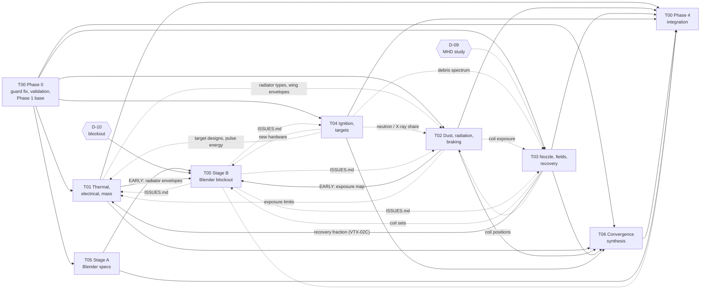

# Vertex threads: dependencies, ownership and exchanges

## Graph

Solid arrows are **hard dependencies** (the receiving work cannot finish without it). Dotted arrows are **optional feedback** (improves
the result; the receiver proceeds on Atlas values if it is late). Hexagons are owner gates.

## Critical path

T00 Phase 0 → **T02** two-orientation exposure map and **T01** radiator envelopes (both EARLY) → T05 Stage B blockout (needs D-10) →
T05 issue feedback → T01/T02 final → T06 final synthesis → T00 Phase 4.

The longest scientific dependency is T03 → T01 (recovery fraction for the ledger) and T04 → T06 (the gain pathway, which decides whether
the convergence story needs a declared breakthrough). T02 is the highest-risk item: D-06 may not close, and that result shapes every
other thread's geometry.

## Information exchanges

| From → to | What | When | Where |
| --- | --- | --- | --- |
| T00 → all | Phase 1 base commit, branch, validation | end of Phase 0 | `/mnt/project-files/vertex/BASE.md`, `planning/BASE.md` |
| T01 → T02, T05, T06 | warm/hot/low areas, wing tip radius per generation and driver-efficiency case, radiator types | early | `studies/thermal/EARLY.md` |
| T02 → T01, T05, T06 | exposure map (component, area, orientation, leg fluence), protection envelopes | early | `studies/dust/EARLY.md` |
| T03 → T01, T02, T05 | coil positions per configuration, recovery fraction range, coil heat loads | early | `studies/nozzle/EARLY.md` |
| T04 → T01, T02, T03, T05 | target designs, pulse energy, yield, spectra, escape shares, cadence | early | `studies/ignition/EARLY.md` |
| T05 → T01-T04 | interference, scale, structure, maintenance, radiator, shadow, clearance issues | as found | `work/vertex-blender/ISSUES.md` |
| each → T06, T00 | final results | end | `studies/<thread>/HANDOFF.md`, `registry_proposal.toml` |
| any → any | questions | as needed | own `/mnt/project-files/vertex/threads/<Txx>.md`, addressed by thread |

Readers fetch from the writer's branch (`git fetch origin <branch>`; `git show origin/<branch>:<path>`). Branch names are in each
`threads/<Txx>.md`.

## Ownership

| Path | Writer | Others |
| --- | --- | --- |
| `lab/variants/vertex-drive/registry/*.toml`, `atlas.py`, `convergence.py`, `tests/`, generated `ATLAS.md`, `READINESS.md`, `figures/`, `results/`, Atlas `NOTES.md`, `README.md`, `REPORT.md` | T00 | read; propose via `registry_proposal.toml` |
| `lab/variants/vertex-drive/planning/` | T00 (this planning thread before it) | read |
| `lab/README.md` `vertex-drive` row | T00 | read |
| `lab/variants/fdp1/tests/test_fdp1.py` guard (Phase 0 fix only) | T00 | read |
| `lab/variants/vertex-drive/studies/thermal/` | T01 | read |
| `lab/variants/vertex-drive/studies/dust/` | T02 | read |
| `lab/variants/vertex-drive/studies/nozzle/` | T03 | read |
| `lab/variants/vertex-drive/studies/ignition/` | T04 | read |
| `work/vertex-blender/` (+ `/mnt/project-files/review/vertex_blender_*/`) | T05 | read |
| `lab/variants/vertex-drive/studies/futures/` | T06 | read |
| `/mnt/project-files/vertex/BASE.md` | T00 | read |
| `/mnt/project-files/vertex/threads/<Txx>.md` | that thread | read |
| FDP-1, four-burn, fiji-drive, fdp1-requirements code; `data/`, `src/`, `tests/`, `tools/`, `godot/`, `web/`, `assets/`, `references/`, `docs/`, Drive | nobody in this plan | read only; changes need an owner-approved proposal |

No two threads write the same path. The only shared-file writes go through T00 at integration.

### Integration and conflict resolution

1. A thread pushes only its owned paths. T00 brings in each thread's folder by merge or path-limited cherry-pick and rejects anything
   outside it.
2. Registry contributions arrive as `registry_proposal.toml` with provisional IDs; T00 assigns final IDs in one pass, so no two threads
   collide on `VTX-03D` or `D-13`.
3. Two threads disagreeing on one quantity (same quantity, different value or basis) → both kept in `planning/RECONCILIATION.md` with
   evidence and the deciding test; neither is folded into a generation until resolved. Never choose the more optimistic by default.
4. A shared calculator change (FDP-1, four-burn, `convergence.py`) needs a written integration proposal; T00 makes it once, re-runs all
   lab tests, and every thread's adapter is re-run against it.
5. Branches are never squashed onto `main` by any thread; only ApeDevil's "squash" for a named branch authorises it.

## Coverage

Every Atlas record (34) has exactly one owner thread; T06 reads all, T05 draws all with geometry.

| Record | Owner | Consumers | Record | Owner | Consumers |
| --- | --- | --- | --- | --- | --- |
| VTX-01 | T04 | T06 | VTX-04 | T04 | T06 |
| VTX-01A | T04 | T05 | VTX-04A | T04 | T06 |
| VTX-01B | T01 | T04, T05 | VTX-04B | T04 | T01 (D-04) |
| VTX-01C | T01 | T04, T05 | VTX-04C | T04 | T02 |
| VTX-01D | T04 | T01, T02 | VTX-04D | T04 | T02 |
| VTX-02 | T03 | T05 | VTX-05 | T03 | T04 |
| VTX-02A | T03 (read-only canon card) | all | VTX-05A | T03 | T04 |
| VTX-02B | T03 | T01 | VTX-05B | T04 | T02 |
| VTX-02C | T03 (physics) | T01 (ledger) | VTX-06 | T02 | T05 |
| VTX-03 | T03 | T05 | VTX-06A | T02 | T01 (galleries) |
| VTX-03A | T03 | T05 | VTX-06B | T02 | T05 |
| VTX-03B | T03 | T02 | VTX-07 | T01 | T05 |
| VTX-03C | T03 | T06 | VTX-07A | T01 | T05 |
| VTX-08 | T02 | T05 | VTX-07B | T01 | T02 |
| VTX-08A | T02 | T05 | VTX-07C | T01 | T04 |
| VTX-08B | T02 | T05 | VTX-07D | T01 | T02, T05 |
| VTX-08C | T02 | T03 (gas, ions) | VTX-08D | T02 | T05 |

Atlas roadmap items (REPORT.md "Roadmap"): 1 energy per target and driver loss book-keeping → T01; 2 V1 at published driver efficiency →
T01; 3 dust exposure map and vaporisation bumper → T02; 4 pulsed nozzle MHD study → T03 (plan; execution D-09); 5 magnetised D-³He gain
and D-T spark with tamper capture → T04; 6 blockout → T05 (D-10). Technical conclusions D-01 and D-03 → T03, D-02 → T04, D-12 → T02
may be challenged only by proposal.

## Quality checks

Run against branch `claude/project-thread-9uz2qd` on 2026-11-09 (Atlas d9602da unchanged).

| Check | Result |
| --- | --- |
| 1. Every Atlas workstream assigned | PASS: all 34 records (8 workstreams, 26 technologies) in the coverage table, checked by script against `registry/technologies.toml` |
| 2. No critical task unowned | PASS: roadmap items 1-6 and the seven brief scopes mapped; records outside the brief's lists (VTX-02A, 03, 04, 05A, 05B, 07, 08) assigned |
| 3. No conflicting file ownership | PASS: disjoint write paths per thread (table above); shared registry and calculators written only by T00 |
| 4. Every experimental implementation gated | PASS: Blender blockout behind D-10; self-consistent MHD/PIC behind D-09; Drive behind D-11; canon drive change D-08 not authorised; squash behind owner "squash" |
| 5. Handoff sufficient for an independent session | PASS: HANDOFF.md requires commits, paths, rerun commands, quantities with units and sources, and integration steps |
| 6. No canon merge or production geometry change | PASS: no prompt writes `data/`, `src/`, generators, `assets/` or Drive; T05 hides canon objects, never deletes |
| 7. Questions actionable with deliverables | PASS: each prompt lists numbered questions, files to produce and a success criterion |
| 8. No assumed results | PASS: every Atlas number is quoted as MODEL/TARGET/PUBLISHED with its source; TARGETs (700-800 K, 0.05 %, gain 3,000, eta 0.79) are framed as requirements to test |
| Planning commit changes only `planning/` | PASS: `git diff --name-only d9602da` lists only `lab/variants/vertex-drive/planning/*` |
| Atlas validation after this commit | PASS: `atlas.py validate` 0 errors; Atlas tests 16/16; FDP-1 guard failure unchanged (T00 Phase 0) |
